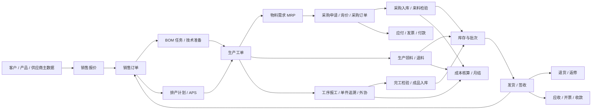
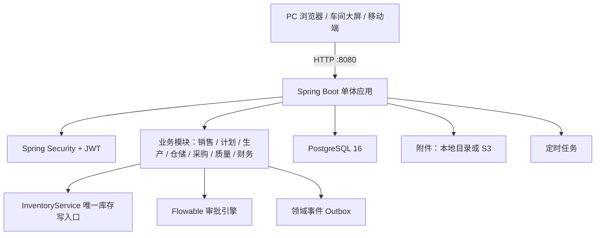

# 智造工单 · 轻量 MES

面向中小制造企业的车间执行系统，把销售、生产、仓库、发货、质检、退货串成一条可追溯的交付链路。

## 整体逻辑

### 一句话
销售订单是源头，生产工单是执行主线，库存是唯一事实账本；采购、质检、仓储、发货、财务都围绕这条主线留下可追溯的单据链。

### 运行形态
- **单进程 + 单数据库**：Spring Boot 一个 jar、PostgreSQL 一个库；前端构建后打进 jar 的 `static`，对外只暴露 8080 一个端口。
- **启动即初始化**：Flyway 自动建表与迁移，启动类补齐演示账号与组织归属；新建库首次登录强制改密（`MES_FORCE_PASSWORD_CHANGE`，生产保持 `true`）。
- **无状态服务**：业务数据在 PostgreSQL，附件落本地目录或 S3，日志落 `logs/`；应用可多实例部署，定时任务用数据库行锁保证同一时刻只有一个节点执行。
- **三种部署形态**：Docker Compose 一条命令、Windows 本机一键脚本、已有 PostgreSQL + 手工 jar，见下文「一键部署」。

### 业务主线



### 四条设计主线

1. **订单驱动，快照隔离**：销售订单审核后转生产，工单的工序来自产品工艺路线、用料来自 BOM 快照；主数据后续修改不会倒改在制工单，保证已下达的单据可复现。
2. **执行闭环，状态机推进**：排产 → 下达 → 领料 → 报工 → 完工检 → 入库 → 发货，每一步都生成单据或流水并推进单据状态；前道未完成不允许后道报工，不良会自动扣减后道计划量。
3. **库存唯一入口**：所有入库、出库、领料、退料、调拨、盘点、发货、退货都经 `InventoryService` 写 `stock_txn`，并带 `ref_type + ref_no` 反查来源；扣减时行锁防并发超发。
4. **财务与追溯一条链**：采购入库自动暂估 → 发票三单匹配 → 付款；发货形成应收；成本按「料 + 工 + 费」归集；批次号与件码贯穿来料、领用、报工、入库、发货。

### 技术架构



### 模块地图

| 领域 | 后端包 | 负责 |
| --- | --- | --- |
| 销售 | `sales` | 报价、销售订单、转生产、履约进度 |
| 计划与执行 | `planning`、`production`、`workshop`、`andon` | BOM 任务、排产、工单、报工、单件、看板、安灯 |
| 供应链 | `purchase`、`warehouse`、`inventory` | 申请/询价/采购、入库/出库/调拨/盘点/库位、库存账 |
| 质量与追溯 | `quality`、`returns`、`trace` | 来料/过程/完工检、不良处置、退货返修、SPC、批次追溯 |
| 交付 | `shipping`、`notice`、`task` | 发货签收、站内通知、全流程任务 |
| 财务与成本 | `finance`、`cost`、`report` | 应付/应收/发票、料工费、成本报表、月结 |
| 平台 | `auth`、`security`、`org`、`system`、`approval`、`integration`、`offline`、`job`、`file` | 登录权限、组织、配置、审批流、开放接口、离线队列、定时任务、附件 |

## 技术栈

| 层 | 选型 |
| --- | --- |
| 后端 | JDK 25、Spring Boot 3.5.16、Spring Security + JWT、Spring JDBC、Flyway |
| 数据库 | PostgreSQL 16 |
| 前端 | Vue 3.5、Vite 6、TypeScript、Element Plus、ECharts、Pinia、Axios |
| 构建 | Maven 3.9+、npm 10+ |

## 功能

| 模块 | 能力 |
| --- | --- |
| 工作台 | 销售额、在制工单、待发货、库存预警、一次合格率（报工口径）、待处置不良、7 日趋势、工单分布 |
| 销售订单 | 主子表建单（客户、客户 PO 号、下单 / 交付日期、优先级、跟单人、联系人、交货地址、备注）、审核、取消、明细级撤行与部分数量取消、转生产、履约进度 |
| 采购申请 | 需求先立单：来源分工单缺料、库存补货、非生产、紧急采购；按金额分级审批（阈值可在系统配置改），批准后可按行分次转采购单，剩余数量保留，采购单取消或删除时已转数量自动退回 |
| 审批流 | 执行引擎换成 **Flowable 8（BPMN 2.0）**，画布上配的节点树会编译成 BPMN 部署上去：支持并行网关、排他网关（条件分支 是/否）、多实例会签、流程版本并存；节点有四类（审批 / 抄送 / 自动通过 / 容器），审批人可配角色、指定成员、发起人、各级主管；待办支持通过、驳回、转交、催办、撤回、加签、回退到指定节点，超时提醒或自动通过；灰度发布支持按工厂 / 按人定向 + 按比例分流，并给出各版本单据量对比 |
| 物料需求 | 按未完工工单 BOM 待领量汇总毛需求，扣库存可用、采购在途、已申请未转与安全库存，算出缺口、最早需求日与建议下单日（按交期倒推）；勾选后一键生成采购申请草稿，单价与建议供应商取自价格库 |
| 询价比价 | 申请中勾了「需询价」的行生成询价单，多家供应商录入报价（单价、交期、账期、有效期），按物料对比最低价并识别总价最低；选定后写供应商价格库，同时回填申请行目标价与建议供应商 |
| 供应商档案 | 物料 / 外协 / 服务三类，带联系人、税号、账期、默认交期与 A/B/C 评级；已产生采购单的供应商只能停用不能删除 |
| 采购订单 | 草稿建单（供应商、收货仓库、预计到货、是否来料检验）→ 确认 → 收货生成入库单 → 入库完成回写实收；在途数量从待收里扣掉，状态自动走 草稿 / 待到货 / 部分到货 / 已到货 / 已取消，建单时还能带出同供应商同物料最近采购价 |
| 发票与应付 | 采购入库完成自动暂估；发票登记含税率与价税拆分，按供应商账期算到期日；三单匹配（订单价、入库量、发票量）冲暂估，数量超收或单价偏差需强制匹配并记录差异；付款登记、应付余额与账龄，只做业务台账不做总账凭证 |
| 红字发票与退货对账 | 红字发票挂在蓝字发票上、金额为负，红冲即回退暂估匹配并减少蓝票应付；蓝票已付款超出部分转「待供应商退款」并可登记退款；退货对账按入库单看暂估 / 开票 / 红冲 / 退货 / 待退款 |
| 采购退货 | 从已完成的采购入库单按行退货（可退数量自动扣减已退），提交即扣库存、回退采购实收、冲减暂估；已开票部分自动开红字发票红冲，已付款超出部分转待供应商退款 |
| 生产工单 | 手工建单可带优先级 / 追溯方式 / 备注，选完产品当场预览会生成的工序路线与用料清单（缺路线、缺 BOM 时明确提示，不让人建完才发现），并能按工序直接派工、设定「只有他能报」；按产品工艺路线生成工序、工单 BOM 快照（含损耗）、非标 BOM 调整与变更记录、工序派工（选系统用户，可限报工权限；一道工序可分给多人并各带分配量）、领料单化领料（批量 / 扫码，仓库与领料人可追溯）与退料（按原批次回库、超领量一键填充）、工序报工（含不良数与工序内检验结论）、工序防差错、不良自动扣减后道计划、自动完工、完工检、返修（可指定起点工序）、工单与工序二维码、随单下发 SOP / SIP 指导书 |
| 单件追溯 | 产品给「默认追溯方式」（按数量 / 单件 / 预留批次），工单建单时快照、下达前可单独改；单件追溯的工单下达时按计划数量生成件码（工单号-三位流水）；扫件码开工 / 完工 / 判不合格 / 报废，件到哪道工序、谁做的、什么时候做都留痕；件完工自动累加工序完成数与报工流水；独立「单件追踪」页可按件码 / 工单 / 状态 / 工序找件，件码可打标签 |
| 标签打印 | 独立打印页，按标签纸出图：热敏 40×30 / 50×30 / 60×40 一张一页，A4 24 / 12 / 2 列拼版；可勾选工单码 / 工序码 / 件码，支持份数与「跳过前 N 格」利用半张纸；`@page` 尺寸按纸型注入，打印出来就是标签本身 |
| 替代料 | 主料不足时自动用替代料补足，领料单明细单列替代行并标注被替代的主料，工单 BOM 另记替代补量，替代行需求随主料、不允许单独调整 |
| 排产计划 | 一键智能排产（优先级 + 交期 + 每日工时）、手工排产、当日队列、加急插队、上移下移、撤销、排产后才可下达 |
| 车间看板 | 在制工单、已排产、今日交期、在制数量、今日产出、缺料预警（物料盖不住的待产 / 在制工单数）、工序分布、工单当前工序位置；在制卡片直接标出缺料项数与齐套率；右上角「投屏大屏」一键开会车间电视用的全屏页 |
| 车间大屏 | 独立免登录页面 `/#/screen`：生产 / 质量 / 异常 / 设备 OEE 四屏每 15 秒轮播（`?rotate=30` 改秒数、`?only=oee` 锁单屏），每 10 秒刷新；深色全屏、时钟、←/→ 手动切屏、F 全屏。生产屏给今日产出 / 计划达成 / 在制 / 交期 / 缺料 + 工作中心负荷 + 工单进度（按已完成工序数算）；质量屏给一次合格率、今日不良 TOP5、最近检验；异常屏给待接单 / 处理中 / 平均响应 + 未关闭清单；设备屏给今日 OEE 与可用率 / 性能 / 合格率 + 分中心明细 |
| 绩效核算 | 按月生成绩效单：计件工资（合格数 × 工序单价）+ 标准工时 + 良率；实际工时来自「工时填报」（按天记，可多条，支持按班组批量填），没填才用手工值并标出来源，效率 = 标准 ÷ 实际；绩效系数 = 效率系数 × 良率系数，绩效工资 = 计件工资 × 系数；草稿 → 提交 → 通过 / 驳回（驳回可改再提交）；配了 `PERFORMANCE` 审批流就进审批中心；已提交 / 已通过可由管理员「撤回重算」，撤回会连审批实例一起作废 |
| 工序外协 | 工单中途把某道工序发外协厂做：转外协（外协厂 / 单价 / 约定回厂日）→ 该工序的料自动退出本厂领料清单 → 外协发出（按批次扣库存给外协厂，回写工单 BOM 已领量）→ 收回登记（数量 / 不良 / 检验结论，推进工序与件码）。外协期间这道工序不能报工；外协费按「收回合格数 × 单价」单列进工单成本。台账页 `/production/outsource` 支持只看超期，大屏显示外协中与超期道数 |
| 齐套与缺料联动 | 工单列表带齐套率与缺料行数，可只看缺料；下达时库存盖不住待领量自动报物料安灯并通知仓库与计划；到货入库后自动判断哪些工单已齐套，推送「可以领料」并自动关掉之前自动报的缺料安灯 |
| 消息中心 | 待办 / 预警 / 通知三类站内消息，每条带单据号，点一下直接跳到对应单据并定位到那一条（工单直接开详情、不良/退货/申请/入库/安灯按单号筛出来）；支持只看未读、分类筛、全部已读；网页可开浏览器桌面通知（在线时弹系统通知、点通知直接去处理） |
| 通知管理 | 管理员视角的全量消息台账：按收件人 / 分类 / 已读状态 / 时间 / 关键字查，看谁收到了什么、有没有点开；可删单条、批量删、清理指定天数前的已读，未读永不被清掉 |
| 库存 | 实时结存、可用量、安全库存预警、手工出入库、库存流水；每条流水带单位成本与金额，结存列直接给出均价与库存金额 |
| 入库 | 采购入库只能由采购单收货生成，手工建单只处理无单据的例外情况（专门权限 + 必填原因，打「无单入库」标签、不参与三单匹配）；提交后待检或直接入库，来料检验合格自动入库 |
| 出库 | 出库申请、多明细、库存校验、完成出库 |
| 调拨 | 仓库间调拨，源仓出、目标仓入，同一事务完成；源仓与目标仓分属不同工厂时自动进两级审批（源厂计划 → 目标厂仓库），通过后才允许执行 |
| 盘点 | 按仓库快照账面数、录入实盘数、差异调整并写流水 |
| 发货 | 按未发数量建单、发货扣成品库存、签收回写订单 |
| 质量 | 来料 / 过程 / 完工检验、合格率与一次合格率（报工口径）分开统计、完工检与来料检合格自动入库 |
| 检验项与抽样 | SIP 落成可执行清单：按产品与工序维护检验项（标准、检具、上下限、必检），检验单逐项录入并自动判定；支持全检与按批量分档抽检（AQL + 接收 / 拒收数），不良项 Top 反推问题工序 |
| 不良处置 | 报工不良 / 完工检不合格 / 来料不合格 / 退货统一进不良台账，按返修、让步接收、报废、退供应商四种方式处置并回链返修工单 |
| 退货 | 按已发数量退货、返修（自动开返修工单）/ 报废（进不良台账）/ 重新入库（回补成品库存） |
| 系统管理 | 用户、角色、菜单权限、数据范围、手机号绑定、密码重置、自定义编码规则、个人中心（资料自助修改与改密） |
| 人员技能 | 用户与工序的技能关系与熟练度；工序配了技能后派工只列持证人员，并拦截非持证派工 |
| 组织架构 | 工厂 → 车间 → 班组三级组织树 + 职能部门，层级校验、物化路径、移动重算、删除护栏、成员与工号；工作中心挂在组织下并承接日产能，分设备线 / 手工工位 / 外协，外协不占厂内产能 |
| 设备台账 | 设备挂在工作中心下，带单台日产能与运行 / 待机 / 维修 / 停机状态，可用设备产能折算中心排产容量 |
| 站内通知 | 报工不良、完工检不合格、来料不合格、退货处理、返修建单等节点按角色推送，顶栏铃铛看未读并一键已读 |
| 页面水印 | PC 与移动端所有页面都铺当前登录人的姓名、账号与日期水印，防截屏外传；开关在系统配置里，关掉即时全站失效 |
| 系统配置 | 全局开关按分组维护（键名、标题、类型、备注、修改人留痕），改动即时生效，不用重启 |
| 附件与文件台账 | 统一上传入口 `/api/files`，数据库只记台账与存储 key，文件本体按系统配置写本地目录或 S3；附件挂到不良单 / 检验单，支持下载、软删除与全量台账查询 |
| 操作日志 | 所有写接口自动留痕（模块、动作、摘要、单号、操作人、角色、IP、UA、耗时、成功失败），业务侧可补充可读摘要；支持按模块 / 操作人 / 结果 / 日期筛选与详情 |
| 表格视图 | 每个账号可保存多套视图：列顺序（拖拽）/ 列显示 / 左右冻结 / 列宽 + 默认查询条件，设默认后打开页面自动应用；数据存后端，换浏览器、换电脑都保留 |
| 移动端 | uni-app（H5 / 微信小程序），登录、工单报工、领料、扫码报工、扫码检验、检验单详情与检验项、不良处置（返修 / 让步 / 报废 / 退供应商）、通知中心与未读标记、出入库；断网时现场动作进本机离线队列，联网按顺序重传且不会重复计数 |
| 基础数据 | 客户、产品、物料清单、仓库 |
| 基础数据导入导出 | 六类数据（产品 / 客户 / 供应商 / BOM / 工艺路线 / 期初库存）统一走 CSV：下模板、导出当前数据、导入前先预览校验，坏行回报行号与原因、好行照常入库，编码存在则更新 |
| 成本核算 | 入库按实际单价刷移动平均成本、出库按均价计价，流水带单位成本与金额；工单完工自动结算料（领料金额）/ 工（报工量 × 工序单价）/ 费（人工 × 配置比例），成本报表给单位成本、售价与毛利率，产品成本看均价与档案成本差异 |
| 定时任务 | 服务内十个定时作业：订单交期预警、缺料工单巡检、未结算成本补算、设备点检保养提醒、过期通知清理、离线重传记录清理、审批超时提醒、领域事件清理、任务逾期提醒、物料缺口逾期预警；每次执行留痕（触发方式、结果、处理条数、耗时），页面上可手工跑一次，任务锁走数据库行锁，多节点部署也只有一个节点真正执行 |
| 领域事件 | 跨模块副作用走事件总线：发布方只声明「发生了什么」，订阅方各自处理（入库完成 → 采购回写实收）。事件落 `sys_domain_event` 做 Outbox 留痕，同进程同步投递保证与原调用一致的事务语义，将来换 MQ 只改投递实现 |
| 登录安全 | 连续失败达阈值锁定账号（管理员可解锁、重置密码自动解锁）、密码长度与三类字符复杂度、刷新令牌 SHA-256 摘要轮换与撤销；PC 端 401 自动刷新并重放原请求，用户不会做到一半被踢 |
| 供应商绩效 | 按供应商算准时率、来料合格率、退货率与综合得分（40/40/20 加权），给 A/B/C 等级；带价格趋势、物料分布、收货与检验明细，无往来数据的供应商不打分 |
| 设备点检保养 | 设备点检项模板、按设备按天幂等生成点检任务、提交即判定 NG 并推提醒；保养计划按周期滚动、到期与逾期列表、保养记录；设备故障报修置停机、关闭按停机分钟回算并恢复待机 |
| 库位管理 | 仓库下建库位（编码、名称、类型），入库明细可指定上架库位，批次带库位分布；整批移库与部分移库（自动拆批次），移库留记录；有库存的库位不能删 |
| 多层 MRP | 半成品逐层展开到原料（默认 3 层、最多 6 层），自制件给建议开工量、外购件扣在途与已申请；页面可一键把自制需求生成工单 |
| SPC 与 CPK | 按检验项取实测值画 X̄ 控制图（±3σ）并算 Cpk，按不良率画 P 图（中心线 p̄ 与 p̄±3√(p̄(1−p̄)/n)），另有工序能力排行 |
| OEE | 按设备与日期算可用率（计划时间扣停机）、性能（标准工时 ÷ 开动时间）、合格率（合格 ÷ 报工），三项相乘给 OEE，带趋势与损失拆解 |
| 月结报表 | 库存月结（期初 + 入 − 出 = 期末，按期初流水回算）与往来月结（采购 / 暂估 / 发票 / 付款 / 退货 / 销售 / 发货），支持 CSV 导出 |
| APS 甘特 | 工作中心 × 日的排产甘特（负荷率、工序条、超载高亮）；一键排产过的单用「整单排产」灰条兜底，不会因为没细分到工序而消失；插单模拟逐道工序消耗剩余产能，给出预计完成日、交期延误天数与受影响工单 |
| 对外接口 | 面向 ERP / 财务的开放接口（工单、库存、物料、工单成本），用 `X-API-Token` 鉴权：令牌只存 SHA-256、范围白名单、可停用与设有效期、120 次/分钟限流，全局开关可一键关闭 |
| 多工厂隔离 | 组织树向上找 `PLANT` 作为工厂，工单与销售订单记 `factory_org_id`；开关打开后各厂只看自己单据，历史无归属数据不隐藏（单工厂使用零影响） |
| 文档与指导书 | 产品级与工序级 SOP 作业指导书、SIP 检验指导书、图纸、包装规范，带版本与启用状态，随工单下发到扫码页 |
| 工序管理 | 工序主数据（编码、类型、默认工时、默认工价、检验方式三态、工作中心、停用）、被引用检查 |
| 工艺路线 | 按产品配置工序顺序、工时、工价，工单工序由路线生成；BOM 行可指定投料工序、替代组、关键件与替代料 |

## 目录结构

```
mes/
├─ mes-backend/                  Spring Boot 服务
│  ├─ src/main/java/com/mes/
│  │  ├─ auth/                   登录与 JWT
│  │  ├─ masterdata/             客户、产品、BOM、工艺路线、仓库
│  │  ├─ process/                工序主数据
│  │  ├─ org/                    组织架构与工作中心
│  │  ├─ sales/                  销售订单
│  │  ├─ production/             生产工单与报工
│  │  ├─ planning/               排产与智能排产
│  │  ├─ workshop/               车间看板
│  │  ├─ andon/                  异常安灯
│  │  ├─ report/                 生产、工资、交期报表
│  │  ├─ inventory/              库存与流水（统一记账入口）
│  │  ├─ shipping/               发货与签收
│  │  ├─ quality/                检验、不良台账与处置、SPC
│  │  ├─ notice/                 站内通知
│  │  ├─ task/                   全流程任务指派（算料 / 派工 / 领料 / 待发货）
│  │  ├─ returns/                退货与返修
│  │  ├─ warehouse/              入库、出库、调拨、盘点、库位
│  │  ├─ purchase/               采购、供应商、绩效、多层 MRP
│  │  ├─ device/                 设备台账、点检保养、OEE
│  │  ├─ cost/                   料工费核算与成本报表
│  │  ├─ job/                    后台定时任务
│  │  ├─ integration/            对外接口与令牌
│  │  ├─ offline/                离线重传幂等
│  │  ├─ dashboard/              工作台聚合
│  │  └─ security/               鉴权、角色、初始化账号
│  └─ src/main/resources/
│     ├─ db/migration/           Flyway 建表与演示数据
│     └─ static/                 前端打包产物
├─ mes-frontend/                 Vue 3 前端（构建后嵌入后端 static）
├─ mes-uniapp/                   uni-app 移动端（H5 / 微信小程序）
├─ scripts/
│  ├─ build.ps1                  前端构建 + 同步 static + 打包 jar
│  ├─ deploy.ps1                 Windows 本机一键部署（构建 → 停旧 → 启动 → 健康检查）
│  ├─ backup.ps1                 数据库 + 附件备份
│  ├─ init-db.sql                手工建库脚本
│  └─ e2e-*.py                   全流程回归脚本
├─ docs/                         上线检查单、全流程测试指南
├─ Dockerfile                    多阶段构建（前端 → 后端 jar → 运行时）
├─ docker-compose.yml            PostgreSQL + 后端一键编排
├─ .env.example                  环境变量模板（复制为 .env 后填写）
└─ .dockerignore                 构建上下文排除规则
```

## 一键部署

按环境选一种。第一次部署建议先看上面的「整体逻辑 → 运行形态」。

- 端口：应用固定监听 `8080`；前面可以再挂 Nginx / 网关做 HTTPS 与域名。
- 依赖：Docker 方式只需要 Docker；本机脚本方式需要 JDK 25、Maven 3.9+、Node 20+、PostgreSQL 16。
- 数据：PostgreSQL 存业务数据；附件默认落本地目录，日志落 `logs/`，升级前先做备份。

| 方式 | 适用场景 | 入口 |
| --- | --- | --- |
| Docker Compose | 有 Docker 的 Linux / Windows，最省事 | `docker compose up -d --build` |
| Windows 本机脚本 | 已装 JDK 25、Maven、Node、PostgreSQL | `scripts\deploy.ps1` |
| 手工 jar | 已有 PostgreSQL，接入现有运维 / 堡垒机 | `java -jar mes-backend-1.0.0.jar` |

### 方式一：Docker Compose 一键部署（推荐）

`docker-compose.yml` 已包含 PostgreSQL + 后端服务（前端已打进 jar），一条命令起全套。

```bash
# 1. 准备环境变量
cp .env.example .env
# 编辑 .env，填入三个必填项：
#   POSTGRES_PASSWORD  数据库密码
#   JWT_SECRET         至少 32 字符，建议 openssl rand -base64 48
#   MES_INIT_PASSWORD  admin 初始密码

# 2. 构建并启动（首次会拉镜像、构建前端+后端，约 5-10 分钟）
docker compose up -d --build

# 3. 查看启动日志，等 mes-app 健康
docker compose logs -f mes

# 4. 确认健康（看到 {"status":"UP"} 即可）
curl -fsS http://localhost:8080/actuator/health
```

启动后访问 `http://localhost:8080`，用 `admin` / `.env` 里的 `MES_INIT_PASSWORD` 登录。

升级版本只需重新构建并滚动重启；数据在命名卷里，不会随容器重建丢失：

```bash
docker compose up -d --build
docker compose down            # 停服务（保留数据卷）
docker compose down -v         # 连数据卷一起删，慎用
```

| 卷 | 内容 |
| --- | --- |
| `mes_pgdata` | PostgreSQL 数据 |
| `mes_logs` | 应用日志（`/app/logs`） |
| `mes_data` | 附件（`/app/data/attachments`） |

| 变量 | 默认值 | 必填 | 说明 |
| --- | --- | --- | --- |
| `POSTGRES_PASSWORD` | — | 是 | 数据库密码 |
| `JWT_SECRET` | — | 是 | JWT 签名密钥，≥32 字符 |
| `MES_INIT_PASSWORD` | — | 是 | admin 初始密码 |
| `POSTGRES_DB` | `mes` | 否 | 数据库名 |
| `POSTGRES_USER` | `mes` | 否 | 数据库账号 |
| `MES_CORS_ORIGINS` | `*` | 否 | 跨域允许源，生产填实际域名 |
| `MES_FORCE_PASSWORD_CHANGE` | `true` | 否 | 首次登录是否强制改密 |

### 方式二：Windows 本机一键部署

前置：JDK 25、Maven 3.9+、Node 20+、PostgreSQL 16 已启动，并且数据库 `mes` 已创建（`psql -U postgres -f scripts/init-db.sql`）。

```powershell
# 数据库连接按实际环境覆盖；不设则用 application.yml 的 localhost:5432/mes、mes/mes123
$env:DB_URL='jdbc:postgresql://localhost:5432/mes?currentSchema=public'
$env:DB_USER='mes'
$env:DB_PASSWORD='mes123'

# 一条命令：构建 → 停旧进程 → 启动 → 等健康检查
powershell -ExecutionPolicy Bypass -File scripts\deploy.ps1
```

脚本做五件事：

1. 调用 `scripts/build.ps1`：前端 `npm run build` → 同步到后端 `static` → `mvn package`；
2. 找到并停掉 8080 上的旧进程；
3. 后台启动 `mes-backend\target\mes-backend-1.0.0.jar`，输出写 `logs\app.out.log`；
4. 轮询 `/actuator/health`，直到返回 `UP`；
5. 打印访问地址、PID、日志位置，PID 同时写入 `logs\mes.pid`。

常用参数：

```powershell
# 只重启，不重新构建
powershell -ExecutionPolicy Bypass -File scripts\deploy.ps1 -SkipBuild

# 构建时跑后端单元测试
powershell -ExecutionPolicy Bypass -File scripts\deploy.ps1 -WithTests
```

停止服务：

```powershell
$appPid = Get-Content logs\mes.pid
Stop-Process -Id $appPid -Force
```

本地演示如果不想被首次强制改密拦住，启动前加 `$env:MES_FORCE_PASSWORD_CHANGE='false'`；生产环境保持默认 `true`。

> 生产环境再加 `$env:SPRING_PROFILES_ACTIVE='prod'`、`$env:JWT_SECRET`、`$env:MES_INIT_PASSWORD`、`$env:MES_CORS_ORIGINS`。`prod` 配置对必填项没有默认值，缺一个服务会直接启动失败。

### 方式三：已有 PostgreSQL，手动启动（Linux / 自定义环境）

```bash
psql -U postgres -f scripts/init-db.sql
```

默认连接 `localhost:5432/mes`，账号 `mes`，密码 `mes123`。不一致时用环境变量覆盖：

| 变量 | 默认值 | 说明 |
| --- | --- | --- |
| `DB_URL` | `jdbc:postgresql://localhost:5432/mes?currentSchema=public` | JDBC 地址 |
| `DB_USER` | `mes` | 数据库账号 |
| `DB_PASSWORD` | `mes123` | 数据库密码 |
| `JWT_SECRET` | 内置演示密钥 | 生产环境务必替换 |

从源码构建时，**前端产物必须先同步到后端 `static` 再打包 jar**，否则访问到的还是旧页面：

```bash
cd mes-frontend
npm ci
npm run build
rm -rf ../mes-backend/src/main/resources/static/*
cp -r dist/* ../mes-backend/src/main/resources/static/

cd ../mes-backend
mvn clean package -DskipTests
```

启动后端（首次自动 Flyway 建表 + 写入演示数据）：

```bash
java -jar mes-backend/target/mes-backend-1.0.0.jar
```

Linux 常驻可配合 `nohup` 或 systemd：

```bash
nohup java -jar mes-backend/target/mes-backend-1.0.0.jar > logs/app.out.log 2>&1 &
```

也可以直接 `mvn spring-boot:run`。启动后访问 <http://localhost:8080>。

### 前端开发模式（可选）

```bash
cd mes-frontend
npm install
npm run dev
```

访问 <http://localhost:5173>，`/api` 会代理到 8080。

生产部署时前端已打包进后端 `static` 目录，无需单独启动前端。修改前端后重新构建：

```bash
cd mes-frontend
npm run build
# 将 dist 内容复制到 mes-backend/src/main/resources/static 后重新打包后端
```

这一步容易漏：只跑 `npm run build` 不会更新后端里的页面，因为 `static` 是构建产物目录，不会被自动覆盖。仓库提供两个脚本：

```powershell
# 推荐：构建 + 停旧进程 + 启动 + 健康检查
powershell -ExecutionPolicy Bypass -File scripts\deploy.ps1

# 只构建 jar，不启动
powershell -ExecutionPolicy Bypass -File scripts\build.ps1
powershell -ExecutionPolicy Bypass -File scripts\build.ps1 -WithTests  # 同时跑单元测试
```

`build.ps1` 负责「前端构建 → 同步 static → 打包 jar」；`deploy.ps1` 在它之上再做停旧、启动和健康检查，是日常发版的入口。

### 移动端（uni-app）

```bash
cd mes-uniapp
npm install
npm run dev:h5          # H5 开发预览
npm run build:h5        # H5 构建
npm run dev:mp-weixin   # 微信小程序，用开发者工具打开 dist/dev/mp-weixin
```

接口地址在 `src/utils/config.js`，默认 `http://localhost:8080/api`，可用 `VITE_API_BASE_URL` 覆盖。用手机真机访问时要把地址改成电脑的局域网 IP，例如 `http://192.168.1.10:8080/api`。微信小程序需在 `src/manifest.json` 填入正式 appid，并把后端域名加入小程序的 request 合法域名。桌面浏览器不支持相机扫码，扫码页提供手动输入工单号、产品编码、发货单号作为兜底。

工单详情可以生成并打印二维码：工单码为 `MES|WO|工单号`，工序码为 `MES|OP|工单号|工序序号`。生产工单列表点「二维码」进入标签页，可一次打印工单码和全部工序码。

Web 端「车间扫码」页面（`/shopfloor/scan`）用浏览器摄像头 + jsQR 真实解码，也支持 USB / 蓝牙扫码枪和手动输入。默认开启「扫码枪模式」：焦点常驻扫码框，扫码枪敲完带回车即识别，识别后清空输入并回焦；焦点被点到别处时还有一层全局按键流兜底，开关状态记在浏览器里，下次进来仍是上次的选择。扫工单码拉到工单，扫工序码自动选中工序并打开报工，扫物料码 `MES|MAT|物料编码` 后选择工单即可按物料分批领料。移动端扫码后同样进入工单详情并自动打开报工弹层。

移动端一共 17 个页面，工作台与「我的」都有快捷入口直达：工单列表 / 详情 / 报工 / 领料、扫码作业、入库与出库申请、质量检验列表 / 新建 / **详情（含检验项逐项结果）**、**不良处置**（返修 / 让步接收 / 报废 / 退供应商，返修会回带返修工单号）、**通知中心**（预警 / 待办 / 通知三类，支持只看未读、一键全部已读，点开自动标记已读，单据类通知可跳到对应列表）、产品档案、发货单详情与**离线待同步**。

断网时的现场动作（报工、检验、不良处置、出入库申请）会进本机队列，联网后按顺序重传，服务端用 `X-Idempotency-Key` 保证同一动作只落一次账；详见下文「移动端离线队列」。

```bash
# 新增的移动端页面
pages/quality/detail   检验单详情，逐项看检验项、实测值与不合格项
pages/defect/list      不良处置，卡片列表 + 底部处置面板
pages/notice/list      通知中心，未读标记与分类筛选
pages/offline/list     离线待同步，看待传记录、同步失败明细与最近同步时间
```

移动端接口复用 PC 端同一套：`/api/defects`（列表 / 汇总 / 处置）、`/api/notices`（列表 / 汇总 / 已读 / 全部已读）、`/api/inspections/{id}`（含 `items` 检验项明细）、`/api/offline/status`（离线开关与队列上限）。

## 上线与运维

### 上线前检查清单

上线不是把 jar 拷过去就完事。下面这几项按顺序过一遍，漏哪条都会在头两天以「系统不好用」的形式返回来。

| # | 项目 | 怎么做 | 漏了会怎样 |
| --- | --- | --- | --- |
| 1 | 角色与账号 | 内置有 `ADMIN` / `SALES` / `PLANNER` / `WAREHOUSE` / `QC` / `OPERATOR` 六个角色。把真实账号挂到对应角色，并把业务账号挂到工厂 / 车间 / 班组（`sys_user.org_id`）。角色权限可在「系统管理 → 角色权限」里改，改完即时生效 | 工人看到成本与绩效工资；多工厂隔离开关打开后会看不到数据 |
| 2 | 强制改密 | `update sys_user set must_change_password = true where password_updated_at is null;` | 所有人都是公开的 `123456` |
| 3 | 清演示数据 | 先备份，再跑 `scripts/reset-demo-data.sql`（清业务流水与回归临时账号，保留主数据）。要用自己的主数据则再清产品 / BOM / 工艺路线 / 客户 / 供应商，然后按「系统管理 → 数据导入」顺序导入：产品 → BOM → 工序 → 工艺路线 → 仓库 → 供应商 → 客户 | 演示订单混进真实账；没有工艺路线的产品下达工单会直接报错 |
| 4 | 期初库存 | 用「手工入库（来源期初）」建期初：数量 + 单价一起填，单价会刷新产品移动平均成本 | 成本从第一天就不准，后面很难纠 |
| 5 | 追溯方式 | 「产品与 BOM → 编辑产品 → 追溯方式」按客户要求配默认值（`NONE` 按数量 / `SERIAL` 单件）。别一刀切全开单件 | 每件每道扫一次，一天几百次扫码，现场会抵制 |
| 6 | 备份 | `scripts\backup.ps1` 建好计划任务（建议每天凌晨），并**实际恢复一次**到测试库验证 | 升级出问题时没有退路 |
| 7 | 现场硬件 | 扫码枪（USB / 蓝牙，键盘楔入即可）、标签打印机（浏览器直接打印）、车间电视（浏览器 kiosk 模式指向 `/#/screen`）、工位网络（断网有移动端离线队列兜底） | 车间没法扫码 / 看不到大屏 |
| 8 | 参数核对 | 「系统管理 → 系统配置」：`manufacturing.overhead.rate`（制造费用摊派比例）、`offline.sync.queue.limit`、编码规则 `sys_code_rule` 的各项前缀 | 成本比例、单号规则与厂里习惯不符 |
| 9 | 试运行 | 挑一条线跑两周：报工 + 领料 + 检验 + 大屏；月结时把系统账与手工账对一遍 | 全厂一起上，出问题没人能定位 |

### 备份

```powershell
# 数据库 + 附件目录，默认放 E:\mes-backup，保留 14 天
powershell -ExecutionPolicy Bypass -File scripts\backup.ps1

# 换目录 / 保留 30 天 / 跳过附件
powershell -ExecutionPolicy Bypass -File scripts\backup.ps1 -BackupDir D:\mes-backup -KeepDays 30
```

脚本做四件事：`pg_dump -Fc` 导库 → `pg_restore --list` 校验备份可读（读不了就直接报错，不会留下一个坏备份）→ 打包 `data\attachments` → 清掉超过保留天数的旧文件。数据库连接参数可用 `-DbHost` / `-DbPort` / `-DbUser` / `-DbPassword` 覆盖，默认取环境变量 `DB_PASSWORD`。

建议挂到 Windows 计划任务（每天 02:00），并且**每月挑一份备份真的恢复到测试库**——只备份不验证，等于没备份。

### 升级与回滚

升级就五步，Flyway 会在启动时自动把库迁到最新版本：

1. 停服务
2. `scripts\backup.ps1` 备份（这一步不能省）
3. 替换 `mes-backend-1.0.0.jar`（前端已打进 jar 的 static 目录）
4. 起服务，看启动日志里 Flyway 的输出，确认版本号到最新且没有报错
5. 冒烟：登录 → 工单列表 → 车间扫码报一次工 → 大屏能开

回滚两步：换回旧 jar + 从 dump 恢复库。

Windows 本机日常发版可以直接用 `scripts\deploy.ps1`，它会自动完成「构建 → 停旧 → 启动 → 健康检查」，但**不包含备份**，升级前仍要先跑 `scripts\backup.ps1`。

**为什么必须备份再升级**：Flyway 迁移没有 undo，脚本执行过就回不去了，唯一可靠的退路就是升级前那份 dump。升级脚本里如果要删列或改类型，风险更高，这时更要在测试库先跑一遍。

### 日常巡检

三个数周周看，比看板上的漂亮数字有用：**报工及时率**（当天该报的工序有多少当天报了）、**领料准确率**（领料单与工单 BOM 的差异笔数）、**异常响应时长**（安灯从报出到接单的平均分钟数）。这三个不对，说明现场没真用起来，功能再多也没意义。

## 演示账号

初始密码均为 `123456`，均可用手机号登录。

> **首次登录会强制改密。** 初始口令是公开的演示口令，所以**新建的库**里每个账号第一次进系统时会被要求设置一个至少 8 位的新密码，
> 改完之前后端只放行登录与改密接口（其它接口返回 `4023`）。
>
> 回归脚本（`scripts/e2e-*.py`）全部用 `123456` 登录，所以在本地/测试环境起服务时把开关关掉即可，
> 生产环境保持默认 `true`：
>
> ```powershell
> $env:MES_FORCE_PASSWORD_CHANGE='false'
> ```
>
> 也可以按账号放行：`update sys_user set must_change_password = false where username = 'admin';`。
> 反过来把演示库当生产库用之前，记得执行一次
> `update sys_user set must_change_password = true where password_updated_at is null;`

> 这个开关是**总开关**：关掉后登录接口不再返回 `mustChangePassword`，前端也就不会弹改密框。
> 之前它只关掉了后端拦截，接口照样回 `true`，前端一登录就强制改密 —— 测试环境被逼着改口令，
> 改完回归脚本（用初始口令）就全跑不了。现在两边口径一致。

> **演示账号与组织归属的种子数据由 `DataInitializer` 建，不写进迁移。**
> 账号是迁移全部跑完之后才创建的，所以迁移脚本里 `update sys_user ... where username = 'admin'`
> 这类语句在全新库上一行都匹配不到（迁移本身仍然「成功」）。组织归属、岗位、工号、人员技能
> 现在统一由启动类补齐，并且只填空值——管理员在界面上改过的归属不会被重启覆盖。

| 账号 | 手机号 | 角色 | 所属组织 / 岗位 | 数据范围 |
| --- | --- | --- | --- | --- |
| `admin` | 13800000000 | 管理员 | 智造工厂 · 系统管理员 | 全部 |
| `sales` | 13800000001 | 销售 | 销售部 · 销售员 | 仅本人创建的销售订单 |
| `planner` | 13800000002 | 计划 | 计划部 · 计划员 | 全部 |
| `warehouse` | 13800000003 | 仓库 | 仓储部 · 仓管员 | 仅所属原料仓 |
| `qc` | 13800000004 | 质检 | 质量部 · 质检员 | 全部 |
| `worker1` | 13800000011 | 操作工 | 下料班组 · 操作工 | 全部 |
| `worker2` | 13800000012 | 操作工 | 装配班组 · 操作工 | 全部 |

`worker1 / worker2` 是一线操作工演示账号，挂在内置的「操作工」角色（`OPERATOR`）上。这个角色只给
`dashboard` / `production` / `production:report` / `production:issue` / `production:return` / `file:upload` 六项权限：
能看工单、报工、领退料，**看不到成本、绩效工资这些经营数据**，也不能下达工单、排产、发外协。
角色可以在「系统管理 → 角色权限」里照着改（新建角色、勾权限、选数据范围），改完即时生效，不用发版。

## 界面与交互

**首页「今天的活儿」**：工作台最上面四块待办 —— 待报工工序、待领料工单、外协待收回、逾期在制工单，点一下进对应列表。四个数都是「还没做完」的口径，外协工序的料不计入待领料（那批料不在本厂领）。

**工单列表**：默认只开 8 列（工单号 / 产品 / 计划完成 / 订单交期 / 进度 / 状态 / 操作），其余列进「列设置」。工具栏上还有两个内置视角：`计划视角`（追交期与齐套）、`车间视角`（只看进度与状态）。视角只切换列显隐，不写库；想长期固定就「保存并设为默认视图」。

**工单详情**是五个页签：概览 / 工序 / 物料 / 单件 / 记录。工序页签含外协记录与单件追踪，物料页签含 BOM、领料、退料，记录页签含 BOM 变更与报工记录。操作按钮顺序固定为「报工 · 领料 · 退料 · 下达/排产 · 更多」，按钮随状态增删但位置不跳。

**车间扫码**按编码类型分三个页签：扫工单码 / 扫工序码 / 扫件码，扫到什么自动切到对应页签；物料码（`MES|MAT|`）没有单独页签，识别后固定在页签下方显示领料区。

**生产大屏**新增「外协在途」卡片：最多 8 条，超期整行标红并显示超期天数，数据跟其它卡片同一次轮询刷新。

**窄屏**（≤900px）做了最小可用适配：弹窗/抽屉铺满屏宽、按钮高度 40–44px、筛选栏与表单多列转单列、表格横向滚动。扫码工位在这一断点下额外隐藏帮助文案、放大操作按钮。

**颜色**统一走 `styles.css` 的语义变量（`--state-success/warning/danger/primary/draft/info-*`），状态标签、首页待办、大屏告警都引用同一套，不再各写各的色值。

## 业务闭环

1. 新建销售订单，选择普通 / 加急 / 特急并审核。
2. 订单转生产，按明细生成工单，工序取自产品的工艺路线，物料需求按工单 BOM 快照计算。
3. 工单进入排产计划，按优先级和交期排在当日队列，急单可插队；排产后才能下达。
4. 工单下达后按工单 BOM 领料：PC 批量领料或车间扫码领料都会先生成一张领料单（单号、仓库、领料人、班组留痕），再按批次扣减库存；非标订单可在工单上增删改物料，不影响产品标准 BOM。
5. 车间需要 BOM 之外的辅料、劳保、工具时，到出库管理开一张「车间领用」出库单并选择工单，成本仍归集到工单，但不进 BOM 用料统计与成品追溯。
6. 工序报工：报工界面右侧直接展示当前工序的 SOP / SIP 指导书；工序若被设为「工序内检验点」，报工必须选合格 / 不合格，判不合格必须填不良数量并自动生成本次过程检验记录与待处置不良。末道工序完成后工单自动完工，车间看板实时显示工单当前工序。前道工序未完工时不允许后道报工；本道报出不良会自动扣减后道计划数量，保证后道仍能完工。
7. 车间遇到缺料、设备、质量异常，随时在异常安灯发起呼叫，班组长接单与解决，超 30 分钟未响应在看板标红。
8. 完工检验合格，合格数量自动入成品仓、工单关闭、订单进入待发货；不合格则写不良台账并生成返修工单（带工序与 BOM 快照），返修复检合格后原工单一起关闭。
9. 质检在「不良处置」里对待处置不良给出结论：返修开返修工单、让步接收放行入库并计入合格数、报废与退供应商只记台账。
10. 创建发货单，发货扣成品库存，签收后订单完成。
11. 退货按已发数量发起，处理时按处理方式落地：重新入库回补成品库存、返修自动开返修工单、报废写不良台账；处理结果通知质检、计划与仓库。
12. 仓库之间用调拨单转移库存，用盘点单校正账实差异。按交期预警报表盯超期订单，按计件工资报表结算车间工资。
13. 客户取消订单：草稿 / 已确认的订单直接取消；已经转生产的，先到「生产工单」把还没开工的工单作废（作废会释放排产占用、把工序一起置作废、记住谁为什么撤），工单全部作废或关闭后再取消订单。已经领料的工单要先做生产退料，已经把件发到外协厂的要先收回或撤销外协；已经发货的订单只能走退货。工单作废后订单可以重新转生产，不用重新建单。
14. 客户只砍其中几行：在订单详情里点某一行的「取消该行」，系统先做预检 —— 能撤就列出会连带作废哪几张工单，点了确认一次撤干净；不能撤就列出卡在哪（已领料 / 已报工 / 在途外协 / 件码已流转 / 已发货）并带出**待退料清单**，先去退料再回来撤。撤完订单合计自动按剩余有效行重算，全部撤完订单自动转已取消；发货、退货、转生产都不再把取消掉的行算进来。
15. 客户只砍一部分数量（比如 10 件只要 6 件）：在同一个弹窗里把「本次取消数量」改成 4。系统按拆行处理 —— 原行减量保留 6 件，砍掉的 4 件单起一条**已取消行**留痕（带取消原因与时间），工单的计划量、工序计划量与标准工时、BOM 快照用量一起按比例缩到 6，排产不会还按老工时占产能。减到 0 就是整行取消；同一行有多张在制工单时不允许缩量（怎么分摊没有唯一答案），要求先合并或整行取消。

## 关键规则

库存只有 `InventoryService` 一个写入口，任何入库、出库、领料、发货、退货、调拨、盘点都会写 `stock_txn`，并带 `ref_type + ref_no` 反查来源单据。扣减时对库存行 `select ... for update`，避免并发超发。

生产领料统一走「领料单」：PC 批量领料、按工序领料、车间扫码领料三个入口都会先生成一张 `production_issue`，再按批次扣减库存，库存流水的 `issue_id` 回指单据，单据与流水可双向互查。

| 规则 | 说明 |
| --- | --- |
| 单据字段 | 单号（`PI` 前缀）、工单、仓库、领料人（车间填写的实际领料人）、班组、系统操作人、来源（`PC` / `SCAN`）、总数量 |
| 仓库可选 | 默认取第一个启用的原料仓，领料时可改选线边仓等未停用仓库，避免实物从线边仓拿、账上却扣原料仓 |
| 整批事务 | 一次提交多行在同一事务内完成，任一行超领或库存不足则整批回滚，不会出现「前两行已扣、第三行报错」的半成功状态 |
| 替代料单独记行 | `production_issue_item.alternative_for` 标注被替代的主料；工单 BOM 的 `issued_qty` 仍是「该行已满足量（含替代）」，另用 `sub_issued_qty` 记录替代补量，主料实领 = 两者之差 |
| 非 BOM 物料 | 不允许走领料（返回 2008 并提示到出库管理开单）；车间领用请开出库单并选「车间领用」类型 + 工单，`outbound_order.work_order_id` 用于成本归集 |
| 超领与已领足 | 按 `plan_qty - issued_qty` 校验剩余需求，超过返回 2010；已领足返回 2009，数量口径不会因替代料而失控 |

领多了要能退：退料同样单据化，生成 `production_return`（`MR` 前缀），按原领料批次退回、默认回到原领料仓库，库存流水 `return_id` 回指退料单。工单列表行直接有「退料」按钮，弹窗里给出需求 / 已领 / 已退 / 可退 / 超领，并可「按超领量填充」——系统算好领多了多少，人只确认。

| 规则 | 说明 |
| --- | --- |
| 单据字段 | 单号（`MR` 前缀）、工单、退回仓库、退料人（车间填写的实际退料人）、班组、系统操作人、来源（`PC` / `SCAN`）、原因、总数量 |
| 仓库默认值 | 不给仓库时退回该物料**最近一次领料**的仓库，避免「从线边仓领、退回原料仓」造成账实不符；也可以按行或按单另选 |
| 批次不丢 | 退料按原领料批次逐批回库（后领先退），批次号沿用原批次，成品→原料的追溯链不断；历史退料的兜底批次（`RET-工单号`）无法匹配时才落到兜底批次 |
| 可退量 | 按库存流水实时汇总：可退 = 已领（含替代料）− 已退；超过可退量返回 2013，未领料退料返回 2012 |
| 超领量 | 已领 − 需求，正数即为「领多了」，退料弹窗用它一键填充；未超领则为 0，按可退量手填 |
| 替代料 | 退的是替代料时，替代行自身的已领量与主料行的「替代补量」同时回退 |
| 关联流水 | 库存流水写 `RETURN_MAT` 并带 `return_id`；工单详情「退料记录」按时间倒序列出退料单与明细 |

仓储单据全部采用「草稿 → 提交/完成」两段式。需要检验的入库单提交后进入待检，来料检验合格才整单入库；不合格保持待检，不产生库存。

齐套与缺料只由系统判断，人不填数字：齐套率按「已领 ÷ 需求」算，`onlyShortage` 直接给缺料工单；下达时库存盖不住待领量才自动报物料安灯（料在库里只是没领不算缺料），同一工单未关闭的物料安灯只有一条；到货入库后自动重算齐套，齐套的工单推「可以领料」并自动关掉系统报的缺料安灯。

权限分三层：菜单权限决定能看到哪些模块，操作权限决定按钮能不能点，数据范围决定能看到哪些数据。数据范围有四种：`ALL` 全量、`SELF` 只看本人创建、`WAREHOUSE` 只看所属仓库、`ORG` 只看本组织及下级组织成员创建的单据（按 `sys_org.path` 前缀匹配）。销售角色默认只能看本人创建的订单，仓库角色只能看所属仓库的库存与流水，管理员不受限制。

操作权限使用 `模块:动作` 编码，例如 `sales:confirm`、`production:release`、`shipping:ship`、`quality:create`。登录后权限随用户返回，前端用 `v-perm` 指令控制按钮显隐；后端 JWT 过滤器每次请求从 `sys_role_permission` 加载权限码，接口用 `hasAuthority` 校验，越权返回 403。角色权限页可以同时勾选菜单和操作权限，保存后同一 token 立即生效。异常安灯与生产报表只要求登录，不额外挂操作权限码，避免车间受限账号无法呼叫异常或查看产量。工艺相关新增 `process:save`（工序主数据）、`routing:save`（工艺路线）、`bom:save`（产品 BOM）、`production:bom`（工单非标 BOM），默认授给管理员与计划员；质量侧新增 `document:save`（SOP / SIP 维护，授管理员与计划）与 `defect:handle`（不良处置，授管理员与质检）。前端进入主框架时会调用 `/api/auth/me` 刷新权限，角色权限调整后刷新页面即可看到新按钮，无需重新登录。

单号由 `code_seq` 表按「前缀 + 日期」原子自增，格式为 `SO/WO/SH/QC/RT/IN/OUT/TR/ST/TX + yyyyMMdd + 4 位流水`。

状态流转在服务层集中校验，非法操作返回业务错误码与中文提示，前端直接展示后端消息。

排产采用「优先级 + 订单交期」排序，队列序号按 10 递增；急单取当日最小序号减 10 插到队首，支持上移、下移和撤销。工单必须处于已排产状态才能下达车间。

工单工序按产品工艺路线展开，但**没有工艺路线不再拒绝建单**：上线初期主数据常常录不全，「先开工、后补路线」是正常路径，一刀切拒绝会把建单整条路堵死。这类工单建出来工序为空，在工单详情的「工序」页签从工序档案里逐道添加（`POST /api/work-orders/{id}/operations`），可以指定计划数量、标准工时与计件工价，不填则回落到产品工艺路线上同工序的配置，序号自动顺延、不覆盖已有工序；未下达的工单可以删工序（`DELETE /api/work-orders/{id}/operations/{seq}`，已报工的不允许）。**下达时会拦住空工序**（返回 2014 并提示去工序页签添加），车间不会拿到一张没有工序可报的单。返修单是例外：按工序返修必须有工艺路线，否则同样返回 2014。

**建单时就把后果摆出来**。手工建单选完产品，弹窗立刻带出这个产品会生成的工序路线（每道工序的工时、是否需检验）与用料清单（单件用量、本单需求、投料工序、替代料），需求口径与工单 BOM 快照一致（单件用量 × 计划数量 ×（1 + 损耗率））。缺工艺路线或 BOM 时给的是黄底提示而不是空白：没路线要先去工序页签加，没 BOM 就领不到料。同一张表单上还能直接定优先级、追溯方式（默认跟产品，可在建单时改）与备注，不用建完再进详情改。

一键智能排产会读取待排工单，按特急、加急、普通和交期排序，用工序标准工时（下料 1.5 分钟/件、机加工 3 分钟/件、装配 2 分钟/件）估算每张工单占用，再按每日可用工时（默认 480 分钟）依次填入未来日期。结果会给出每日负载、延期风险和未排下的工单；单张工单超过日产能时允许独占一天并标记超负荷。

有限产能排产（`POST /api/scheduling/aps`）在此基础上按工作中心占产能：同一工作中心的工序共享日产能，超载就顺延到次日，单工序不跨天，后道工序不早于前道结束，返回工序级起止时间与按工作中心聚合的每日负荷。当前不做工单跨天拆分，也不接设备日历与换型时间，属于标准工时 + 工作中心日产能约束下的顺排算法。

车间看板按工序聚合待加工、加工中、已完成数量，并按当前工序分列展示每张工单的位置、派工人员和最后报工时间。

工序主数据（`process`）是工序目录，含编码、类型、默认工时、默认工价、工作中心、检验方式（不检验 / 工序内检验点 / 独立检验工序）与启用状态；被工艺路线或工单引用时不能删除，只能停用，停用后不再进入新建工单。产品工艺路线（`product_routing`）决定工单生成哪些工序、顺序、工时与工价；产品没有工艺路线时拒绝创建工单，避免退回硬编码工序。工艺路线变更只影响之后新建的工单，已生成的工单按自己的工序快照执行。

工艺路线初始化有两条路径：一是逐行维护，第一次保存记为 `INIT`，后续保存记为 `UPDATE`；二是从其他产品复制（`POST /api/products/{id}/routing/copy`），复制前会校验源产品必须有路线、不能复制自身，目标产品已有路线时必须显式勾选覆盖，复制结果记为 `COPY`。每次保存或复制都往 `product_routing_change` 写一条变更日志，记录动作、变更前摘要（如「下料→机加工」）、变更后摘要、操作人和时间，产品页的「变更记录」折叠区按时间倒序展示最近 20 条，便于追溯工艺什么时候被谁改过。迁移前已有的演示路线会在升级时补一条 `INIT` 记录（备注「演示数据初始化」），避免变更记录一片空白。

原材料与工序的关联落在 BOM 行上：`bom_item.operation_seq` 指定这行物料在哪道工序投料，`substitute_group` 标记替代组，`is_key` 标记关键件。工单工序列表因此能算出两个字段——`materialRequired`（该工序是否有投料）和 `materialReady`（该工序待领量是否已为 0），前端「齐套」列直接展示「料已齐 / 待领 N / 无需领料」。领料可以整单领，也可以按工序领（`POST /api/work-orders/{id}/issue-operation`），按工序领只动该工序的待领物料，同名物料出现在多道工序时按行独立计算，避免一道工序把后道料一起领走。

工单 BOM（`work_order_bom`）是标准 BOM × 计划数量 ×（1 + 产品损耗率）的快照，领料、退料、非标调整都基于它。BOM 行带投料工序（`operation_seq`）、替代组（`substitute_group`）与关键件标记，工单详情会按工序提示未领物料。非标调整只写工单快照并把行标记为 `CUSTOM`，不修改产品标准 BOM，也不影响其他工单；每次调整都写 `work_order_bom_change`（新增 / 调整 / 删除 / 恢复标准）。工单已完工不能调整；已领料的行不能删除，用量也不能小于已领数量，必须先退料。调整返回值里带 `needIssueQty`（新用量减去已领数量的缺口），前端会提示还需补领多少，避免改完 BOM 忘了补料。

`GET /api/work-orders/{id}/bom-diff` 把产品标准 BOM（含损耗率换算到本单数量）与当前工单快照逐行合并，输出 `changeType`（`ADDED` 新增 / `REMOVED` 删除 / `CHANGED` 用量变化 / `SAME` 一致）、`standardQty`、`currentQty`、`diffQty` 与已领数量。这样非标产品被改过哪些料、改了多少、有没有已经把料领出去，一眼能对上；只要工单上有过领料记录，「恢复标准 BOM」就会被拒绝（错误码 2017），必须先退料再恢复。

替代料在 BOM 主料行上用 `substitute_material_id` 指定（一个主料配一个替代料）。领料时先扣主料库存，不足部分自动用替代料补，两处合起来仍不够就报错并给出双方可用量；替代发料在库存流水里写明「主料 X 不足，替代发料」，工单 BOM 会保留一条 `source = SUBSTITUTE` 的替代行记录实发数量，这条行需求随主料、不能单独调整或删除。主料行的已领数量按「主料 + 替代」合计，避免重复超领。

一码到底：工单和每道工序都能生成二维码，扫码即进入该工单该工序的报工界面；报工时校验前道 `done_qty >= plan_qty`，前道未完工直接拒绝，避免跳工序。报出不良时按不良数量扣减后续工序的 `plan_qty`（不低于已完工数量），所以前道报废不会导致后道永远凑不满计划。工序工价取工艺路线中的单价，计件工资按「合格数量 × 工序工价」汇总到人。

安灯呼叫状态为 `OPEN → ACKED → RESOLVED`，只能顺序流转，重复接单、重复解决都会被拒绝（错误码 2014 / 2015），汇总接口给出待响应、处理中、今日解决和平均响应分钟数。

金额使用 `BigDecimal` 计算，单价四位小数、金额两位四舍五入。

## 单件序列号（SN）

一张工单做 10 件，以前只能看到「工单做到了第 3 道工序、完成 4 件」，看不到这 10 件分别是哪一件走到了哪、是谁做的。单件追溯把「件」变成最小管理单位：工单按计划数量生成件码，之后每次扫件码就是一次件级流转。

**追溯方式是「产品给默认 + 工单快照」**，不是产品上的一个布尔开关：

| 位置 | 字段 | 作用 |
| --- | --- | --- |
| 产品 | `trace_mode`：`NONE` / `SERIAL`（预留 `LOT` 批次追溯） | 默认值，在「产品与 BOM → 编辑产品 → 追溯方式」里配一次 |
| 工单 | `trace_mode` | 建单时从产品快照，**下达前**可以在工单详情里改（`POST /api/work-orders/{id}/trace-mode`），下达后锁住 |

为什么这么设计：追溯粒度本质是订单属性而不是物料属性——同一物料卖给汽车厂要单件追溯，卖给五金店不用；试制单要追、量产单不要。产品只管默认值，真正执行看工单。而且改成读工单快照之后，**中途改产品的追溯方式不会影响在制工单**（改造前是实时读产品表，改一下产品已下达的工单会立刻从「能报工」变成「不能报工」，件码又不会补生成，工单直接卡死）。

选 `SERIAL` 后该工单计划数量必须是整数（数量出现小数返回 1002），件码在工单下达时生成；也可以在工单上手动补生成（`POST /api/work-orders/{id}/units/generate`），已生成过不会重复生成。选 `NONE` 的产品完全不受影响，仍是按数量报工。`serial_managed` 保留为兼容列（等价于 `trace_mode = 'SERIAL'`），写入时由 `trace_mode` 派生。

件码规则是 `工单号-三位流水`，例如 `WO202610220232-007`；一件一码，唯一索引在 `unit_no` 上，同一个工单内 `(work_order_id, seq_no)` 也唯一。

| 环节 | 行为 |
| --- | --- |
| 生成 | 工单下达时生成，`work_order_unit` 每件一行，状态 `PENDING`，件还没有绑定工序 |
| 扫码识别 | `GET /api/work-order-units/{件码}` 返回件信息、当前工序、下一道工序、可执行动作与流转记录。刚下达的件会把「第一道未做完的工序」当作当前工序，所以扫完可以直接开工 |
| 开工 | `POST .../start`：`PENDING → IN_PROGRESS`，绑定当前工序，写 `START` 日志（操作工、时间、系统操作人） |
| 完工 | `POST .../finish`：当前工序 `done_qty + 1`（达到计划数转 `DONE`），写一条 `work_report`（备注 `SN:件码`），合格则流转到下一道、末道合格置 `FINISHED`；判不合格则件置 `SCRAPPED`，报工记为不合格 |
| 报废 | `POST .../scrap`：必须填原因，件置 `SCRAPPED`，**不动**工序完成数（没做出来的东西不该计入产出） |
| 计数口径 | 件完工同时改工序完成数并写报工流水，所以车间看板、生产报表、计件工资与手工报工完全同一口径，不另算一套 |
| 报工互斥 | 单件管理的工单不允许 PC 按数量报工（返回 2023，提示「请到车间扫码扫件码完工」），避免件流转与数量报工重复计数 |
| 工单达成 | 每次件流转都回写工单：完成数取末道工序完成数、合格数取末道报工合格合计；全部件都结束（完工或报废）时工单自动置 `FINISHED` |
| 界面 | 工单详情「单件追踪」：4 个状态计数、按当前工序的位置分布（哪几件在哪道）、件列表（件码 / 状态 / 当前工序 / 最后操作人 / 最后操作时间）；工单列表行有「件」按钮直接跳到这块 |
| 找件入口 | 左侧菜单「单件追踪」（`/production/units`）：跨工单按件码 / 工单号 / 产品搜，按状态（待投产 / 在制 / 已完工 / 已报废）和当前工序筛，点件码看这条件自己的流转记录；车间扫码扫件码进入「单件流转」面板，开工 / 完工合格 / 判不合格 / 报废一键操作 |
| 标签 | 标签打印页按件生成件码标签（`MES\|SN\|件码`），单次最多 200 张，超出提示分批打印 |

件码与工单号的关系是「一单多件」：作废件不影响同单其他件，返修仍按原工单流程走；件级流转只记状态与经手人，不写库存，入库仍走完工检与入库单。

## 组织与产能

组织是这套系统的基础设施，不是一层装饰性的标签：

- `sys_org` 用一棵树表达「工厂 → 车间 → 班组」，职能部门（计划、仓储、质量、销售）挂在工厂下，车间下也可以挂部门。每个节点带编码、层级、负责人、电话与物化路径 `path`（如 `/1/2/4/`），路径让「含下级」查询和数据范围都退化成一次前缀匹配，不用递归。
- 层级关系在服务端强制校验：只有工厂能作为顶级组织，车间只能挂工厂，班组只能挂车间，职能部门挂工厂或车间。移动组织时，子树路径与层级整体平移；把节点移到自己的下级会被拒绝。删除有三道护栏：还有下级、还有成员、还有工作中心，都会被拦下并提示改为停用。
- 人员通过 `sys_user.org_id / position / employee_no` 挂到组织上，工号唯一。个人中心能看到自己的组织、岗位与工号，但不能改；改组织是管理员在「组织架构 / 用户管理」里的动作。
- `work_center` 是真正承接产能的执行单元：下料中心、机加中心、装配中心、喷涂中心、质检中心、包装中心，各自挂在班组或部门下，带日产能分钟数。工序通过 `process.work_center_id` 决定「去哪儿做」，同一工作中心的多个工序共享它的日产能——机加中心 360 分钟里，机加工和折弯一起排队，这是有限产能排产与「按工序各算各的」最本质的区别。
- 工作中心分三类：`MACHINE` 设备线、`HAND` 手工工位、`OUTSOURCE` 外协。外协中心只是执行地点与成本归口，**不占厂内日产能**：有限产能排产会照常排出外协工序的日期，但不把它的分钟数计进厂内负荷，也不参与过载判断，日负荷里单独给一行 `outsource = true`，让计划看得见外协花了多少。
- 设备台账 `work_center_device` 挂在中心下，带单台日产能与状态（运行 / 待机 / 维修 / 停机）。中心的实际可用产能取「可用设备（运行 + 待机）产能之和」与「中心日产能」的较小值；没维护设备时直接用中心日产能。所以把一台机器改成维修，第二天的排产容量会立刻降下来，而不是继续按满产能排。
- 排产返回的工序级计划与每日负荷都按工作中心聚合，并带 `overloaded` 标记：历史排程留下的负荷可能已经超过新产能口径，此时照实标记、由前端把负载率标红，而不是悄悄抹平。
- 车间看板支持按车间切换（`GET /api/workshop/board?orgId=`），工序负载、工单位置与卡片上的工作中心都跟着过滤；不传组织时为全厂口径。数据范围新增 `ORG`：看本组织及下级组织成员创建的单据。
- 侧边栏底部显示当前登录人的真实组织与岗位，不再是写死的「一号车间」。

## 派工与返修起点

**派工是派给人，不是填个名字。** 工单工序的 `assigned_user_id` 指向 `sys_user`，`assigned_worker` 只是取用户姓名的显示名（计件报表、看板、扫码页展示用）。派工时从 `/api/system/users/options` 里选启用用户，下拉带组织与岗位，方便按班组挑人；选中的责任人会回写到工序，报工时默认带出该人员。后端会校验三件事：用户存在、用户启用、工序属于当前工单，任一不满足直接拒绝（错误码 1002）。旧客户端只传 `worker` 名字时按姓名或账号反查，匹配不到唯一用户就要求改成选人，不再允许自由文本——否则计件工资和消息推送会落到一个不存在的人头上。

**派工默认只列持证人。** `user_skill` 记录「谁能做哪道工序」，每人每道工序一条，带熟练度（初级 / 中级 / 高级）。规则是一条开关而不是硬约束：某道工序**只要有人配了技能**，派工时候选列表就只返回持证人员，后端也会拦下非持证派工（错误码 2022）；一道工序**谁都没配**，视为未启用技能管控，可选任何人。这样新库不会因为没配技能而把派工全锁死，老工序也能逐步纳入持证管理。前端在派工弹窗里直接提示「该工序有 N 人持证」或「该工序还没配置技能」，技能维护在「用户管理 → 技能」。

**报工权限分两档。** 工序上的 `report_policy` 决定谁能给它报工：

| 取值 | 含义 | 适用 |
| --- | --- | --- |
| `ANY` 所有人可报（默认） | 有 `production:report` 的人都能报，报工人只作记录 | 大多数工序，车间代填工时不至于卡住 |
| `ASSIGNED` 仅派工人员可报 | 只有 `assigned_user_id` 本人能报，别人提交返回 2024 并点名该派给谁 | 计件到人的关键工序、持证岗位 |

管理员始终可以代办（避免人不在就停线）；设成 `ASSIGNED` 却没派人的单，报工会提示「还没派工」而不是静默放行。派工弹窗与建单时都能选这一档，建单时按工序填好即可，不用建完再逐道派。

**一道工序可以分给多个人做，各带分配量。** 装配线上三个人一起干，以前只能记在其中一个人头上，计件工资就算错了。现在工序有一张分配子表（`work_order_operation_assignment`）：每人一行，`quota_qty` 是分给他的数量，`reported_qty` 是按他累计报工的量。

| 场景 | 行为 |
| --- | --- |
| 只派一个人 | 与原来一致：其他人也能代报（`ANY` 时），配额不参与校验 |
| 派两个人及以上 | 报工人必须在名单里，且不能超过他自己的剩余分配量（错误码 2025） |
| 名单为空 | 回到「不限人」状态，只受 `report_policy` 约束 |

派工弹窗里加一行就多一个人，分配数量填不填都行（不填按整道工序计划量算），底下实时给出「工序计划 / 已分配 / 还剩多少没分到人」。工序表里多人时显示「张三 等 3 人」，鼠标悬停看每人分了多少；报工弹窗的报工人换成名单下拉，直接带出「分 30 / 已报 10 / 剩 20」。

**返修不必从第一道工序重走。** 装配划伤就只返修装配及其后道，前面的下料、机加工已经做对了。`work_order.rework_from_seq` 记录起点工序，`ReworkService.createRework` 按起点生成工序与 BOM：

- 工序只生成 `seq >= 起点` 的部分，序号沿用原工艺路线，方便和原工单对照；
- BOM 只带起点及之后的物料，前道物料已经固化在半成品里，不再重复领；
- 报工的工序防差错会跳过不存在的前道——返修单第一道就是起点工序，没有前道可等；
- 起点工序不在该产品路线内时报错（1002），而不是悄悄生成一张空工序的返修单。

起点怎么定：不良处置选「返修」时，取不良记录所在工序的序号，也就是哪道工序发现的就从哪道返修；完工检不合格可以在检验单上手动选起点（默认整件从第一道起）；退货返修没有工序上下文，按整件返修。工单详情里返修单会显示「从第 N 道工序起返修，前面工序不再重复加工」。

## 质检形态与作业指导书

质检不是「要么独立工序、要么没有」的二选一，`process.inspection_mode` 用三态表达：

| 取值 | 含义 | 报工行为 | 适合场景 |
| --- | --- | --- | --- |
| `NONE` | 不检验 | 只报数量与不良数 | 一般加工序，质量靠抽检与末端把关 |
| `ATTACHED` | 工序内检验点 | 报工必须给合格 / 不合格；判不合格必须填不良数量 | 首件确认、关键尺寸自检、喷涂外观等「干完顺手判一下」的场合 |
| `ROUTING` | 独立检验工序 | 在工艺路线里单独成一道工序，由质检报检并出检验单 | 需要专职质检签字、要留检验单的场合 |

`ATTACHED` 的价值在于不新增工序、不打断计件工时，但结论必须落到数据上：报工时会同时写一条 `inspection`（`type = PROCESS`）与一条待处置不良，前端在扫码页与工单报工弹窗都会强制选择结论。检验方式定义在工序主数据上，工艺路线与工单工序只做镜像和快照——改工序会同步路线，已生成的工单保持下单时的快照不变，避免历史单据被追溯改写。

作业指导书落在 `product_document`：`doc_type` 分 `SOP` / `SIP` / `DRAWING` / `PACKING` / `OTHER`，带版本与启用状态，`process_id` 为空表示产品级通用文档、有值表示绑定到某道工序。工单详情点「作业指导书」、车间扫码页选中工序时，都会调 `GET /api/work-orders/{id}/documents` 拿到「产品级文档 + 每道工序的文档」并按工序渲染正文与附件链接，工人和质检看的是同一份带版本的文件。

## 标签打印

标签不能靠「把网页打印出来」：主框架的内容区是内部滚动的，浏览器打印只会输出可视区，结果就是一片空白；而且网页版式是 A4 阅读版，跟标签纸的尺寸毫无关系。所以标签打印是一个**脱离主框架的独立页**（`/print/labels?workNo=xxx`，路由挂在 `AppLayout` 之外，没有侧边栏、没有滚动容器），页面里只有标签本身和一个不参与打印的工具条。

| 纸型 | 页面尺寸 | 每页张数 | 用途 |
| --- | --- | --- | --- |
| 热敏标签 40×30mm | 40×30mm | 1 | 最常见的工位标签机，二维码 15mm |
| 热敏标签 50×30mm | 50×30mm | 1 | 同上，二维码 17mm |
| 热敏标签 60×40mm | 60×40mm | 1 | 需放下产品名的场景，二维码 25mm |
| A4 24 格（70×37mm） | A4 | 24（3×8） | 不干胶拼版纸，整页打满 |
| A4 12 格（70×74mm） | A4 | 12（3×4） | 大标签拼版 |
| A4 2 列（105×74mm） | A4 | 8（2×4） | 流转卡、随工单卡 |

实现上有三个要点：

- **纸型靠 `@page` 而不是靠缩放**：切换纸型时动态往 `head` 注入 `@page { size: 40mm 30mm; margin: 0 }`，浏览器打印出来就是 40×30 的一页一张，不再是一张 A4 上排个小标签。用无头 Chrome 打印验证过：40×30 的标签导出 PDF 后 `MediaBox` 为 113.04×84.96pt，正好是 40×30mm，两件就是两页。
- **二维码用 `` 承载并强制 `print-color-adjust: exact`**：二维码是 data URL 的 PNG 图片，属于内容而不是背景，不需要在打印设置里勾「背景图形」；页面里也不再使用渐变等依赖背景图的样式，打印时统一白底。
- **排版尺寸直接写 mm**：标签宽高、二维码边长、字号都用 mm 声明，屏幕预览与打印同尺寸（所见即所得），不会因为屏幕 DPI 不同而变形。

打印设置只有三条要注意：缩放 100%（标签边缘被打印机裁掉时调到 98%）、边距选「无」、关掉页眉页脚。页面上可以勾选打哪些内容（工单码 / 工序码 / 件码）、每张打几份，拼版纸还能「跳过前 N 格」接着用掉半张的标签纸。

入口：生产工单列表行「二维码」（新标签页打开）、单件追踪页行「标签」、单件流转抽屉「打印件码标签」。

## 二维码与扫码设备

二维码里存的是**纯文本**而不是网址：工单码 `MES|WO|工单号`、工序码 `MES|OP|工单号|工序序号`、物料码 `MES|MAT|物料编码`、件码 `MES|SN|件码`。这一点决定了它对硬件的兼容性——USB 扫码枪、蓝牙扫码枪、PDA 都是「键盘楔入」（HID）设备，扫出来就是把这段文字当成键盘敲进当前焦点的输入框，不需要装驱动、也不需要浏览器支持摄像头。只有摄像头扫码才依赖 `jsQR` / `uni.scanCode`，属于没有扫码枪时的兜底。

裸码也能识别：`工单号-001` 这种末尾三位流水的按件码处理，其余裸码按工单号处理。

三个入口都吃同一种码：

- **PC 车间扫码**（`/shopfloor/scan`）：「扫码枪模式」默认开启，进入页面就把焦点钉在扫码框上，扫码枪敲完带回车直接识别，识别后清空输入并重新聚焦；焦点被点到别处（点过下拉、弹窗）时，全局按键流会在 300ms 内攒够字符并回车时接住，照样能扫。开关关掉后回到普通输入框，避免和手工录入抢焦点。扫件码进入「单件流转」面板，扫物料码进入「按物料领料」面板。
- **PC 工单列表 / 单件追踪**：行内「二维码」「标签」按钮打开独立的标签打印页（见上一节），按标签纸直接出图。
- **移动端（H5 / 小程序）**：蓝牙扫码枪同样能用，质检扫码面板的输入框打开即聚焦、回车即识别；有摄像头时用 `uni.scanCode`，桌面浏览器没有摄像头接口就退化成输入框。

**扫码检验**在移动端「质量检验」页：右下角「扫码检验」按钮 → 扫工单码或工序码（扫码枪也可以直接扫进面板里的输入框）。

- 扫**工序码**：自动切成「过程检验」，带入工单、产品、该道工序与检验数量（默认取该工序已完工数量），提交后检验单的 `operation_id / operation_seq` 落到这道工序上；
- 扫**工单码**：工单已完工就按「完工检验」走，合格自动入成品仓；还没完工就按「过程检验」检当前未完工的那道工序；
- 工序检验判**不合格**时，不良会写进 `defect_record`（`source = PROCESS_QC`）并挂上这道工序，后续在「不良处置」里选择返修时，返修单就会从这道工序起做，而不是整件从第一道重来；
- 工序不属于该工单（扫了别的厂的码、或工序序号篡改）直接拒绝（错误码 1002），不会把 A 工单的工序记到 B 工单上。

## 检验项与抽样

SIP 以前只是一份文档，看完还是要靠人记。现在把它拆成**检验项**：`inspection_item` 按「产品 + 工序」挂，二选一——挂在工序上就是这道工序的检查清单，挂产品上就是整机的通用项（完工检用）。每一项记标准（`180±0.5 mm`）、检具 / 方法、类型（目视 / 计量 / 计数）、上下限与单位、是否必检、排序。

维护入口有两个：**工序管理 → 检验项**、**产品与 BOM → 检验项**，抽屉里直接增删改，保存是全量覆盖。演示库给下料配了「下料长度 / 切口毛刺」，给终检配了「外观 / 外形尺寸 / 功能测试」。

检验单创建时按「工序项 + 产品通用项」自动带出清单，逐项录入实测值、不良数与判定：

- 配了检验项的对象，**必检项少一项都不让提交**（错误码 1002，提示还差哪几项）；
- 整单不良数默认取各项不良合计，任一项判不合格则整单不合格——不良照样进台账，返修起点仍然是这道工序；
- 检验单详情能回看每一项的标准、实测值与判定，历史检验单不会因为后来改了模板而变样（名称与标准都做了快照）。

**抽样**分两档。全检就是原来的规则，不良数大于 0 即不合格。抽检按批量分档给样本量，再用一条可解释的简化规则判定：

| 批量 | 样本量 | | AQL | 接收数 Ac |
| --- | --- | --- | --- | --- |
| 2–8 | 2 | | 0.65 / 1.0 / 1.5 | Ac = floor(样本量 × AQL%) |
| 9–15 | 3 | | 2.5（默认） | 同上 |
| 16–25 | 5 | | 4.0 | 同上 |
| 26–50 | 8 | | | 拒收数 Re = Ac + 1 |
| 51–90 | 13 | | | |
| 91–150 | 20 | | | |
| 151–280 | 32 | | | |
| 281–500 | 50 | | | |
| 501–1200 | 80 | | | |
| 1201–3200 | 125 | | | |
| 3201–10000 | 200 | | | |
| 10001–35000 | 315 | | | |
| 35001–150000 | 500 | | | |
| 150001 以上 | 800 | | | |

这是**简化规则**，不是 GB/T 2828.1 全表：样本量档位对齐一般检验水平 II，接收数用「样本量 × AQL%」向下取整。要严格按国标执行时，把 `aql` 与企业抽样方案对齐即可，页面和接口都会把 Ac / Re 明确显示出来。抽样结果（`sample_plan / sample_qty / aql / accept_qty / reject_qty`）随检验单落库，事后能解释「为什么 1 件不良判了合格」。

质量页顶部的**不良项 Top** 按检验项统计近 30 天不合格次数、不良数与不合格率，用来反推是某道工序不稳还是某家来料有问题。

**受检产品由来源单据决定**：完工检选工单后产品自动带出（工单列表接口返回 `productId`，详情再兜底一次，弹窗里也能看到只读的「受检产品」），来料检选待检入库单后取明细首行产品，过程检才需要手动选产品。后端同样做了兜底：`POST /api/inspections` 没传 `productId` 时，按 `workOrderId` / `inboundOrderId` 回查补齐，避免出现「工单和数量都填了，却提示请填写产品」的误拦。

## 不良处置与退货返修

所有不良只有一张台账 `defect_record`：`source` 区分报工（`REPORT`）、工序检验（`PROCESS_QC`）、完工检（`FINAL_QC`）、来料检（`INCOMING`）与退货（`RETURN`），`work_order_id / operation_id / process_id / product_id` 带来源坐标，`qty` 带数量，`status` 只有 `PENDING / DISPOSED`。写入统一走 `DefectWriter`，避免 `ProductionService` 与 `DefectService` 相互依赖。

处置有四种，落点不同：

- `REWORK` 返修：调 `ReworkService` 开一张 `work_type = REWORK` 的工单，补齐工艺路线工序（带 `process_id` 与工价）与 BOM 快照，所以返修单能排产、能领料、能计件，处置记录通过 `rework_work_order_id` 回链。
- `CONCESSION` 让步接收：调 `InventoryService.inbound` 入成品仓并回加工单 `qualified_qty`，等于把这批降级放行。
- `SCRAP` 报废 / `RETURN_SUPPLIER` 退供应商：只留痕，不动库存，用于统计损失与对供应商索赔。

已处置的记录不能重复处置（错误码 2019）。退货单的处理方式在创建时确定，处理时按方式落地：`RESTOCK` 回补成品库存，`REWORK` 按明细各开一张返修工单并把返修单号回写 `return_order.rework_work_order_id`，`SCRAP` 写不良台账并直接标记报废。退货详情页直接展示回链的返修工单号与状态，不用再去工单列表里翻。

## 合格率口径

合格率不混算，三个口径分开给：

- **一次合格率**（`firstPassRate`）：报工口径，`sum(work_report.qualified_qty) / sum(work_report.qty)`，衡量工序一次做对的比例，工作台 KPI 用的就是这个。
- **检验合格率**（`rate`）：检验单口径，`(检验数 - 不良数) / 检验数`，含来料、过程、完工三类检验，反映检验环节的判定结果。
- **完工检验合格率**（`finalRate`）：只看 `type = FINAL`，衡量交付前的守门效果。

不良的处置结果单独统计（待处置笔数与数量、返修 / 让步 / 报废 / 退供应商笔数），不掺进合格率，避免「处置了就当合格」把指标做漂亮。

## 工序外协

之前「外协」只有标签没有单据：外协工作中心只让排产不占产能、供应商档案里有个「外协」分类，
但工单工序上没有任何外协字段，车间中途要把某道工序发出去做，只能改工序名写备注，
料还被整单领料一起领走，成本里也没有外协费这一块。

现在把外协做成**工序的一个执行方式 + 一张外协加工单**（不另起一个模块）：

| 环节 | 做法 |
| --- | --- |
| 转外协 | 工单详情里对某道工序点「转外协」，填外协厂、外协单价、约定回厂日；工序状态 `PENDING_SEND`。中途外协就是给在制工单的未完工工序点这一下 |
| 领料 | 转外协后这道工序的 BOM 行**自动从本厂领料清单里消失**（整单领料、按工序领料、按物料领料都拦），提示「料由外协单发出」 |
| 发出 | 生成外协单（`OS` 前缀），把该工序的料从原料仓按批次扣减发给外协厂，并回写 `work_order_bom.issued_qty` —— 需求已满足，整单领料不会再来要一遍；料早就领到线边的记成「随件转出」，不重复扣库存 |
| 报工 | 已转外协的工序禁止报工，数量只能在外协单上收回登记，避免同一批活算两次产量 |
| 收回 | 登记收回数量与不良、检验结论（工序是检验点时必须给），工序完成数随之累加，不良扣减后道计划量，单件管理工单的件码按数量推进到下一道；收回满后工序状态 `RECEIVED` |
| 费用 | 外协费 = (收回数 − 不良) × 外协单价，落在 `work_order.outsource_cost`，与料工费并列参与总成本与毛利 |

为什么外协收回**不写报工表**：报工是「厂内工人工作量」的凭据，外协干的活写进去会污染计件工资、
工人绩效与人工成本三处。产量与合格数记在外协单与工单上，口径在报表里能对上。

页面在「业务执行 → 外协管理」（`/production/outsource`，权限 `production`）：发出、收回、超期都在这张台账上，
带「只看超期」「按外协厂 / 单号 / 工单查」；生产屏大屏也会显示「外协中 N 道（超期 M）」，在制工单行上标外协角标。
权限分两个：`production:outsource`（转外协 / 发出，与领料同档给仓库）、`production:outsource-receive`（收回，给质检）。

已知边界（刻意没做）：① 一张外协单只对应一道工序，同一道工序要分两批发出去得先收回再发；
② 工序发出期间不能同时按厂内报工做剩余数量（收回后才能继续报）；
③ 外协发出后没有「余料退回」流程，剩料仍在待领清单外，需要退回时走退料单；
④ 外协单不做作废，发错只能按收回处理。

## 成本核算

库存原来只有数量、没有金额，工单也不知道自己花了多少钱。成本核算把这条链接起来：**入库时按实际单价刷新产品移动平均成本，出库按均价计价，工单完工时把料、工、费、外协算成一张成本快照**。

价格从哪里来：

| 环节 | 单价来源 |
| --- | --- |
| 采购收货入库 | 采购单明细单价，自动带进入库明细；收货时实测价优先（`inbound_order_item.unit_price`） |
| 手工入库（期初 / 退料 / 其他） | 明细里填的单价；留 0 表示按产品档案成本 `product.cost` 入库 |
| 生产退料 / 调拨 | 沿用原批次与产品均价，不改变均价方向 |
| 出库（领料 / 发货 / 报废） | 出库当时的产品移动平均成本 `product.avg_cost` |

移动加权口径：`新均价 = (原数量 × 原均价 + 本次数量 × 本次单价) ÷ 新数量`，保留 6 位小数。每一条库存流水都落 `unit_cost` 与 `amount`（数量 × 单价，出库为负），所以任意时点的库存金额都能从流水回算，不是只留一个当前值。

工单成本四块：

| 项 | 口径 |
| --- | --- |
| 材料成本 | 该工单领料流水的金额合计取负，退料流水（正数）自动抵减；外协发出的料也算这单的材料（`ref_type = 'OUTSOURCE'`） |
| 人工成本 | `sum(报工数量 × 工序单价)`，不良品同样耗工，所以按报工量而不是合格量计；外协干的活不写报工，所以不含外协 |
| 制造费用 | 人工成本 × `manufacturing.overhead.rate`（默认 10%，可在系统配置改） |
| 外协费 | 外协单上按 `(收回数 − 不良) × 外协单价` 累加，落在 `work_order.outsource_cost`，不摊制造费用 |
| 单位成本 | 总成本（料 + 工 + 费 + 外协）÷ 合格数量；合格数为 0 时留 0 |

结算时机：工单报工到全部工序完成（或单件全部完工、或外协收完最后一道）时自动结算，写入 `work_order` 的 `material_cost / labor_cost / overhead_cost / outsource_cost / total_cost / unit_cost / costed_at`；结算失败不会挡住业务动作，事后可以在成本报表里点「重算」补上。另有定时任务 `COST_REFRESH` 每天把还没有快照的工单补算一遍。

页面在「业务执行 → 成本核算」（`/reports/cost`，权限 `cost`，管理员与计划可见）：

- **工单成本**：区间 / 状态 / 关键字筛选，列出材料、人工、制造费用、总成本、单位成本、售价与毛利率（`(售价 − 单位成本) ÷ 售价`），毛利率为负标红；点工单号看成本构成抽屉，材料按物料汇总、人工按工序汇总；支持按批次重算与导出 CSV。
- **产品成本**：移动平均成本、档案成本、两者差异、库存金额，用来发现「成本不准」的物料；差异大说明入库单价没维护或期初成本填错。
- **概览**：区间内已结算工单数、总成本、平均单位成本与料工费占比。

刻意没做的：不做标准成本与实际成本的双轨差异分析，不做成本层（批次级成本）与月末加权，也不生成总账凭证——先把「一张工单花多少」算准。

## 物料需求（MRP）

之前「买什么、买多少」全靠人算：采购申请要一行行填物料和数量，工单缺料只有一张待领清单。物料需求计算把这一步交给系统：**按未完工工单的 BOM 待领量汇总需求，再扣掉已有资源，算出真实缺口与建议下单日，采购员确认后一键生成采购申请**。

计算口径（单阶，只算成品自身 BOM，不展开半成品下层）：

| 项 | 取值 |
| --- | --- |
| 毛需求 | 未完工工单（`RELEASED` / `IN_PROGRESS`，可勾选把 `SCHEDULED` 也算进来）的 BOM 快照：`sum(greatest(plan_qty − issued_qty, 0))`，替代料行不重复计 |
| 库存可用 | 各仓 `qty − locked_qty` 合计 |
| 采购在途 | 已确认 / 部分到货的采购单：`sum(qty − received_qty)` |
| 已申请未转 | 草稿 / 已提交 / 已批准的采购申请：`sum(qty − converted_qty)`；草稿也算计划内供给——MRP 一键生成的就是草稿，不算会导致每跑一次算料都把同一批料重复申请 |
| 安全库存 | 物料档案的安全库存，作为必须留存的底量 |
| 缺口 | `max(0, 毛需求 + 安全库存 − 库存可用 − 采购在途 − 已申请未转)` |
| 需求日 | 取该物料涉及的工单里最早的 `coalesce(schedule_date, plan_start, 今天)` |
| 建议下单日 | 需求日 − 交期；交期优先取价格库最近报价的 `lead_days`，其次供应商档案的 `lead_days`，都没有按 7 天 |
| 建议供应商 / 单价 | 价格库里该物料最近一条有效报价（询价选定或手工维护）；没有价格库记录时回退到最近一张已确认采购单的供应商与单价，都没有则留空由采购选 |

页面上（采购管理 → 物料需求）可以切换「含已排产」「只看缺料」「需求日范围」，表格给出毛需求、可用、在途、已申请、安全库存、缺口、最早需求日、建议下单日（逾期标红）、建议供应商与单价、涉及多少张工单；勾选行后「生成采购申请」会生成一张来源为「工单缺料」的草稿申请，需求日取选中行最早的需求日，单价与建议供应商一起带过去；申请单仍要先提交、再审批、再转采购单。

边界（刻意没做的）：工单 BOM 仍按一层展开（多层展开放在「多层 MRP」页做建议，不自动建多级工单），不做自动下单（只给建议草稿），不按销售订单模拟交期（CTP），也不做工单跨期的滚动排程。

## 全流程任务指派

以前每个环节只是把单据状态改一下：订单确认了、工单下达了、完工检过了，但**没有人被点名负责**。于是「订单转生产之后谁来跑 MRP」这种问题只能靠人盯——MRP 页面一直有，谁想起来谁去跑。

`biz_task` 把交接点落成一条条可指派、可追踪、会通知的记录。五类任务对应五个真实断层：

| 任务类型 | 什么时候开 | 默认归谁 | 什么时候自动关 |
| --- | --- | --- | --- |
| `MRP_RUN` 算料 | 订单转生产、工单生成之后 | 计划 | 跑 MRP 时只关被本轮 BOM 需求覆盖到的订单（没下达工单、没算到料的订单继续提醒），或本人手工完成 |
| `REQ_CONVERT` 转采购单 | MRP 生成采购申请之后 | 计划 | 已批准（或无需审批）的行都转完采购单；申请被驳回 / 取消也关 |
| `WO_ASSIGN` 派工 | 工单下达之后 | 计划 | 该工单每一道工序都挂上了人（外协工序除外） |
| `WO_PICK` 领料 | 工单下达之后 | 仓库 | 该工单 BOM 待领行全部发完（替代料行不算） |
| `SHIP_READY` 待发货 | 完工检合格使订单进入「待发货」 | 销售 | 开出第一张发货单 |

指派是两段式：**先落角色池，再指到人**。业务侧只知道「这活该由计划做」，所以开单时只写角色；管理员与计划（`task:assign`）在任务页把角色池里的活指到具体某个人，指完对方立刻收到一条站内信。角色的口径跟随 `sys_user.role`，不额外维护一张「谁能干这个」的关系表。

开单即通知，走站内信主通道（`sys_notice`，分类 `TASK`），接入厂商推送后同一条消息顺带推到手机；`TASK_OVERDUE` 每天 09:00 扫一遍逾期任务，按负责人与角色池各汇总一条，不逐条刷屏。同一张单据的同一类活只保留一条未完成（部分唯一索引 `uk_biz_task_open`），重复触发不会派生重复待办。

页面在「概览 → 我的任务」：我的任务看点名给我的加上我角色池里没人认领的；管理岗多一个「全部任务」页签，专门找没人认领和已逾期的。任务卡片可以直接跳到对应订单或工单，通知里的链接也走同一套映射。

边界：不替代审批流（要多人会签走审批中心），不做排班与工时分配（那是排产与绩效的事），也不自动替人完成——只有上游动作真的做完了（料领齐、工序全派完、发货单开了）才会自动关。

## 齐套与缺料联动

目标是把「这张单能不能开工、缺什么、什么时候有货」从人盯变成系统算。四个环节串起来：

**报工默认值**。PC 工单页、扫码台与移动端的报工表单都按「本工序剩余量」预填数量，报工人优先取该工序的派工人员、没有派工才回落到当前登录用户，合格数由数量减不良自动算。切工序时按新工序的剩余量重填，改坏了点「按剩余填满」一键还原，工人只需要在真出不良时动手。

**齐套率**。工单列表每行给出齐套率与缺料行数：

| 字段 | 口径 |
| --- | --- |
| `materialNeedQty` | 工单 BOM 快照的需求合计，替代行不重复计 |
| `materialPendingQty` | 待领量合计：`plan_qty − issued_qty`，只累加为正的行 |
| `shortageLines` | 还有待领量的行数 |
| 齐套率 | `(需求 − 待领) ÷ 需求`；没有 BOM 显示「无 BOM」 |
| 只看缺料 | 列表参数 `onlyShortage=true`，筛出 `shortageLines > 0` 的工单，班长打开就知道哪些单还缺料 |

车间看板的「缺料预警」指标统计待产 / 在制里物料没领齐的工单数，点击直接跳到工单列表并自动勾上「只看缺料」；在制看板卡片上补一行「缺料 N 项 · 齐套 62%」。

**缺料自动安灯**。工单下达时系统比较「待领量」与「全仓库存合计」，**只有真没货才报`MATERIAL` 安灯**（料还没领但库里有货不算缺料，领一下就行）：安灯发起人记「系统」，描述形如「下达时库存不足，缺：P003 铝合金型材 缺 3190.928kg」，同时给仓库与计划推一条 `ALERT` 站内通知。同一张工单已有未关闭的物料安灯时不再重复报，避免刷屏。

**到货自动提醒可领料**。入库完成（含来料检验合格入库）后，按本次到货的物料反查在制 / 已下达 / 已排产工单，判断有没有已经齐套的：齐套的工单给仓库与计划推「工单 XXX 物料已齐套，可以领料」，并把之前由系统自动报的缺料安灯自动置为已解决（`handler = 系统`）。提醒按紧急程度取前 20 张（在制优先、已下达次之、再看排产日期），安灯关闭不受这个上限限制。整套计算包在 try 里，算不出来不影响入库本身。

## 消息中心与手机推送

站内消息是「有事找人」的统一出口：业务里该谁处理，系统就落一条消息到 `sys_notice`，PC 右上角铃铛与「概览 → 消息中心」、手机端通知中心看到的是同一批数据。

目前进消息的业务节点：

| 事件 | 分类 | 收件人 | 单据号 |
| --- | --- | --- | --- |
| 报工 / 工序检 / 完工检新增不良 | 预警 ALERT | 质检、计划 | 不良单号 |
| 不良处置完成 | 通知 INFO | 质检、计划 | 不良单号 |
| 返修工单生成（待排产） | 待办 TASK | 计划、管理员 | 返修工单号 |
| 原工单产生返修（待复检） | 通知 INFO | 质检 | 返修工单号 |
| 退货单处理完成 | 通知 INFO | 质检、计划、仓库 | 退货单号 |
| 安灯呼叫（人工） | 待办 TASK | 计划、管理员 | 安灯号 |
| 工单下达时库存不足（自动安灯） | 预警 ALERT | 仓库、计划 | 工单号 |
| 到货物料齐套，可以领料 | 通知 INFO | 仓库、计划 | 工单号 |
| 采购申请提交待审批 | 待办 TASK | 计划；超阈值只给管理员 | 申请单号 |
| 采购申请批准 / 驳回 | 通知 INFO / 预警 ALERT | 申请人 | 申请单号 |
| 入库单提交待来料检验 | 待办 TASK | 质检 | 入库单号 |

**点消息能直接去干活**。每条消息只存「哪类单据 + 单据号」（`ref_type` / `ref_no`），跳转规则在前端 `src/utils/noticeLink.ts` 里集中维护，点一下先标已读、再跳到能处理它的页面并定位到那一条：

| 单据类型 | 落地页 | 定位方式 |
| --- | --- | --- |
| `WORK_ORDER` | 生产工单 | 带工单号并直接打开详情抽屉 |
| `DEFECT` | 不良处置 | 带不良单号，清掉状态筛选（已处置的也能搜到） |
| `RETURN` | 退货管理 | 带退货单号 |
| `ANDON` | 异常安灯 | 带安灯号，安灯页新增关键字检索（安灯号 / 工单号 / 描述） |
| `REQUISITION` | 采购申请 | 带申请单号 |
| `INBOUND` | 入库管理 | 带入库单号 |
| `INSPECTION` / `SHIPMENT` | 质量检验 / 发货管理 | 带单据号 |

新增业务只要在 `noticeLink.ts` 补一行映射，PC 消息中心、铃铛抽屉、手机端通知中心同时生效。

**手机端**。「通知中心」页支持只看未读、全部已读，每条消息下面的单据号点进去会带上单据号落地：工单跳到工单列表并按工单号筛、不良跳到不良处置并按单号筛、检验/退货/入库跳到对应列表；安灯与采购申请在手机端只做提示，回 PC 处理。

**浏览器桌面通知（网页开着就能弹）**。消息中心顶部有「桌面通知」开关，打开时浏览器会申请一次通知权限，之后页面上每 30 秒轮询 `/api/notices/pending?since=上次最大 id`，有新消息就在桌面右下角弹系统通知：标题是消息标题，正文是内容，点通知会聚焦窗口并直接跳到对应单据（同时把这条标已读）。实现细节：

| 项 | 说明 |
| --- | --- |
| 前提 | 浏览器支持 Notification（Chrome / Edge 等），并且是 `https` 或 `localhost` 访问；http 局域网 IP 拿不到权限，开关会提示原因 |
| 权限 | 必须用户点开关才申请，被拒绝时提示去地址栏站点设置里改，绝不反复弹窗骚扰 |
| 不重复 | 上次见过的最大消息 id 存在浏览器本地，只弹之后新来的；同一 id 用 `tag` 去重，多开标签页也只弹一次 |
| 只弹未读 | 接口只返回 `read_at is null` 的消息，点过、标过已读的不会再弹 |
| 首次开启 | 只记基线，不把历史未读一次性弹出来；可点「发一条测试」确认浏览器设置是否放行 |
| 页面关掉 | 不再有通知（这是浏览器页面内通知的边界）；手机端要看的话走后续厂商推送 / 公众号，当前留空不接 |

**通知管理（管理员）**。左侧「系统管理 → 通知管理」是给管理员看的全量台账，和普通用户的「消息中心」不是一回事：

| 能力 | 说明 |
| --- | --- |
| 查询 | 关键字（标题 / 内容 / 单据号）、收件人（账号或姓名）、分类、已读状态、日期范围，分页 |
| 统计 | 消息总数、未读、今日新增、待办数、预警数 |
| 详情 | 抽屉里看正文、收件人、单据类型与单据号、已读时间 |
| 删除 | 单条删除（删除后收件人的消息中心也看不到）；后端支持批量删除 |
| 清理已读 | 按 30 天 / 7 天 / 全部已读清理，**未读消息永远不动**，避免把没看过的待办清掉 |
| 权限 | 独立权限码 `system_notice`，默认只授管理员（V37），仓库、计划等角色访问返回 403 |
| 定位 | 管理页只做「看与清理」，要跳去处理单据仍然走消息中心，避免把处理入口做成两套 |

**推送是预留的，不是写死的**：站内消息永远落库，手机推送是附加通道（当前 `provider=none`，先留空）。

| 通道 | 状态 | 怎么接 |
| --- | --- | --- |
| 站内通知 | 默认启用 | 无需配置 |
| 浏览器桌面通知（在线） | 默认可用 | 消息中心打开开关即可，无需后端配置 |
| 厂商推送（极光 / 个推 / UniPush） | 预留 | 手机端登录后调 `POST /api/push/devices` 登记厂商 clientId（`utils/push.js` 已写好，App 端拿到 clientId 就上报）；后端实现一个 `PushSender`（`supports("JPUSH")`）并把 `mes.push.provider` 配成 `JPUSH`，业务侧不用改 |
| 微信公众号 / 小程序模板消息 | 预留 | 同一张设备表，`platform = WECHAT-MP`、`token` 存 openid，`provider = WECHAT`；后端实现 `PushSender` 调模板消息接口 |
| 没接通道 | 默认 | `mes.push.provider=none`，`PushService.dispatch` 直接跳过，前端会提示「消息只到站内 / 可开桌面通知」 |

浏览器后台推送（Web Push / VAPID）评估后不做：国内网络到 FCM 不稳、微信内置浏览器不支持，收益不匹配维护成本；`sys_push_device` 与 `PushSender` 的扩展点保留，后续要接厂商通道直接在设备表加一类 provider 即可。

`GET /api/push/config` 会告诉前端当前通道与是否启用；`GET /api/push/devices` 只返回自己的设备且 token 打码。推送与通知都包在 try 里，推送失败不会影响单据操作。

## 采购与供应商

采购从申请开始，不直接建订单。申请单在「采购管理 → 采购申请」，来源分四种：工单缺料、库存补货、非生产采购、紧急采购。工单缺料会要求选关联工单，其余只需要填部门、需求日期和用途。申请单状态走 `DRAFT / SUBMITTED / APPROVED / PARTIAL / CONVERTED / REJECTED / CANCELLED`，草稿可以改，提交后锁定。

**按金额分级审批**：单张申请金额不超过 `purchase.approval.threshold`（系统配置里默认 5000 元）时，计划主管（PLANNER）就能批；超过阈值必须 ADMIN 审批，普通角色调用审批接口会返回 403 并提示需要管理员。驳回必须填原因，原因会记在申请单和操作日志里。金额按明细的「数量 × 目标单价」汇总。

**批准后才能转采购单，而且可以分次转**。转单时选供应商、收货仓库、预计到货与是否检验，按行改本次转单数量，系统校验不能超过剩余数量；一张申请可以转出多张采购单，全部转完状态变已转单，部分转则是部分转单。采购单上会记录 `requisition_id`，明细记录 `requisition_item_id`，在采购单列表和详情里都能看到来源申请单号。采购单被删除或取消时，`releaseRequisition` 会把已转数量退回申请，申请状态自动从已转单 / 部分转单回退到已批准，避免申请数量被永久占用。

**询价比价是申请的下一站**。申请行勾了「需询价」的，在「采购管理 → 询价比价」点「发起询价」，选一张已批准或部分转单的申请，系统只带出勾了需询价、还有剩余数量、且没有在询价中的行，重复发起会被拒（1002）。询价单状态走 `OPEN 待报价 / QUOTED 已报价 / SELECTED 已选定 / CANCELLED 已取消`。

报价不是“邀请函”而是实打实的记录：每个供应商一份报价，填单价、交期、账期、报价有效期与备注，金额按询价数量自动算；同一供应商再次录入会覆盖旧报价，不会堆出多条。比价页按物料横向展开各家单价，最低价标绿，同时按含税总价识别「总价最低」的供应商。选定之后锁单：不能改报价、不能重选、不能取消，只能重新发起一张询价。

**选定即沉淀价格**。选定报价会把该供应商每个物料的价格写入 `supplier_price`（含来源询价单号、有效期、交期），同时回填申请行的 `target_price` 与 `suggest_supplier_id`，后续把这行转采购单时默认带出这个价格和建议供应商，不用再手输。价格库在询价页的「供应商价格」页签，可按供应商、物料、关键字过滤，默认只看有效价格，过期价格会标灰，方便下次询价前先看历史价。

权限上，`rfq` 菜单给管理员、计划、仓库；`purchase:rfq`（发起询价、录报价、删报价、取消）给管理员与计划，`purchase:select_quote`（选定）也只给管理员与计划，仓库只能看不能选；销售与质检访问询价接口直接 403。发起询价、录入报价、选定报价都会写操作日志。

供应商档案在「采购管理 → 供应商档案」，分物料、外协、服务三类，字段有联系人、电话、邮箱、地址、税号、结算账期、默认交期天数与 A/B/C 评级。采购单只列启用状态的供应商；已经产生采购单的供应商不允许删除（返回 2004），只能改成停用，保证历史单据还能查到是谁供的货。编码唯一，重复返回 2006，类型与评级分别只接受 `MATERIAL / OUTSOURCE / SERVICE` 与 `A / B / C`（1002）。

采购订单是一张独立单据，不与入库单混在一起：

| 状态 | 含义 | 能做什么 |
| --- | --- | --- |
| `DRAFT` 草稿 | 刚建单，数量价格都能改 | 编辑、删除、确认 |
| `CONFIRMED` 待到货 | 已确认，供应商在备货 | 收货、取消 |
| `PARTIAL` 部分到货 | 已有部分入库完成 | 继续收货、取消（需无在途） |
| `RECEIVED` 已到货 | 全部数量入库完成 | 只能看 |
| `CANCELLED` 已取消 | 取消后不再收货 | 只能看 |

建单时选供应商与收货仓库，填下单日期和预计到货（不填按供应商默认交期推算），逐行填物料、数量、单价，金额按「数量 × 单价」四舍五入到分自动汇总。选了供应商和物料后，前端会调 `/api/purchase-orders/last-price` 查同供应商同物料最近一次未取消的采购价并回填，避免每次手工问价。

**默认供应商**：产品档案上可以维护「默认供应商」（`product.default_supplier_id`）。建采购单时如果没选供应商，后端按明细物料的默认供应商兜底，前端在选物料时也会自动带出并提示；明细指向多个不同供应商时要求手工选（1002），全都没维护默认供应商同样报错 —— 采购单只有一个供应商字段，猜错比报错更麻烦。手工选了供应商则以手工为准，产品的默认值不覆盖；供应商停用或删除不影响已建的单，只在确认时校验是否启用。

**收货才生成入库单**。确认后的采购单点「收货」，弹窗按行显示待收数量，可以改本次收货数量与批次号（默认 `采购单号-行号`），确认后生成一张草稿入库单：类型 `PURCHASE`、带供应商与采购单回链（`inbound_order.purchase_order_id` / `supplier_id`），明细带 `purchase_item_id`。收货本身不动库存，仍要走入库单的提交与来料检验，库存与批次口径和手工入库完全一致。

**在途防重复收货**：待收数量 = 采购数量 − 已收数量 − 在途数量，在途是这张采购单下状态为 `DRAFT` / `PENDING_QC` 的入库单明细合计。所以连点两次收货不会重复生成，全部在途时第二次会返回「没有可收货的明细」。超过待收数量直接拒绝（1002）。

**入库完成才回写实收**。`WarehouseService.completeInbound` 完成入库后调用 `PurchaseOrderService.applyReceipt`，把本次入库明细的数量加回 `purchase_order_item.received_qty`，再按「实收合计 = 采购合计」刷新采购单状态：没收满转 `PARTIAL`，收满转 `RECEIVED`。因此免检入库与来料检验合格入库两条路径都会自动回写，不需要额外操作。已到货的采购单不能取消，部分到货但还有未完成入库单时也不能取消，必须先处理入库单。

**入库完成就自动暂估**。`WarehouseService.completeInbound` 完成采购入库后，`ApService.createAccrualForInbound` 按入库单生成一条暂估：金额 = 本次实收数量 × 采购单价，台账在 `ap_accrual` / `ap_accrual_item`，同一入库单只生成一次。这一步不需要人工点，月底即使发票没到，也能看到暂估应付余额。

**发票登记再匹配**。发票页点「登记发票」，选供应商后系统只列「已入库未开票」的采购行，填发票号、类型、开票日期、税率，按行填数量与单价，价税合计自动汇总并按税率拆出不含税金额与税额（价税合计 ÷（1 + 税率））。到期日 = 开票日期 + 供应商 `credit_days`，所以供应商档案里除了账期文案，还有账期天数。

**三单匹配**：点「匹配」时逐行核对三件事。数量不能超过「已入库数量 − 已开票数量」；单价与订单价的容差是 0.5% 或 1 元（取大者）；匹配金额按暂估明细先进先出冲销。三项都过就直接匹配，暂估从 `OPEN` 转 `PARTIAL` / `MATCHED`，发票转 `MATCHED 待付款`。有差异时接口返回 2020 并列出差异原因与金额，确认无误可以「强制匹配」，差异金额和说明会落在发票的 `difference_amount / difference_note` 上，不会悄悄放过。

**付款与账龄**。已匹配的发票可以登记付款，金额不能超过未付金额，付款方式支持银行 / 现金 / 其他并记流水号；付一部分转 `PARTIAL`，付满转 `PAID`。账龄页按到期日分「未到期 / 1-30 天 / 31-60 天 / 61-90 天 / 90 天以上」汇总未付金额，并列出逾期发票与逾期天数。已匹配未付款的发票可以作废，作废会回退暂估匹配；已有付款的发票不能作废。

边界说明：这里做的是采购应付台账与三单匹配，不做会计凭证、总账与报税，避免在轻量 MES 里造一套财务系统；需要时可按发票与付款台账导出给财务系统。

权限：`ap` 菜单与 `ap:invoice` / `ap:match` / `ap:payment` 都给管理员与计划；销售、仓库访问应付接口直接 403。暂估、发票登记、匹配、付款、作废都会写操作日志。

权限：`requisition` / `supplier` / `purchase` 是菜单，申请菜单额外给质检；`purchase:request`（提申请）给管理员、计划、仓库、质检，`purchase:approve` 给管理员与计划；`supplier:save` 给管理员与计划；`purchase:create / edit / confirm / cancel / delete` 给管理员与计划；`purchase:receive` 额外给仓库。销售看不到采购申请与采购单（接口直接 403）。操作日志会记录「提交 / 审批 / 驳回 / 转采购」「确认采购单」「采购单收货生成入库单」「到货回写」这几类摘要。

## 入库来源与采购退货

入库不再是一个可以随手填的口子。`inbound_order` 增加 `source` 与 `no_order_reason` 两列，把入库分成三种来源：

| 来源 | 怎么产生 | 能不能改 | 是否参与应付 |
| --- | --- | --- | --- |
| `PO` 采购单收货 | 采购订单点「收货」生成，带 `purchase_order_id` 与 `supplier_id` | 草稿也不能改数量，只能取消后重新收货 | 入库完成自动暂估，进三单匹配 |
| `MANUAL` 无单入库 | 入库管理页手工建单，必须填原因 | 草稿可改 | 不生成暂估，不参与三单匹配 |
| `RETURN` 退货入库 | 手工建单，类型选退货入库 | 草稿可改 | 同上 |

**采购入库禁止手工建单**。`POST /api/inbound-orders` 传 `type=PURCHASE` 一律返回 4006「采购入库请从采购订单收货生成」，因为手工建单没有采购单回链，暂估、三单匹配、在途防重复收货全部会断。采购到货的正确路径只有一条：采购订单 → 收货 → 入库单 → 提交（免检直接入库，需检则等来料检验合格入库）。

**无单入库是例外通道，不是后门**。除了要有 `warehouse:inbound`，还要有 `warehouse:inbound_free` 才能手工建单（默认只给管理员和仓库），并且必须填 `no_order_reason`（少于 2 个字返回 4007）。单子上会打上「无单入库」标签，列表、详情、汇总里都能看到原因。这样期初建账、供应商赠品、客户退回返修可以照常入账，但事后能被查出来是谁、为什么开的。

入库管理页顶部有四张卡：待来料检验、草稿入库单、本月无单入库、本月采购退货（单数与金额），异常一眼可见。入库单列表新增「来源」列，无单入库带问号图标，鼠标悬停看原因。

**采购退货**在「采购管理 → 采购退货」，也可以从入库单详情里点「发起采购退货」直接带过来。只能对「已完成 + 来源为采购单」的入库单退货，可退数量 = 该入库明细的入库数量 − 已完成退货数量，页面按行显示可退数量与采购单价，金额 = 数量 × 采购单价。

退货单本身是草稿，提交（`POST /api/purchase-returns/{id}/complete`）时一次做三件事：

1. 按先进先出扣减库存，生成 `PURCHASE_RETURN` 类型的库存流水，批次号记在流水的备注里；
2. 回退 `purchase_order_item.received_qty`，并按实收重算采购单状态（收满 → 部分到货 → 待收货）；
3. 冲减这张入库单的暂估应付（`ap_accrual.amount` 与 `ap_accrual_item` 的数量金额一起减），发票到时就只需要对退货后的数量开票。

**已开票匹配的部分走红字发票**：提交退货时会先看该入库单还有多少「未开票暂估」，这部分直接冲暂估；已经开票匹配的数量（按发票行先进先出）自动开一张红字发票并立即红冲，蓝票金额同步减少。已付款超出红冲后应付的部分转为「待供应商退款」，在应付页登记退款即可清零。退货金额不能超过该入库单的暂估总额（4011）；提交时会再核对一次可退数量，避免两张草稿退货单重复扣同一批货（4010）。

权限：`preturn` 菜单与 `purchase:return`（新建、提交、取消、删除）给管理员、计划、仓库；`warehouse:inbound_free` 只给管理员与仓库。销售访问退货接口 403，也不能建入库单。退货单建单、提交、取消都会写操作日志，同时挂到对应采购单的时间线上。

## 红字发票与退货对账

蓝票（正常发票）匹配后金额就固定了，退货或折让不能直接改蓝票，只能开红字发票红冲。红字发票在「发票与应付 → 开红字发票」：

1. 选一张已匹配的蓝字发票（列表只给 `MATCHED / PARTIAL / PAID` 的蓝票）；
2. 按蓝票行填红冲数量，单价沿用蓝票，红票金额与税额自动取负；
3. 保存后可以「立即红冲」，也可以存草稿回到列表点「红冲」。

红冲（`POST /api/ap/credit-invoices/{id}/match`）做四件事：

| 动作 | 说明 |
| --- | --- |
| 回退暂估匹配 | 按暂估明细先进先出，把 `ap_accrual_item.matched_qty / matched_amount` 减回去，暂估状态从 `MATCHED` 回到 `PARTIAL / OPEN` |
| 减少蓝票金额 | 蓝票的价税合计、不含税、税额同步减去红冲金额；减到 0 且未付款时蓝票变 `RED_REVERSED 已全额红冲` |
| 记录红冲明细 | `ap_invoice_match` 写一条数量与金额为负的匹配记录，红票详情能看到冲的是哪条暂估 |
| 计算待退款 | 已付款超过红冲后应付的差额写到蓝票 `refundable_amount`，蓝票状态按剩余应付重算 |

红冲数量有三道校验：不能超过蓝票行开票数量减已红冲数量、不能超过该行已匹配数量、红票金额必须为负；任何一项不符返回 2021。

**供应商退款**：蓝票挂了待退款金额后，列表会出现「退款」按钮，登记日期、金额、方式与流水号，金额不能超过待退款金额；退完 `refundable_amount` 归零。退款走 `ap_refund` 台账（编号 `RF` 开头），在蓝票详情里能看到退款记录。

**票据回退的边界**：红字发票可以作废（回退蓝票金额与暂估匹配、重算待退款），但**由采购退货自动生成的红票不能直接作废**（返回 2014），因为实物已经退回去了，撤红票会让账实不符；蓝票已有红票红冲时也不能作废（提示先作废红票）；蓝票已有退款记录时同样不允许作废红票。红字发票不参与付款，也不进账龄与应付余额。

**退货对账**在「发票与应付 → 退货对账」页签，按入库单一行汇总：暂估金额、已开票金额、已红冲金额、已退货金额与单数、未开票暂估、关联红字发票号，顶部给出供应商维度的合计与待供应商退款。对账口径是「暂估 = 已开票 + 红冲抵减 + 未开票暂估」，退货金额从 `purchase_return` 汇总，红冲金额只统计状态为 `MATCHED` 的红票，作废红票自动从合计里剔除。

权限：`ap:credit`（开红字发票、红冲）与 `ap:refund`（供应商退款）给管理员与计划，仓库、销售访问返回 403。红票登记、红冲、退款、作废都会写操作日志。

## 批次追溯

库存不是只记一个总数。`inventory` 仍是「产品 + 仓库」的汇总（查询、预警、绩效都用它），下面挂一张 `inventory_batch` 记「产品 + 仓库 + 批次」的余量，`stock_txn` 每一条流水都带 `batch_no`，出库时按批次逐条记账。批次号怎么来：

| 来源 | 批次号 |
| --- | --- |
| 来料 / 采购入库 | 入库单明细填的批次（合格证号），没填就用入库单号 |
| 完工检验合格入库 | **工单号**（一张工单就是一次投产） |
| 让步接收 | 该不良所属工单号，没有工单就是 `ADJ-不良单号` |
| 退货回库 | `RT-退货单号` |
| 生产退料 | `RET-工单号` |
| 调拨 | 沿用原批次，批次跟着货走 |
| 盘点盘盈 | 盘点单号 |
| 历史库存 / 手工 SQL 补的库存 | 升级时统一归到 `INIT` 批次；对不上时自动补 `AUTO-日期` 兜底批次，保证「批次合计 = 汇总库存」且不会因为没批次而扣不动 |

**领料和发货都是先进先出**：扣减时按批次的入库时间从早到晚逐批扣，一次跨多个批次就拆成多条流水。领料会把「哪张工单用了哪个原料批次、用了多少」写进 `work_order_material_batch`，发货会把「哪张发货单发走了哪个成品批次」写进 `shipment_batch`。这两张表就是追溯的骨架：

- **向上**：成品批次（= 工单号）→ 工单 → 消耗的原料批次；
- **向下**：原料批次 → 被哪些工单用掉 → 对应的成品批次 → 进了哪张发货单、发给了哪个客户。

页面在「仓储与质量 → 批次追溯」（`/trace`），一个输入框吃三种编码：批次号、`WO` 开头的工单号、`SH` 开头的发货单号，回车即查，扫码枪可以直接扫 `MES|BATCH|批次号`。结果分三块：当前库存、向上原料批次、向下工单与发货客户，批次号、工单号、发货单号都可以点进去继续钻。库存管理页每行有「N 批」，点开看该产品在该仓的批次明细，再点「追溯」跳到追溯页；入库弹窗也能直接填批次号。

接口统一走 `/api/trace/*`，需要 `trace` 权限（管理员、计划、仓库、质检默认有，销售没有）。

## 站内通知

`sys_notice` 按人推送，`category` 分 `TASK`（待办）/ `ALERT`（预警）/ `INFO`（通知），带 `ref_type + ref_no` 指回来源单据。推送入口是 `NoticeService`：`push` 单人、`pushToRoles` 按角色、`pushToOrg` 按组织（含下级）。已接入的节点：报工出不良、完工检不合格、来料检不合格、不良处置完成、返修建单、退货处理完成、安灯呼叫、下达缺料自动安灯、到货齐套可领料、采购申请提交 / 批准 / 驳回、入库单待来料检验。推送失败只吞异常不阻断主流程——通知是辅助手段，不能因为一条消息写不进去就把报工回滚。

前端顶栏铃铛每 60 秒拉一次 `/api/notices/summary`，点开抽屉看最近 50 条，单条点击先标已读再跳到对应单据（工单直接开详情，其他按单号定位），也支持一键全部已读；完整列表在「概览 → 消息中心」，可按待办 / 预警 / 通知筛。

## 登录与密码安全

密码分两段保护，缺一不可：

- **传输段**：后端启动时生成 2048 位 RSA 密钥对，`GET /api/auth/public-key` 把公钥 PEM 与 `keyId` 交给浏览器。登录、新建用户、重置密码、修改密码都在浏览器里用 Web Crypto 的 `RSA-OAEP + SHA-256` 加密，请求体带 `encryptedPassword` / `encryptedOldPassword` / `encryptedNewPassword` 与 `keyId`，服务端用私钥解密。`keyId` 不匹配（服务重启换了密钥）返回 4009，提示刷新页面，而不是误报「密码错误」。Java 侧必须显式指定 `OAEPParameterSpec("SHA-256", "MGF1", MGF1ParameterSpec.SHA256)`，否则 SunJCE 默认用 SHA-1 做 MGF1，和浏览器对不上。
- **存储段**：解密后的明文只用于 BCrypt 校验，数据库里始终是不可逆哈希。非对称加密不能代替哈希——私钥在服务端，一旦落库的是可解密文本，等于明文存储。已有账号的哈希不受本次改动影响，可继续登录。

明文通道保留：请求体只带 `password` 时按明文处理，供移动端、接口脚本与旧客户端使用；浏览器端一律走密文。非安全上下文（局域网 http 直连）浏览器不提供 `crypto.subtle`，前端会自动回退明文，正式部署请上 HTTPS。

个人中心（右上角头像 → 个人中心）支持自助改姓名、手机号、邮箱，以及校验原密码后改密；账号、角色由管理员分配，个人不能改。手机号仍然唯一，格式校验为 11 位大陆号码。

**失败锁定**。连续登录失败达到上限后账号锁一段时间，锁定期内正确密码也进不去（拦截放在密码校验之前，避免用锁定账号试探）。阈值在系统配置「安全」分组：`security.login.max-fail`（默认 5，填 0 关闭）、`security.login.lock-minutes`（默认 15）。失败时提示还剩几次，锁定后提示还有几分钟；用户列表新增「登录安全」列，显示「失败 N 次」或「锁定至 某时间」与「最近登录」，管理员点「解锁」即可立即放行，重置密码也会顺带清零解锁。

**密码策略**。`security.password.min-length`（默认 8）与 `security.password.require-complex`（默认开）约束新建用户、管理员重置、自助改密三个入口：开启复杂度后要求大写 / 小写 / 数字 / 符号里至少三类，不满足返回 1002 并说明原因。老账号的历史密码不强制重算，下次改密时才校验。

**刷新令牌**。登录响应除 `token` 还返回 `refreshToken` 与两个有效期（`expiresIn` / `refreshExpiresIn`）。访问令牌短期有效，过期时前端拦截 401 自动调 `POST /api/auth/refresh` 换新令牌并重放原请求（多个请求同时 401 会共用一次刷新），用户不会做到一半被踢出去。刷新令牌只存 SHA-256 摘要、可撤销，每次刷新轮换一张（旧的立即作废，防止重放）；`POST /api/auth/logout` 退出时主动作废；有效期 `security.refresh.days`（默认 7 天）。

## 页面水印与系统配置

所有页面都铺水印，水印内容跟着当前登录人走，开关放在「系统管理 → 系统配置」里。

水印本身是一层 `position: fixed` 的全屏 Canvas 平铺图（`components/Watermark.vue`，挂在 `App.vue` 上，路由切换不重新挂载）：第一行「姓名 · 账号」，第二行「智造工单 + 日期」，倾斜 18 度、图块 300×180，`pointer-events: none` 所以不挡点击、不影响选中。登录页是深色底，用浅色水印；内页浅色底用深色水印；未登录时显示「内部资料 禁止外传」。切换账号会重新拉配置并重绘，不会把上一个人的名字留在屏幕上。

开关是配置表里的一行，不是前端写死的常量。`sys_config` 以 `config_key` 为主键，`value_type` 分 `TEXT / BOOLEAN / NUMBER / SELECT`，带 `title / group_name / remark / updated_by / updated_at`，`SELECT` 另有 `options` 限定取值；新增配置只要插一行数据，「系统配置」页按 `group_name` 分组自动渲染出对应控件（`BOOLEAN` 渲染成开关、`SELECT` 渲染成下拉，其余走输入框 + 保存），不用改前端代码。写入时按类型校验：布尔只接受 `true` / `false`，下拉只能取 `options` 里的值（错误码 1002），键不存在返回 2019。`sensitive = true` 的配置（如 S3 Secret Key）只写不读，列表里回显掩码 `******`，提交掩码或留空表示不修改。

生效路径很短：前端启动时拉一次 `GET /api/system/configs/map` 存进 Pinia（`stores/config.ts`），关闭开关后同步写回 store，水印层的 `v-if` 立刻为假——水印马上消失、重新打开马上出现，既不刷新页面也不重启后端。每次修改都记 `updated_by / updated_at`，配置页直接显示「最近修改 谁 什么时候」。

除水印开关外，`附件` 分组里还有存储方式（`LOCAL` / `S3`）、本地目录、S3 地址 / 区域 / 桶 / 密钥 / 路径风格等配置；打印、消息、备份等配置留了表结构和分组位置，后续按同样方式追加即可。

**移动端是同一套。** `mes-uniapp` 的 `components/Watermark.vue` 用 `position: fixed` 的一层 `view`，栅格放大到 170% 后整体旋转 18 度，保证四角也铺满；默认浅色页面用深色文字，登录页传 `tone="dark"` 换成浅色文字，未登录时同样显示「内部资料 禁止外传」。14 个页面（登录、工作台、工单列表与详情、扫码、出入库、检验、我的、产品与发货详情）都挂了这个组件，`pointer-events: none` 不影响点击与滑动手势。

移动端读的是同一个配置项：`utils/appConfig.js` 把 `/api/system/configs/map` 缓存在内存与 Storage 里，未登录不请求、请求失败用缓存兜底；水印组件每次挂载、以及 App 回到前台时强制刷新一次，所以在 PC 上关掉开关后，移动端切个页面或从后台切回来水印就没了，不需要杀进程重登。H5 与微信小程序两条构建都验证过，小程序里组件会被编译成 `mes-watermark` 并写进页面的 `usingComponents`。

## 基础数据导入导出

期初建账最费时间的不是录单，而是把客户、物料、BOM、工艺路线一条条敲进系统。这里给了统一的 CSV 通道，**模板下载 → 填表 → 先预览校验 → 确认导入**，出错的行原样回报行号与原因，好的行照常入库。

为什么用 CSV 而不是 xlsx：不引 POI / EasyExcel，包体不变、离线仓库不用补依赖；Excel 双击就能打开，导出文件带 UTF-8 BOM 所以中文不乱码。

| 类型 | 关键列 | 幂等键 |
| --- | --- | --- |
| `product` 产品 | 产品编码、名称、规格、类别（原料 / 半成品 / 成品）、单位、销售价、成本、安全库存、损耗率、追溯方式（按数量 / 单件 / 批次） | 产品编码 |
| `customer` 客户 | 客户编码、名称、联系人、电话、地址、信用额度 | 客户编码 |
| `supplier` 供应商 | 供应商编码、名称、类型、联系人、电话、账期、默认交期 | 供应商编码 |
| `bom` 物料清单 | 产品编码、物料编码、用量、投料工序、替代组、替代料编码 | (产品, 物料) |
| `routing` 工艺路线 | 产品编码、工序号、工序编码、单件工时、工序单价、是否检验 | (产品, 工序号) |
| `inventory` 期初库存 | 物料编码、仓库编码、数量、批次号 | 走库存入库，产生流水与批次 |

接口：

- `GET /api/data-exchange/templates/{type}` 下载模板（表头 + 以 `#` 开头的填写说明）
- `GET /api/data-exchange/export/{type}` 导出当前数据，可原样改完再导回
- `POST /api/data-exchange/import/{type}?preview=true` 只校验不落库，返回总数 / 可导入 / 新增 / 更新 / 失败与失败行明细

解析器手写了 CSV 解析（支持引号包裹、字段内逗号与换行、`#` 注释行、BOM 头），每行 `try/catch` 独立处理，所以一条坏行不会让整批失败。编码已存在时走更新（`on conflict do update`），不存在才新增。页面在「系统管理 → 基础数据导入」（`/system/data`，权限 `system_data`，仅管理员）。

## 后台定时任务

原来没有任何定时作业，「订单快到期了」「哪些工单还缺料」只能靠人每天点报表。现在有十个任务跑在服务内（`@Scheduled`，不依赖外部调度器），页面在「系统管理 → 定时任务」（`/system/jobs`，权限 `system_job`）：

| 任务 | 计划 | 做什么 |
| --- | --- | --- |
| `DELIVERY_ALERT` 订单交期预警 | 每天 08:00 | 未完成订单里交期已过或 3 天内到期、且还没发完的，逐单推「预警」消息给销售与计划；同一张订单同一天只推一次 |
| `SHORTAGE_SCAN` 缺料工单巡检 | 每天 08:10 | 已下达 / 在制工单的待领物料库存不够时，汇总成一条提醒推给仓库与计划；当天重复跑不会重复推 |
| `COST_REFRESH` 未结算成本补算 | 每天 01:30 | 把还没有成本快照的工单按料工费补算一遍，兜住历史数据与结算失败的单 |
| `DEVICE_UPKEEP` 设备点检与保养提醒 | 每天 07:00 | 按设备生成当天点检任务，并提醒即将到期或已逾期的保养 |
| `NOTICE_CLEANUP` 过期通知清理 | 每天 02:00 | 清理 90 天前的已读消息，未读永远不动 |
| `OFFLINE_CLEANUP` 离线重传记录清理 | 每天 02:20 | 删除超过 `offline.sync.retention.days`（默认 7 天）的移动端幂等键，防表无限增长 |
| `APPROVAL_TIMEOUT` 审批超时提醒 | 每小时第 5 分钟 | 扫描配置了超时的审批待办：`REMIND` 只提醒一次（写 `reminded_at`），`AUTO_PASS` 记到 `system` 名下代为通过 |
| `TASK_OVERDUE` 逾期任务提醒 | 每天 09:00 | 把「我的任务」里过了到期日还没做的活，按负责人、按角色池各汇总一条提醒 |
| `MRP_ALERT` 物料缺口逾期预警 | 工作日 08:20 | 跑一遍 MRP，把已过建议下单日仍有缺口的物料按建议供应商的采购员推到本人，没指定采购员的回退给计划；按「日期 + 物料」去重，当天重跑不重复推 |

设计上把「什么时候跑」和「跑什么」分开：`ScheduledJobs` 只负责按 cron 叫起 `JobService.run(code, trigger)`，页面上的「立即执行」走同一条代码路径（`trigger = MANUAL`），所以手工跑出来的效果跟定时跑完全一致，不会出现两套逻辑对不上。

每次执行落一条 `sys_job_log`（任务、触发方式、成功 / 失败、处理条数、耗时、执行人、失败原因），页面顶部每个任务一张卡片显示最近状态与上次处理量，下方是执行记录表，可按任务过滤。同一任务用 `AtomicBoolean` 加锁，上一次没跑完时本次直接跳过并记 `SKIPPED`，避免定时器把上一个实例再叫起来。

总开关 `job.enabled`（系统配置「任务」分组）关掉后定时器空转，但手工执行仍然可用——排查问题时可以只留手工触发。任务失败不会抛到定时线程外，失败原因写进日志表，第二天照常再跑。

## 供应商绩效

采购只比价格会吃亏，所以按「交得准不准、来料好不好、退不退货」三项给每个供应商打分。页面在「采购 → 供应商绩效」（`/purchase/performance`，权限 `supplier_view`）。

| 指标 | 口径 |
| --- | --- |
| 准时率 | 采购入库单完成日 ≤ 采购单预计到货日的批次数 ÷ 判定批次数 |
| 来料合格率 | (检验数 − 不良数) ÷ 检验数，只统计来料检验单 |
| 退货率 | 采购退货金额 ÷ 同期采购金额 |
| 综合得分 | 准时率 × 40% + 合格率 × 40% + (100 − 退货率) × 20%，再按实际有数据的项归一 |

等级按得分切：≥ 90 为 A、≥ 80 为 B、≥ 70 为 C，其余 D。**没有往来数据的供应商不给分**（显示 `-`），否则空供应商会以满分排在前面；某一家没检验过时，合格率那 40% 的权重按比例剔除，不会把「没检验」当成「全合格」。

列表按得分倒序，点开看单家明细：价格趋势（同物料历次采购单价）、物料分布（各自采购金额占比）、收货批次与检验记录。接口 `GET /api/supplier-performance?from=&to=&supplierId=` 与 `GET /api/supplier-performance/{id}`。

## 设备点检与保养

设备台账只管「有哪些设备、产能多少」，日常的「今天点检了吗、保养是不是该做了」是另一套东西，落成 6 张表：点检项模板、点检任务、点检结果、保养计划、保养记录、故障报修。页面在「设备 → 点检保养」（`/device/maintenance`，权限 `device`）。

- **点检**：先给设备维护点检项（项名、标准、是否必检），点「生成今日任务」按（设备 + 日期）幂等建任务，重复点不会多出来；工人逐项勾选提交，任意一项 NG 即整单 NG 并推提醒给设备管理员。提交过的任务可撤销（`reset`），撤销后可以重新点检。
- **保养**：保养计划按周期天数配置，执行一次即把「下次到期日」推到下个周期，所以列表里到期 / 逾期的设备会自然轮转；`dueOnly` 只看到期与逾期（今天 + `noticeDays` 天以内）。每日 07:00 的 `DEVICE_UPKEEP` 任务负责生成当天点检任务并提醒到期保养。
- **故障**：报修时设备置为 `OFFLINE` 并停止占用产能，关闭时按「关闭时间 − 报修时间」算停机分钟，设备恢复 `IDLE`。这些停机时间同时是 OEE 可用率的扣减来源。

## 库位管理

库存原来只到「仓库 + 批次」，车间要按货位上架就得知道「这箱料在哪个货架」。现在仓库下可以建库位（编码、名称、类型），页面在「仓库 → 库位」（`/warehouse/locations`）：
- 入库明细可填库位编码，入库完成时按编码上架，批次带上 `location_id`；
- 批次分布按「物料 × 批次 × 库位」看，能查到某个货架上还有多少；
- 移库支持整批与部分：整批直接改批次库位；部分移库会拆出一个后缀为 `-库位ID` 的新批次，数量按移出量，原批次扣减，保证总量不变；
- 移库写 `stock_move` 记录（谁、什么时候、从哪到哪、多少），页面可查历史；
- 有库存的库位不能删（拦住「删了库位库里还有料」的情况）。

库存总量口径没变：可用量、先进先出仍然按物料 + 仓库 + 批次算，库位只是把批次落到更细的位置。

## 多层 MRP

原来只按工单 BOM 一层算需求，半成品要人工建工单。现在支持逐层展开：给定产品或半成品的需求数量，按 BOM 往下拆，遇到自制件继续展开（生成建议开工量），遇到外购件汇总成采购需求，并扣掉现有库存、采购在途与已申请未转的量。层数默认 3 层、最多 6 层，防止循环 BOM 把服务拖死。

页面在「采购 → 多层 MRP」（`/purchase/mrp-multi`），上半部分是自制需求（可勾选一键生成工单），下半部分是外购需求（与单层 MRP 同口径）。接口 `GET /api/mrp/explode?productId=&qty=&levels=`。

## SPC 与 CPK

质检一直在记检验值，但「这批是不是比上批差了」看不出来。SPC 页（`/quality/spc`）给了三个视角：

- **X̄ 控制图**：按检验项取实测值（`inspection_item_result.measured` 里能转成数字的部分），按时间顺序画点，中心线取均值、上下控制限取 ±3σ（σ 用样本标准差 n−1），同时算 Cpk = min(USL−μ, μ−LSL) ÷ 3σ；
- **P 图**：按批次的检验数与不良数算不良率，中心线 p̄、控制限 p̄ ± 3√(p̄(1−p̄)/n)，批量不同时控制限跟着变；
- **能力排行**：按 Cpk 给检验项排序，先看哪些工序/特性最不稳。

点超出控制限时标红，页面上直接能看到离群点是哪一批。注意样本量太小时 σ 不可靠，测试里用 20 个稳定点 + 1 个离群点验证控制限确实能抓住异常。

## OEE

按「设备 × 日期区间」算三个率，相乘就是 OEE（页面 `/device/oee`）：

| 指标 | 口径 |
| --- | --- |
| 可用率 A | (计划时间 − 停机时间) ÷ 计划时间；计划时间 = 工作中心日产能折算的天数容量，停机取故障报修的停机分钟 |
| 性能 P | 标准工时 × 报工数量 ÷ 开动时间（近似，不做节拍采样） |
| 合格率 Q | 合格数 ÷ 报工数 |

页面上给区间内的 OEE 趋势、按设备的排行与损失拆解（停机损失 / 速度损失 / 质量损失），能看出瓶颈是「停得多」还是「做得慢」。

## 月结报表

月底对账要两件事：库存账实与往来余额。页面在「报表 → 月结」（`/reports/month-close`）：

- **库存月结**：选月份，按「月初前流水累计为期初 + 本月入 − 本月出 = 期末」逐物料逐仓库算，入出均取 `stock_txn`，批次成本口径与库存页一致；
- **往来月结**：同月汇总采购金额、暂估（已入库未开票）、发票、付款、采购退货、销售、发货，给「本月发生 / 累计」两列。

两个页签都能导出 CSV（复用通用导出的格式化逻辑），期初数直接用流水回算，所以补录历史单据后重算一次就对。

## APS 甘特与插单模拟

排产原来是「一键顺排 + 当日队列」，看不出各工作中心未来几天有多满。APS 页（`/planning/aps`）给两样东西：

- **甘特**：横轴是日期、纵轴是工作中心，每格是该中心当天的负荷率（已排工时 ÷ 日产能），超过 100% 标红；格子里是工序条（工单号、工序名、数量），点开看明细；
- **插单模拟**：输入产品、数量、期望开工日，按工艺路线逐道工序去消耗各中心剩余产能（先到先占），算出每道工序的预计开工 / 完成日、整体预计完成日、相对交期的延误天数，以及被这次插单往后挤的工单清单。模拟只读，不写任何排产数据。

**粗排也能上甘特**。一键智能排产、单张排产、加急插队都只在**工单级**落一个日期（它们用「全厂一个日产能池」，不区分工序与工作中心），没有工序级数据。甘特按工序取数，这批单会整体消失 —— 所以接口会额外返回一条**「整单排产（未到工序级）」**的兜底行：灰底虚线格，只显示当天工时与工单条，不参与负荷率，也不计入工作中心数量。页面顶部同时提示「有 N 张工单只做了整单排产」，一键跳到排产计划跑有限产能排产。

于是两个视图成了「粗排 / 精排」两层：

| | 一键排产 / 单张排产 / 加急 | 有限产能排产（APS） |
| --- | --- | --- |
| 产能口径 | 全厂一个日池（默认 480 分/天） | 各工作中心各自的日产能 |
| 粒度 | 整张工单落一天 | 逐道工序落位、可跨天顺延 |
| 甘特表现 | 灰底「整单」行 | 工作中心行里的工序条 |
| 什么时候用 | 交期粗排、先让车间有活干 | 要按中心看负荷、判断会不会挤爆 |

跑过 APS 的工单，其工序有了排产日，自动从灰条行消失、落到对应工作中心行，不会重复出现。

接口 `GET /api/aps/gantt?from=&to=`（返回 `centers` 与 `summary.orderLevelCount`）与 `POST /api/aps/simulate`。

## 对外接口与令牌

ERP、财务要拿工单进度、库存和成本，用账号密码对接既不方便也不安全。这里给了独立的令牌通道：

1. 管理员在「系统管理 → 接口令牌」（`/system/api-tokens`，权限 `system_api`）新建令牌，选权限范围（`WORK_ORDER` / `INVENTORY` / `MATERIAL` / `COST`）与有效期；
2. 明文只在创建时返回一次，库里只存 SHA-256 摘要与前缀，页面之后只显示前缀；
3. 调用方带 `X-API-Token` 头访问 `/api/open/v1/**`：`ping`、`work-orders`、`inventory`、`materials`、`cost/work-orders`；
4. 每次调用校验存在 / 启用 / 未过期 / 范围命中，并更新 `last_used_at`；同一令牌 120 次/分钟限流，超限返回 429；
5. 全局开关 `open.api.enabled` 关掉后，全部开放接口一律拒绝，已发出的令牌立即失效。

令牌停用、删除即时生效；失效统一返回 4030，不区分「不存在」与「过期」，避免被枚举。

## 审批流

系统里其实是「一套引擎 + 一个开关」：引擎统一走 Flowable，强度按业务单据（对应一个菜单）配，随时可切。

| 强度 | 含义 | 默认用在 |
| --- | --- | --- |
| `NONE` 免审批 | 提交即生效，不产生审批待办 | 内部小额、信任岗位的单据 |
| `THRESHOLD` 金额阈值 | 只按 `purchase.approval.threshold` 分级，超阈值只有管理员能批 | 采购申请（保持存量行为） |
| `FLOW` 走审批流 | 走 `sys_approval_flow` 里配的 BPMN 流程，节点进度在审批中心 | 跨厂调拨、绩效核算 |

开关表 `sys_approval_biz`（`biz_type` 主键 + `name` + `menu_path` + `mode`）。**没登记的业务类型按 `FLOW` 处理**——老业务本来就是「有流程就走」，不能因为多了这张表就把它们的审批悄悄关掉。页面在「审批中心 → 流程配置 → 业务审批开关」，切完立即生效，已经在走的实例不受影响；开关放在 `FLOW` 但没有任何启用流程时，列表会直接提醒「开了但没流程，实际不会发起审批」，避免以为配了其实没配。

单据侧只认三件事：`approval.submit(...)` 返回实例就代表要走流程（单据停在待审批、状态由审批结果回写）；返回 `null` 时看 `modeOf(...)`——`NONE` 直接置为已批准，`THRESHOLD` 走自己的金额规则。采购申请就是这么接的：进了审批流的单据再调 `approve` 会被拒（`2015 请到审批中心处理`），绕不过节点。

### 适用条件与分流（一个业务类型多条链）

同一业务类型可以挂多条审批链，提交时按「适用条件 + 优先级」命中其中一条，这是「标准件、外协件、设备备件各走各的链」的落点。

| 项 | 口径 |
| --- | --- |
| 规则存储 | `sys_approval_flow.match_rules`（jsonb 数组，元素 `{field, op, value}`）；多条之间是 **AND** |
| 可用字段 | `AMOUNT` 金额 / `QTY` 数量 / `ITEM_COUNT` 明细行数 / `CATEGORY` 采购类别 / `DEPARTMENT` 申请部门 / `SOURCE_TYPE` 来源 / `URGENT` 是否紧急 / `APPLICANT_ROLE` 申请人角色 / `BIZ_TYPE` 业务类型 |
| 可用运算符 | `>= <= > < = !=`，以及 `IN` / `NOT IN`（逗号分隔多值） |
| 优先级 | `priority` 1~999，同业务类型内数字大的先试；命中即停 |
| 兜底 | 规则为空 = 不限条件，兜底必须放最低优先级，且同一业务类型只能有一条 |
| 都不命中 | 不发起审批，单据按「无需审批」处理（采购申请回落金额阈值），并写一条命中日志 |
| 命中留痕 | `sys_approval_match_log` 记单据、命中流程、当时的变量快照与原因，用来回答「这张单为什么没人审」 |

页面在「审批中心 → 流程配置」：列表里每条链显示条件摘要与优先级，点「条件」配规则与优先级（只改规则，不重新部署 BPMN），点「试算」填一组假想变量，直接看会命中哪条链、每条链的每个条件为什么通过或不通过。规则写坏（不是数组）的链会被跳过，不会被当成兜底放行。

采购申请为此补了三个字段：`category`（原辅料 / 外协 / 设备备件 / 设备 / 服务）、`urgent`、`budget_no`，建单时选定，提交时作为变量参与分流。

### 行级分流（一张单里不同行走不同链）

单据头的类别只是默认值。明细行可以各自带 `category`（留空跟随单据头），提交时**逐行**按「行金额 × 行类别」选链，再按命中的链分组提交：

| 项 | 口径 |
| --- | --- |
| 行变量 | 金额 = 本行数量 × 单价；数量 = 本行数量；类别 = 行上的（空则取单据头）；其余（部门、来源、紧急）跟随单据头 |
| 分组提交 | 命中同一条链的行合成一个审批实例 —— 一个审批人批一次覆盖这几行，不是一行一个待办 |
| 未命中 | 该行直接标 `SKIPPED`（无需审批），不会卡在待审批里 |
| 行状态 | `PENDING` 待审批 / `APPROVED` 已通过 / `REJECTED` 被驳回 / `SKIPPED` 无需审批 |
| 整单推进 | 全部行都不再是 `PENDING` 才把单据推进：全转完 `CONVERTED`、转了一部分 `PARTIAL`、还没转 `APPROVED` |
| 驳回 | 任何一行被驳回，整单退回（`REJECTED`），行状态一并标成驳回 |
| 转采购单 | **按行放行**：只转「已批准（或无需审批）」的行，审批中的单据也能先把批完的那几行转掉；没指定行时默认把可转的行全带上 |
| 绕过拦截 | 审批中心仍在走单时直接调单据上的 `approve` 会被拒（`2015`），按 `biz_type + biz_id` 查在途实例，行级多实例也拦得住 |

建单时在明细表里选「类别」即可；详情里每行会显示自己的审批状态，一眼看出是哪一行卡住了。

通用审批流的四张表（配置与索引，执行状态在 Flowable 的 `ACT_*` 里）：

| 表 | 作用 |
| --- | --- |
| `sys_approval_flow` | 流程定义：`biz_type` 绑定、只允许一条启用；同时存编译出来的 `bpmn_xml` 与部署版本 |
| `sys_approval_node` | 节点树：`item_key` 是稳定标识，`parent_key` + `branch_key` 表示挂在哪个容器的哪条支路 |
| `sys_approval_instance` | 实例索引：业务单据 ↔ Flowable 流程实例（`process_id`）的映射，列表页靠它分页 |
| `sys_approval_task` | 旧引擎的历史任务，迁移后只读；新单据的待办在 Flowable 运行时表里 |
| `sys_approval_log` | 抄送 / 自动通过 / 超时这类「不产生待办」的事件留痕，供时间线展示 |

### 画布式配置（BPMN 建模器）

流程配置用的是 **bpmn-js 建模器**（`/approvals/design/:id`，需 `system_approval` 权限）：左边是 BPMN 元素工具栏（开始/结束事件、用户任务、服务任务、排他/并行/包容网关、子流程、边界事件、连接线），中间是自由拖拽的画布，右边是本项目自己的属性面板。**BPMN XML 就是流程的定义**，保存时直接部署到 Flowable，中间不再有一层「节点树编译」。

画布上的操作：

- 从左侧工具栏把元素拖到画布，鼠标从元素边缘拖出连线连到下一个元素；节点位置随你摆，不再是一条竖线；
- 右键元素可以改类型、删除、加边界事件；
- 选中用户任务后，右侧面板配「审批人来源」：按角色 / 指定成员 / 发起人自己 / 发起人主管 / 主管的上级，也可以打开「会签」（自动加多实例，全员通过才流转）；
- 选中连线可以在面板里写流转条件，例如 `qty >= 100`（面板帮你包成 `${...}`）；
- 选中服务任务可以选「抄送」或「自动通过」，内部会写成 `${approvalHooks.notifyCc(execution)}` / `${approvalHooks.autoPass(execution)}`；
- 选中边界定时器可以写 ISO 时长（如 `PT4H`），到点走边界出口；
- 工具栏支持撤销 / 重做 / 缩放 / 适应屏幕。

默认的「跨厂调拨」流程就是画出来的：发起 → 源厂计划审核（PLANNER）→ 金额 ≥ 1000? →（是）厂长复核 `${initiatorLeader2}` /（否）直连 → 并行分叉 →（目标厂仓库确认 WAREHOUSE ‖ 质量确认 QC）→ 包容汇聚 → 结束。改完保存会部署成新版本。

属性面板写入的 flowable 扩展属性：

| 面板配置 | BPMN 里的结果 |
| --- | --- |
| 按角色 | `flowable:candidateGroups="PLANNER"` |
| 指定成员 | `flowable:candidateUsers="u1,u2"` |
| 发起人 / 主管 / 上级主管 | `flowable:assignee="${initiator}"` / `${initiatorLeader}` / `${initiatorLeader2}` |
| 会签 | 用户任务加多实例，集合是 `${mi_<taskId>}`，创建实例前由后端按审批人配置填好 |
| 抄送 / 自动通过 | `serviceTask` 的 `flowable:expression` |
| 流转条件 | 连线的 `conditionExpression` |

可用流程变量（提交时注入）：`initiator`、`initiatorLeader`、`initiatorLeader2`、`applicantRole`、`qty`、`amount`、`bizType`、`bizNo`。

节点类型：

| 节点类型 | 行为 |
| --- | --- |
| `APPROVER` 审批 | 生成待办等人处理，可或签可会签；审批人为空时转管理员兜底 |
| `CC` 抄送 | 走到这一步就给抄送人推通知，不停留、不产生待办，`sys_approval_log` 里留一条 `CC` |
| `AUTO` 自动通过 | 系统自动记一笔通过继续往下走，用于留痕或占位 |
| `CONDITION` 条件分支 | 排他网关：命中走「满足条件」支路，否则走「不满足条件」，两条支路汇合后继续 |
| `PARALLEL` 并行分支 | 多条支路同时跑，汇齐后继续 |

每个节点能配的东西：

| 配置 | 取值 | 说明 |
| --- | --- | --- |
| 审批人来源 | 按角色 / 指定成员 / 发起人自己 / 发起人主管 | 主管按 `sys_org.leader` 沿组织树向上找，可设向上第几级 |
| 审批人 | 角色可多选（ADMIN / SALES / PLANNER / WAREHOUSE / QC）；指定成员可多选账号 | 保存时校验角色白名单与账号是否存在 |
| 或签 / 会签 | ANY / ALL | 或签一人通过即代表本节点通过；会签需所有人通过才流转 |
| 审批人为空时 | 自动通过 / 转管理员 | 按角色或主管找不到在岗的人时的兜底 |
| 转交 / 加签 | 开 / 关 | 关掉后该节点的待办人不能再转交；加签在当前引擎下统一不支持 |
| 超时 | 小时数 + 提醒 / 自动通过 | 由 `APPROVAL_TIMEOUT` 定时任务每小时扫描，提醒只发一次，自动通过记到 `system` 名下 |
| 条件 | 字段（金额 / 数量 / 发起人角色 / 业务类型）+ 运算符（`>=` `<=` `>` `<` `=` `!=`）+ 比较值 | 审批节点上的是「本级条件」，条件节点上的是「分支开关」 |
| 抄送人 | 账号多选 | 审批节点上配的是流程结束时通知；抄送节点上是走到就通知 |

### 执行规则

跑一遍跨厂调拨就明白：

1. 建调拨单时判断源仓与目标仓的工厂，不同则标 `cross_factory` 并自动发起 `CROSS_FACTORY_TRANSFER` 流程，单据状态变 `PENDING_APPROVAL`；提交时会带 `数量 / 金额 / 源厂 / 目标厂` 作为条件上下文；
2. 第一级「源厂计划审核」（角色 PLANNER、或签）通过后流转到「目标厂仓库确认」（角色 WAREHOUSE、或签），每级都会给对应角色推站内通知；
3. 最后一级通过后实例变 `APPROVED`，调拨单同步变 `APPROVED`，这时才允许「完成调拨」；任一级驳回则单据变 `REJECTED`，后续任务置 `SKIPPED`，驳回必须填原因；
4. 申请人可以撤回，但只在没人处理时有效；撤回后单据回到 `DRAFT` 可改可删。

推进由 Flowable 按 BPMN 走：抄送与自动通过是 serviceTask，处理完自动往下；条件分支命中走「是」、不命中走「否」；并行分支的全部支路汇齐才继续。所以画布上点了什么，引擎就执行什么，不存在「自己解释一套、引擎跑另一套」。

审批人的动作：

| 动作 | 谁能做 | 效果 |
| --- | --- | --- |
| 通过 / 驳回 | 当前节点待办人（管理员可代办） | 或签作废同节点其他待办；会签要看剩余人数；驳回要求必填原因 |
| 转交 | 待办人 | 待办改派给指定账号，原审批人不再持有该任务，也无法再处理 |
| 加签 | —— | BPMN 版暂不支持给运行中的节点追加执行实例，接口会明确提示改成会签节点 |
| 催办 | 申请人 / 管理员 | 给当前节点所有待办人（按角色则按角色）推提醒，返回通知人数 |
| 撤回 | 申请人 / 管理员 | 仅限无人处理时，单据回草稿 |

几个刻意的取舍：

- **没有配置流程时不阻断业务**：`submit` 找不到启用流程就返回 null，跨厂调拨退回草稿状态，等于「这条流程没开」；
- **分支能力交给引擎**：并行网关、排他网关、多实例会签、流程版本并存全部是 Flowable 原生，自研引擎只负责「配置 + 业务接入 + 通知」；
- **驳回等于终止**：驳回用 `deleteProcessInstance` 结束流程并写明原因，业务单据回写为已驳回（不接受「驳回后回到上一级」这种分支模型，需要时再加）；
- **流程版本并存**：改完流程重新部署会产生新版本，在途实例继续跑旧版本，不会被配置变更影响；
- **结果回写放在审批侧**：`applyBusiness` 按 `biz_type` 更新业务单据状态，业务服务不反向依赖审批服务，加新单据类型只加一个分支；
- **流程可停用不可乱删**：已有审批记录的流程只能停用，删了会让历史记录失去定义。

页面在「审批中心」（`/approvals`，所有人可见）：待我审批（通过 / 驳回 / 转交）、我发起的（催办 / 撤回）、流程配置（需 `system_approval` 权限，仅管理员默认拥有，点「设计」进画布）。调拨单列表会显示跨厂标记、审批状态与当前节点，点「审批」能看完整进度与每级的审批人、方式（或签/会签）。

流程配置是独立页面（`/approvals/flows`，菜单「流程配置」）：列表里能看引擎版本、在办数、启停、删除、配自定义回调；点「设计」进 bpmn-js 画布。

审批事件的通知：待办到达推给处理人（指定人推本人、按角色推整个角色）、每级通过通知申请人并给下一级推待办、驳回/加签人不同意通知申请人、加签与转交通知当事人、催办与超时提醒推给当前待办人。

加签是业务层实现（`sys_approval_extra_task`）：加签待办挂在原待办旁边，原审批人要等加签人确认后才能通过，加签人不同意则整单驳回；或签、会签节点都能加签。

自定义逻辑两条路子：节点级在建模器里放服务任务、选「自定义逻辑（HTTP 回调）」填地址，走到该节点就 POST；流程级在流程配置页配「自定义回调」，流程结束/驳回/撤回时 POST 一份 JSON（单号、金额、数量、申请人、结果、时间）。回调失败只记日志，不影响审批。

### 灰度发布

流程配置页点「灰度」可以先把新版本放给一小部分单据，验证没问题再放量。分流规则按优先级是：

| 顺序 | 条件 | 结果 |
| --- | --- | --- |
| 1 | 发起人在「定向用户」名单里 | 一定走灰度版本 |
| 2 | 发起人所属工厂在「定向工厂」里 | 一定走灰度版本 |
| 3 | 以上都没命中，且灰度比例 > 0 | 按比例随机走灰度版本 |
| 4 | 都不满足 | 走稳定版本 |

定向和比例可以叠加用，例如「先让一厂和两个关键用户全量试，其他人抽 10%」；只有定向没有比例（比例填 0）就是纯定向灰度。稳定版本是开灰度那一刻的最新版本，灰度期间再保存流程也不会把稳定版顶掉。弹窗底部会列出每个版本实际跑了多少单（总数 / 在办 / 已通过 / 驳回撤回），灰度版跑稳了再放量；出问题点「关闭灰度」，新单据立刻回到稳定版，在途实例不受影响。

### 其它能力

- **回退到指定节点**：待办里能退回到本次流程走过的任意节点，退回后该节点重新生成待办，审批日志留痕；
- **表单字段级权限**：按节点配字段的只读 / 可编辑 / 隐藏，隐藏字段服务端直接不返回，仓库与数量这类字段即使配了可编辑也会被拒；
- **手写签名**：流程上一键开启必签，审批时在签名板上签字，签名图存 `sys_approval_signature`，后端校验 `data:image/` 前缀与 400KB 上限。

还没做的（按需再补）：灰度只按「人 / 工厂」两个维度定向，没有按部门树或单据金额区间定向；还没有指定「表单内成员」当审批人（需要单据上有人员字段）。

## 多工厂隔离

组织树是「工厂 → 车间 → 班组」。隔离的载体分两类：

| 载体 | 表 | 说明 |
| --- | --- | --- |
| 直接归属 | `work_order` / `sales_order` / `purchase_requisition` / `ap_accrual` / `ap_invoice` | 建单时写入 `factory_org_id`；暂估随入库仓库，发票随采购单仓库，红字发票继承蓝票 |
| 沿仓库归属 | `warehouse` | 库存、采购单、入库 / 出库、调拨、盘点都带 `warehouse_id`，按仓库的工厂过滤，流水表不再重复存一份 |

开关 `org.isolation.enabled` 打开后：

- 当前用户沿组织树向上找 `type = 'PLANT'` 的节点作为所属工厂（班组账号也能定位到工厂）；
- 工单、销售订单、采购申请、采购单、库存与流水、出入库、调拨、盘点、发货单都只返回本厂数据；
- 应付侧同步收口：暂估、发票、应付概览、账龄、退货对账、可开票行与可红冲候选都只算本厂；
- 仓库下拉也只列本厂仓库，保证建单时选不到别厂的仓；
- 新建单据自动写入当前工厂，没有组织归属的账号写入默认工厂；新建仓库可在页面上显式选工厂（仅管理员、且存在多个工厂时显示该字段）；
- **历史数据兜底**：`factory_org_id is null` 的单据与仓库仍然可见，避免升级后老数据凭空消失；
- **没挂组织的账号不参与隔离**：种子里的 admin 默认不挂在任何组织下，这类账号看到全部数据（留给超管排查用）。正式启用前请把业务账号挂到工厂 / 车间 / 班组，否则等于没开。

单工厂场景保持开关关闭，行为与之前一致；开关只影响查询范围，不改任何数据。

跨厂调拨（源厂出、目标厂入）已经实现：建单时自动识别两个仓库是否属于不同工厂，跨厂则必须走「审批流」章节里的两级审批，通过后才能执行调拨；同厂调拨仍是草稿直接执行。跨厂需求协同（A 厂缺料自动看 B 厂余量）还没做。

## 移动端离线队列

车间角落经常没信号，断网时如果报工直接报错，工人就走了，数据就丢了。现在的做法是「本地排队 + 幂等重传」：

1. 每个写请求由移动端生成 `X-Idempotency-Key` 随请求带出；
2. 断网、超时或服务端 5xx 时，请求体存进 `uni.storage` 队列（上限 `offline.sync.queue.limit`，默认 200 条），页面提示「已离线保存」并照常返回；
3. 网络恢复、App 回到前台、进入「我的」或手动点「立即同步」时按发生顺序重传；
4. 服务端 `IdempotencyFilter` 认这个键：同一键只真正执行一次，重复到达直接返回上次的响应体并带 `X-Idempotent-Replay: true`，所以「其实已经成功但响应没回来」不会变成两次报工；
5. 业务错误（4xx 或 `code ≠ 0`）不重试，移出队列记到「同步失败」，让用户回页面重录；401 则整体暂停等重新登录。

覆盖的动作：生产报工、质量检验、不良处置、入库申请、出库申请。断网时扫码如果只是识别单据，编码会留在本机扫码记录里（标记「离线扫码」），联网后再识别。队列页在「我的 → 离线待同步」（`/pages/offline/list`），能看待传记录、失败明细与最近同步时间；服务端状态用 `GET /api/offline/status`，管理员在「系统管理 → 离线重传记录」（`/system/offline`，权限 `system_offline`）里能看到最近的幂等键、账号、接口与状态码，排查「这条到底传上来没有」，记录按 `offline.sync.retention.days`（默认 7 天）在每天的 `OFFLINE_CLEANUP` 任务里清理。

## 附件与操作日志

附件只有一个入口：`POST /api/files`（multipart）。业务页面不直接接触磁盘或对象存储，只传 `bizType / bizId / bizNo`，剩下的由 `FileService` 统一处理：

1. 校验文件（非空、≤ 20MB、拒绝 `exe / bat / cmd / ps1 / sh / jsp / php / js` 等可执行扩展名），文件名去掉路径、保留中文；
2. 按当前配置选存储（`storage.provider` 为 `LOCAL` 或 `S3`），对象 key 统一是 `年/月/日/UUID.ext`；
3. 写台账 `attach_file`：台账号（`F` + 日期 + 流水）、原始文件名、大小、`sha256`、存储类型、对象 key、桶、业务归属、上传人；
4. 先落存储再写台账，任一步失败都不会留下半条记录。

下载统一走 `GET /api/files/{id}/download`，由后端流式返回并带 `Content-Disposition`，不把磁盘目录或桶暴露成静态地址。**读取时按台账里的 `storage_type` 选择实现**，所以中途把存储方式从本地切到 S3、或者换桶，历史附件仍然能下载；反过来切回本地也同理。删除是软删除：台账标记 `deleted = true`，同时尽力清掉文件本体（清不掉只记日志，不回滚业务操作）。

S3 没有引第三方 SDK，`S3Signer` 用 JDK 自带 `HttpClient` + AWS Signature V4 直接发 PUT / GET / DELETE，支持 MinIO 与云厂商的 S3 兼容接口；`storage.s3.path-style` 默认 true，MinIO 必须保持 true。系统配置页的「测试附件存储」会写一个 `_probe` 探针再删掉，本地目录不可写或 S3 连不上会直接提示原因。

本地模式默认落在服务启动目录下的 `data/attachments`（可用 `storage.local.root` 改成绝对路径），已在 `.gitignore` 里排除；这个目录要跟着数据库一起备份，否则台账还在、文件没了。S3 模式则要保证桶名与密钥权限只覆盖该桶，建议用只能读写这个桶的子账号。

权限拆成四项：`file:upload`（管理员、计划、仓库、质检）、`file:delete`（仅管理员）、`system_file`（文件台账页）、`system_log`（操作日志页）。台账页在「系统管理 → 文件台账」，能看到每个文件写到了本地还是 S3、挂在哪个单据、谁在什么时候传的，支持按业务、存储类型、关键字与日期筛选。

操作日志由 `OperLogInterceptor` 自动完成：所有 `/api/**` 的写操作（POST / PUT / DELETE）在请求结束时落一条，查询默认不记，附件下载单独记一条。字段包括模块、动作、业务单号、摘要、操作人、角色、IP、User-Agent、请求方法、路径、耗时、成功/失败与失败原因——**失败也记**，排查「为什么这单没保存」时直接看错误原因。

摘要默认是「方法 + 路径」，业务代码可以用 `OperLogService.touch(bizType, bizId, bizNo, summary)` 换成可读文案，例如「上传附件「外观划伤说明.txt」（DEFECT · DF202610220057）」「检验单 QI… 判定为不合格，不良 2」「发货单 SH… 出库完成」「不良单 DF… 处置为返修」。登录时安全上下文还没建立，`AuthController` 会显式 `actor(username, role)`，所以登录日志记的是真实账号而不是 `anonymousUser`。`touch` 只写请求属性，真正入库在请求结束时统一完成，一次操作不会写两条。

页面在「系统管理 → 操作日志」（`/system/logs`），顶部是累计条数 / 失败次数 / 最近一条，支持按模块、操作人、结果、关键字与日期筛选，点任意一行打开详情抽屉（含附加参数、失败原因与客户端信息）。日志不自动清理，`operlog.retention.days` 只作为运维清理脚本的参考值。

## 交互约定

弹窗统一「垂直居中 + 内容区滚动 + 底部按钮固定」：`.el-dialog` 最大高度为视口减 140px，`.el-dialog__body` 独立滚动，`.el-dialog__footer` 始终可见。所有 `el-dialog` 都加 `append-to-body`，因为页面容器 `.page` 有入场动画（`transform`），会把 `position: fixed` 的遮罩层变成相对页面定位，导致弹窗偏下、按钮跑到屏幕外。弹窗内表单项间距 18px、控件最小高度 36px；表格类弹窗的 `max-height` 用 `calc(70vh - Npx)` 跟随屏幕高度，不再写死像素。

抽屉同理，并且多两道保险：页面入场动画只做 `opacity`，不在关键帧里写 `transform`（只要出现过 transform，Chrome 就会把 `.page` 当成合成层，计算值长期是 identity matrix，`fixed` 子元素随之相对它定位）；18 个 `el-drawer` 全部加 `append-to-body`；全局约束 `.el-drawer { max-height: 100vh; max-width: 100vw }`，让详情抽屉写死的 940/980px 在窄屏自动收窄，内容在 `.el-drawer__body` 内滚动。修复前工单详情抽屉只有 401px 高（等于列表高度），修复后铺满 846px 视口。

**所有弹窗都可以拖动**：PC 端 42 个 `el-dialog` 全部开启 Element Plus 的 `draggable`，按住标题栏就能把弹窗挪开，方便看被遮住的表格数据；拖动范围由组件限制在视口内，不会把弹窗拖丢。新增弹窗时记得带 `draggable` 与 `append-to-body`。

**列表页是「表头固定 + 只有表格体滚动」**，不再整页滚动。布局链是 `body → .shell(100vh) → .main(100vh) → .content(flex:1, overflow:hidden) → .page-fill(flex 列) → .panel(flex:1) → .table-wrap(flex:1) → el-table(height="100%")`，分页条固定在面板底部。

| 页面类型 | 根节点 | 行为 |
| --- | --- | --- |
| 列表页（26 个：工单、采购、库存、质检、系统管理等） | `class="page page-fill"` | 页面不滚，表头与分页始终可见，中间表格体独立滚动 |
| 带页签的列表页（发票与应付、询价比价等） | 同上 | `el-tabs` 内容区撑满，每个页签内的表格同样固定表头 |
| 看板 / 报表 / 甘特 / 追溯（工作台、生产报表、排产计划、安灯、车间看板、批次追溯） | `class="page"` | 不加 `page-fill`，在内容区内整体滚动，顶栏与菜单保持固定 |

两个约定：主表格必须写 `height="100%"`（否则 Element Plus 不会进入固定表头模式）；表格与分页可以都放在 `.table-wrap` 里，也可以把 `.pager` 放在面板层级，样式对两种结构都做了适配。窄屏（≤900px）自动回退成整页滚动，避免小屏上表格被压得太矮。

## 表格视图

列表页右侧有「视图：xxx」和「列设置」两个入口。视图不是浏览器本地缓存，而是按「账号 + 页面」存到 `sys_user_view`，换浏览器、换电脑登录同一个账号都能恢复。

| 能力 | 说明 |
| --- | --- |
| 列显示 / 隐藏 | 抽屉里勾选，至少保留一列 |
| 列顺序 | 抽屉里拖动左侧把手调整，顺序随视图保存；「恢复默认顺序」一键回到代码里声明的顺序 |
| 左右冻结 | 每列可选不冻结 / 冻结左侧 / 冻结右侧（Element Plus `fixed`） |
| 列宽 | 直接拖表头右边缘调整，也可在列设置里输入；范围 60–800px，拖完点「更新当前视图」长期保留 |
| 默认查询条件 | 当前筛选值随视图保存，打开页面自动回填并查询；列设置面板会列出本次将保存的条件，首次保存即可直接「保存并设为默认」 |
| 多套视图 | 同一页面最多 20 套，支持另存为、更新当前、设默认、删除、恢复内置默认 |
| 默认互斥 | 同一用户同一页面只有一个默认视图，由数据库部分唯一索引 `uk_user_view_default` 保证 |

表结构：`sys_user_view(user_id, page_key, name, view_json jsonb, is_default)`，`view_json` 形如：

```json
{
  "order": ["workNo", "product", "qty", "status", "actions"],
  "columns": [{ "key": "workNo", "visible": true, "width": 190, "fixed": "left" }],
  "filters": { "keyword": "", "status": "IN_PROGRESS" },
  "pageSize": 20
}
```

`order` 是列顺序，与 `columns` 分开存：`columns` 只管单列的显隐 / 宽度 / 冻结，顺序单独一份数组。没存过顺序的旧视图没有该字段，前端会按代码里 `columns` 的声明顺序兜底；视图里的顺序缺列（页面新增列）或多列（页面删列）时，前端按列定义校正：保留已保存的相对顺序，新列按声明顺序补到末尾。

`filters` 是默认查询条件，由页面传入的 `getFilters` 在保存视图时取当前筛选值，应用视图时通过 `setFilters` 回填到页面筛选控件，随后页面按新条件重新查询。列设置面板里有「默认查询条件」区块，实时列出本次会一起保存的条件（状态、类型等码值会转成中文，未登记的码原样显示），避免用户不清楚筛选是否被记住。

前端是三块复用件：`composables/useTableView.ts` 负责读写视图与合并列配置，`components/TableToolbar.vue` 是视图下拉 + 列设置抽屉，`components/DataTable.vue` 按列定义渲染表格本身（显隐、宽度、冻结全部来自当前视图，页面不再逐列手写三绑定）。

页面接入固定三步：

1. 用 `useTableView` 声明列定义并给出筛选值的 `getFilters / setFilters`：

```ts
const table = useTableView({
  pageKey: 'sales.orders',
  columns: [
    { key: 'orderNo', label: '订单号', width: 165, fixed: 'left' },
    { key: 'customerName', label: '客户', width: 180, flex: true, ellipsis: true },
    { key: 'amount', label: '金额', width: 115, align: 'right' },
    { key: 'actions', label: '操作', width: 230, fixed: 'right' }
  ],
  getFilters: () => ({ keyword: keyword.value, status: status.value }),
  setFilters: (filters) => {
    keyword.value = filters.keyword || ''
    status.value = filters.status || ''
  },
  getPageSize: () => size.value,
  setPageSize: (value) => { size.value = value }
})
```

2. `onMounted` 里先 `await table.load()` 再查询，保证默认视图的筛选条件先生效。

3. 筛选栏放 `<TableToolbar :table="table" @applied="reload" />`，表格用 `<DataTable>`，只有需要自定义单元格的列才写同名插槽：

```html
<div class="table-wrap">
  <DataTable
    :table="table"
    :data="rows"
    :loading="loading"
    :total="total"
    :page="page"
    :size="size"
    @page-change="changePage"
  >
    <template #cell-orderNo="{ row }"><span class="mono">{{ row.orderNo }}</span></template>
    <template #cell-actions="{ row }">
      <el-button link type="primary" @click="openDetail(row)">详情</el-button>
    </template>
  </DataTable>
</div>
```

列定义的四个可选字段：`flex`（按 `min-width` 渲染，剩余宽度由该列吸收）、`ellipsis`（超长省略 + 悬浮提示）、`align`、`prop`（列 key 与后端字段名不一致时指定，如 `{ key: 'warehouse', prop: 'warehouseName' }`；纯模板列写 `prop: ''` 关闭默认取值）。未写插槽的列自动渲染 `row[prop]`，空值显示 `-`。传入 `total` 时组件内建「共 X 条 + 上下页」分页，原页面若使用带 `page-sizes` 或 `v-model` 的分页则保留原分页、不传 `total`。

已接入的列表页（page_key）：

| 模块 | 页面（page_key） |
| --- | --- |
| 销售与生产 | 销售订单 `sales.orders`、生产工单 `production.work-orders`、发货管理 `shipping.shipments` |
| 采购 | 采购申请 `purchase.requisitions`、询价比价 `purchase.rfqs`（含供应商价格 `purchase.rfq-prices`）、供应商档案 `purchase.suppliers`、采购订单 `purchase.orders`、发票与应付 `purchase.payables.invoices` / `purchase.payables.accruals`、采购退货 `purchase.returns` |
| 仓储与质量 | 库存管理 `warehouse.inventory`、入库管理 `warehouse.inbound`、出库管理 `warehouse.outbound`、库存调拨 `warehouse.transfers`、库存盘点 `warehouse.stocktakes`、质量检验 `quality.inspections`、不良处置 `quality.defects`、退货管理 `returns` |
| 基础数据 | 客户 `customers`、产品与 BOM `products`、工序 `processes`、仓库 `warehouses` |
| 系统管理 | 用户 `system.users`、角色 `system.roles`、编码规则 `system.code-rules`、文件台账 `system.files`、操作日志 `system.logs` |

报表型页面（退货对账、账龄、车间看板、甘特排产）不接入视图，保留整页滚动与固定列。

列顺序由视图里的 `order` 决定，页面不需要额外声明顺序，`DataTable` 直接按 `table.orderedDefs` 渲染。拖拽在「列设置」抽屉里完成而不是直接拖表头，原因是：抽屉能同时调整已隐藏的列、不受 Element Plus 固定列 DOM 复制影响，也不会和表头点击排序 / 筛选等原生交互抢事件。

拖拽用 Sortable.js 实现（`animation: 200` + 缓动曲线），按住左侧 `⠿` 把手上下拖即可，其它行会平滑让位，原位置显示蓝色虚线占位。两个与冻结相关的处理：拖离边缘时自动取消该列冻结并提示，否则固定列会被表格钉回两端、看起来像没拖动；每次拖拽或修改冻结后按「左冻结 → 不冻结 → 右冻结」归并一次顺序，保证设置面板里的顺序和表格实际显示一致。

列宽则直接拖表头右边缘：Element Plus 的拖拽手柄只在 `border` 模式下出现，所以 `DataTable` 给表格开了 `border`，再用 scoped 样式把网格线收回到表头（只保留表头竖线、去掉单元格竖线），视觉与原来一致。拖拽结束通过 `header-dragend` 事件把新宽度按 `column-key` 写回视图，与列设置里的宽度是同一份数据；冻结列不开拖拽手柄，避免与固定列布局冲突。

权限上不新增权限点：接口只允许操作当前登录人自己的视图，跨用户访问返回 2012；视图名称 2–40 字、页面标识小写字母数字与点/连字符，重名返回 2015。

## 通用列表导出

大部分列表页都支持「导出 CSV」，入口在表格右上角的视图工具栏里（「列设置」右边）。导出不是把当前页塞进文件，而是**按当前视图的筛选条件把全量拉下来**：

1. 取当前视图保存的查询条件（就是工具栏里能看到的那份），把日期区间拆成 `from` / `to`；
2. 按 200 条一页向后翻，直到取满 `total` 或触到 5000 行上限——有些接口会对 `size` 做上限裁剪，一次 `size=5000` 反而拿不全；
3. 用当前视图的列定义（顺序、显隐、列宽一致）作为表头，操作列自动排除；
4. 值按人看的样子输出：布尔转「是 / 否」，状态码转中文（`FINISHED` → 已完工），空值留空不写 `null`；
5. 前端生成 CSV 并写 UTF-8 BOM，Excel 双击打开不乱码，文件名带日期（如 `生产工单_20261023.csv`）。

覆盖的页面：生产工单、销售订单、采购订单、采购申请、采购退货、询价比价与供应商价格、库存结存、入库 / 出库 / 调拨 / 盘点、质量检验、不良台账、发货、退货、发票与应付、采购暂估、单件追踪、客户、供应商、产品、工序、仓库、用户、消息台账、操作日志。报表类页面（生产报表、成本核算）保留各自的导出按钮，字段口径与页面一致。

实现只有两处：`utils/exportCsv.ts`（列解析 + 值格式化 + 下载）与 `TableToolbar` 的 `export-api` / `export-name` 属性，页面加一行属性就能用，不需要每个模块写导出接口。

## 接口约定

统一前缀 `/api`，统一返回：

```json
{ "code": 0, "message": "ok", "data": {} }
```

分页返回 `{ records, total, page, size }`。业务错误 `code` 非 0，HTTP 状态仍为 200；未登录返回 401。

主要接口：

| 方法 | 路径 | 说明 |
| --- | --- | --- |
| POST | `/api/auth/login` | 登录（账号或手机号） |
| GET | `/api/auth/public-key` | 取登录加密公钥（keyId + PEM） |
| GET/PUT | `/api/auth/me` `/api/auth/profile` | 当前用户资料查询 / 自助修改姓名、手机、邮箱 |
| POST | `/api/auth/bind-phone` | 绑定手机号 |
| PUT | `/api/auth/password` | 修改密码（原密码 + 新密码） |
| GET/POST/PUT/DELETE | `/api/system/users` | 用户管理（含组织、岗位、工号） |
| GET | `/api/system/users/options` | 派工选人下拉（启用用户，带组织与岗位，支持组织与关键字） |
| GET/POST | `/api/user-views` | 当前账号的表格视图列表（按 `pageKey`）/ 保存新视图 |
| PUT/DELETE | `/api/user-views/{id}` | 更新 / 删除自己的视图 |
| POST | `/api/user-views/{id}/default` | 设为默认视图（同页互斥） |
| GET/PUT | `/api/system/users/{id}/skills` | 人员工序技能查询与保存（全量覆盖） |
| GET | `/api/processes/{id}/skill-users` | 该工序持证候选人，空数组表示未启用技能管控 |
| GET/POST | `/api/work-centers/{id}/devices` | 设备台账查询与新增 |
| PUT/DELETE | `/api/devices/{id}` | 设备修改（状态、产能）/ 删除 |
| POST | `/api/work-orders/{id}/operations/{operationId}/assign` | 工序派工（`userId` 选系统用户） |
| GET | `/api/orgs` `/api/orgs/tree` `/api/orgs/options` | 组织列表 / 组织树 / 下拉选项 |
| GET | `/api/orgs/{id}` `/api/orgs/{id}/members` | 组织详情 / 成员（可含下级） |
| POST/PUT/DELETE | `/api/orgs` `/api/orgs/{id}` | 组织新建、编辑（含移动）、删除 |
| GET/POST/PUT/DELETE | `/api/work-centers` | 工作中心（日产能、所属组织） |
| GET | `/api/work-centers/options` | 工作中心下拉 |
| GET/POST/PUT/DELETE | `/api/system/roles` | 角色与权限 |
| GET | `/api/system/permissions` | 权限目录 |
| GET/PUT | `/api/system/code-rules` | 编码规则查询与修改 |
| GET | `/api/system/configs` | 系统配置列表（按分组，带标题、类型、备注、修改人） |
| GET | `/api/system/configs/map` | 配置键值映射（前端启动读一次，登录即可访问） |
| PUT | `/api/system/configs/{key}` | 修改配置项（按类型校验，需 `config:save`），改后即时生效 |
| POST | `/api/files` | 统一附件上传（multipart，`bizType / bizId / bizNo` 可选，需 `file:upload`，单文件 20MB） |
| GET | `/api/files` | 文件台账查询（业务、存储类型、关键字、日期） |
| GET | `/api/files/{id}` `/api/files/{id}/download` | 附件元数据 / 下载（登录即可，按台账记录的存储类型读取） |
| DELETE | `/api/files/{id}` | 删除附件（软删除台账 + 清本体，需 `file:delete`） |
| GET/POST | `/api/files/storage` `/api/files/storage/test` | 当前存储状态 / 存储探针（测试需 `config:save`） |
| GET | `/api/system/logs` `/api/system/logs/options` | 操作日志查询 / 筛选项与统计（需 `system_log`） |
| GET | `/api/ap/summary` | 应付汇总（暂估未冲、应付余额、逾期、本月已付、待匹配） |
| GET | `/api/ap/accruals` | 暂估列表（按供应商、状态、关键字） |
| GET | `/api/ap/invoiceable-lines` | 可开票采购行（已入库未开票数量） |
| GET/POST | `/api/ap/invoices` | 发票列表 / 登记发票 |
| GET/PUT/DELETE | `/api/ap/invoices/{id}` | 发票详情 / 编辑草稿 / 删除草稿 |
| POST | `/api/ap/invoices/{id}/match` `/cancel` | 三单匹配（支持强制）/ 作废 |
| POST | `/api/ap/invoices/{id}/payments` | 付款登记 |
| GET | `/api/ap/credit-candidates` | 可开红字发票的蓝票及每行可红冲数量 |
| POST | `/api/ap/credit-invoices` | 登记红字发票（`ap:credit`） |
| POST | `/api/ap/credit-invoices/{id}/match` | 红冲（回退暂估、减蓝票金额、算待退款） |
| POST | `/api/ap/invoices/{id}/refunds` | 供应商退款登记（`ap:refund`） |
| GET | `/api/ap/reconciliation` | 退货对账：按入库单汇总暂估 / 开票 / 红冲 / 退货 / 待退款 |
| GET | `/api/ap/aging` | 账龄分档与逾期发票 |
| GET | `/api/purchase-rfqs` `/api/purchase-rfqs/{id}` | 询价单列表 / 详情（明细、报价、最低价、总价最低） |
| POST | `/api/purchase-rfqs/from-requisition/{reqId}` | 由采购申请发起询价（只带需询价且有剩余的行） |
| POST/DELETE | `/api/purchase-rfqs/{id}/quotes` | 录入或覆盖报价 / 删除报价 |
| POST | `/api/purchase-rfqs/{id}/select` | 选定报价，写价格库并回填申请 |
| POST | `/api/purchase-rfqs/{id}/cancel` | 取消询价 |
| GET | `/api/supplier-prices` | 供应商价格库（供应商、物料、关键字、是否有效） |
| GET/POST | `/api/purchase-requisitions` | 采购申请列表 / 新建 |
| GET/PUT/DELETE | `/api/purchase-requisitions/{id}` | 申请详情 / 编辑草稿 / 删除草稿 |
| POST | `/api/purchase-requisitions/{id}/submit` `/approve` `/reject` `/cancel` | 提交 / 审批 / 驳回 / 取消 |
| POST | `/api/purchase-requisitions/{id}/to-order` | 转采购单，支持按行部分转 |
| GET | `/api/purchase-requisitions/summary` | 申请汇总（待审批、待转、本月金额） |
| GET | `/api/mrp/run` | 物料需求计算：毛需求、可用、在途、已申请、缺口与建议下单日 |
| POST | `/api/mrp/requisitions` | 把勾选的缺口行生成一张采购申请（草稿） |
| GET/POST/PUT/DELETE | `/api/suppliers` | 供应商档案（读登录即可，写需 `supplier:save`） |
| GET | `/api/suppliers/options` | 供应商下拉（仅启用，带默认交期） |
| GET/POST | `/api/purchase-orders` | 采购订单列表 / 新建 |
| GET/PUT/DELETE | `/api/purchase-orders/{id}` | 详情 / 编辑 / 删除草稿 |
| POST | `/api/purchase-orders/{id}/confirm` `/cancel` | 确认 / 取消 |
| POST | `/api/purchase-orders/{id}/receive` | 收货生成入库单（需 `purchase:receive`） |
| GET | `/api/purchase-orders/summary` `/last-price` | 采购汇总 / 同供应商同物料最近采购价 |
| GET/POST | `/api/purchase-returns` | 采购退货单列表 / 新建（需 `purchase:return`） |
| GET | `/api/purchase-returns/returnable-inbounds` | 可发起退货的采购入库单（已完成且还有可退数量） |
| GET | `/api/purchase-returns/inbound-orders/{id}/returnable` | 某张入库单的可退明细 |
| GET/DELETE | `/api/purchase-returns/{id}` | 退货单详情 / 删除草稿 |
| POST | `/api/purchase-returns/{id}/complete` `/cancel` | 提交退货（扣库存、回退实收、冲暂估）/ 取消草稿 |
| GET/POST/PUT/DELETE | `/api/customers` | 客户 |
| GET/POST/PUT/DELETE | `/api/products` | 产品 |
| GET/PUT | `/api/products/{id}/bom` | BOM |
| GET/POST/PUT/DELETE | `/api/warehouses` | 仓库 |
| GET/POST | `/api/sales-orders` | 销售订单 |
| POST | `/api/sales-orders/{id}/confirm` | 审核 |
| POST | `/api/sales-orders/{id}/cancel` | 整单取消 |
| GET | `/api/sales-orders/{id}/items/{itemId}/cancel-preview` | 明细级撤单预检（含待退料清单）；带 `qty` 按部分取消算 |
| POST | `/api/sales-orders/{id}/items/{itemId}/cancel` | 明细级撤单：整行作废工单，带 `qty` 时原行减量 + 工单缩量 |
| POST | `/api/sales-orders/{id}/to-production` | 转生产 |
| GET | `/api/scheduling/board` | 排产看板 |
| POST | `/api/scheduling/auto` | 一键智能排产 |
| POST | `/api/scheduling/aps` | 有限产能排产（工序级工作中心产能） |
| POST | `/api/scheduling/{id}/schedule` | 排产 |
| POST | `/api/scheduling/{id}/rush` | 加急插队 |
| POST | `/api/scheduling/{id}/move` | 队列上移/下移 |
| POST | `/api/scheduling/{id}/unschedule` | 撤销排产 |
| GET | `/api/workshop/board` | 车间看板 |
| GET/POST | `/api/andon/calls` | 安灯呼叫查询与发起 |
| POST | `/api/andon/calls/{id}/ack` | 安灯接单 |
| POST | `/api/andon/calls/{id}/resolve` | 安灯解决 |
| GET | `/api/andon/summary` | 安灯汇总 |
| GET | `/api/reports/production` | 产量报表（按日 / 工序 / 人员） |
| GET | `/api/reports/payroll` | 计件工资报表 |
| GET | `/api/reports/delivery` | 交期预警 |
| GET/POST | `/api/work-orders` | 生产工单；列表支持 `onlyShortage=true` 只看缺料，返回 `materialNeedQty` / `materialPendingQty` / `shortageLines` |
| POST | `/api/work-orders/{id}/release` | 下达 |
| POST | `/api/work-orders/{id}/issue` | 整单领料（按工单 BOM 领足待领量，生成一张领料单） |
| POST | `/api/work-orders/{id}/return-material` | 生产退料：生成退料单（`MR`），按原批次回库并回写已领量 |
| GET | `/api/work-orders/{id}/returnable` | 可退料明细：需求 / 已领 / 已退 / 可退 / 超领量 |
| GET | `/api/work-orders/{id}/returns` | 工单的退料单列表（含仓库、退料人、明细批次摘要） |
| POST | `/api/work-orders/{id}/issue-batch` | 批量领料：仓库 + 领料人 + 班组 + 多行明细，同一事务生成一张领料单 |
| GET | `/api/work-orders/{id}/issues` | 工单的领料单列表（含仓库、领料人、班组、批次摘要） |
| POST | `/api/work-orders/{id}/issue-item` | 按物料分批领料（扫码场景，可带仓库与领料人） |
| POST | `/api/work-orders/{id}/issue-operation` | 按工序领料（只领该工序投料） |
| GET | `/api/work-orders/{id}/bom-diff` | 工单 BOM 与标准 BOM 差异对比 |
| POST | `/api/work-orders/{id}/report` | 报工 |
| POST | `/api/work-orders/{id}/bom` | 工单 BOM 非标新增 / 调整 |
| DELETE | `/api/work-orders/{id}/bom/{bomId}` | 删除工单 BOM 行（需已退料） |
| POST | `/api/work-orders/{id}/bom/reset` | 恢复标准 BOM |
| GET | `/api/work-orders/{id}/bom-changes` | 工单 BOM 变更记录 |
| POST | `/api/work-orders/{id}/units/generate` | 按计划数量生成件码（`trace_mode = SERIAL` 的工单，幂等） |
| POST | `/api/work-orders/{id}/trace-mode` | 改本单追溯方式（`NONE` / `SERIAL`），只允许下达前改 |
| GET | `/api/work-order-units?workOrderId=` | 工单的件列表、状态计数与按工序的位置分布 |
| GET | `/api/work-order-units?keyword=&status=&operationSeq=&page=&size=` | 跨工单件检索（单件追踪页），带状态计数 |
| GET | `/api/work-order-units/operations` | 件当前工序下拉选项 |
| GET | `/api/work-order-units/{unitNo}` | 扫件码解析：件信息、当前 / 下一道工序、可执行动作、流转记录 |
| POST | `/api/work-order-units/{unitNo}/start` | 件开工（绑定当前工序） |
| POST | `/api/work-order-units/{unitNo}/finish` | 件完工（`qualified` 判合格 / 不合格，自动流转下一道并写报工流水） |
| POST | `/api/work-order-units/{unitNo}/scrap` | 件报废（必填原因） |
| GET/POST | `/api/processes` | 工序主数据 |
| PUT/DELETE | `/api/processes/{id}` | 工序修改 / 删除 |
| GET/PUT | `/api/products/{id}/routing` | 产品工艺路线查询与保存 |
| POST | `/api/products/{id}/routing/copy` | 从其他产品复制工艺路线 |
| GET | `/api/products/{id}/routing-changes` | 工艺路线变更记录 |
| GET | `/api/inventory` | 库存 |
| GET | `/api/inventory/{productId}/batches` | 某产品在某仓的批次库存（先进先出排序） |
| GET | `/api/trace/query` | 追溯统一入口：WO 开头当工单、SH 开头当发货单、其余当批次 |
| GET | `/api/trace/batch/{batchNo}` | 批次追溯：当前库存、上游原料批次、下游工单与发货客户 |
| GET | `/api/trace/work-order/{workNo}` | 工单视角：成品批次、用料批次、发货记录 |
| GET | `/api/trace/shipment/{shipmentNo}` | 发货单视角：明细批次与各批次的原料 |
| GET | `/api/stock-txns` | 库存流水（含批次号） |
| POST | `/api/inventory/inbound` | 手工入库 |
| POST | `/api/inventory/outbound` | 手工出库 |
| GET/POST | `/api/inbound-orders` | 入库单（采购来源只能由收货生成，手工建单仅限无单例外） |
| GET | `/api/inbound-orders/summary` | 入库异常概览（草稿、待检、本月无单入库、本月采购退货） |
| POST | `/api/inbound-orders/{id}/submit` | 提交入库（触发检验） |
| GET/POST | `/api/outbound-orders` | 出库单 |
| POST | `/api/outbound-orders/{id}/complete` | 完成出库 |
| GET/POST | `/api/transfers` | 库存调拨 |
| POST | `/api/transfers/{id}/complete` | 完成调拨 |
| GET/POST | `/api/stocktakes` | 库存盘点 |
| POST | `/api/stocktakes/{id}/complete` | 完成盘点 |
| GET/POST | `/api/shipments` | 发货单 |
| POST | `/api/shipments/{id}/ship` | 发货 |
| POST | `/api/shipments/{id}/sign` | 签收 |
| GET/POST | `/api/inspections` | 检验单（扫码检验可带 `operationId` / `operationSeq`，落到具体工序） |
| GET | `/api/inspections/{id}` | 检验单详情（含逐项检验结果与抽样方案） |
| GET/PUT | `/api/inspections/items` | 检验项模板：按产品 / 工序查询，按范围全量保存 |
| GET | `/api/inspections/sample-plan` | 抽样方案：批量 + AQL 算样本量与 Ac / Re |
| GET | `/api/inspections/item-defects` | 不良项 Top：按检验项统计不合格次数与不良数 |
| GET | `/api/inspections/summary` | 检验汇总（合格率 / 一次合格率 / 待处置） |
| GET/POST | `/api/products/{id}/documents` | 产品 SOP / SIP 文档查询与新增 |
| PUT/DELETE | `/api/documents/{id}` | 文档修改 / 删除 |
| GET | `/api/work-orders/{id}/documents` | 工单视角文档（产品级 + 按工序） |
| GET | `/api/defects` | 不良台账（按状态、关键字） |
| GET | `/api/defects/summary` | 不良汇总（待处置与各处置方式） |
| POST | `/api/defects/{id}/dispose` | 不良处置（返修 / 让步接收 / 报废 / 退供应商） |
| GET/POST | `/api/returns` | 退货单（建单时确定处理方式） |
| POST | `/api/returns/{id}/process` | 处理退货（回库 / 开返修工单 / 报废入台账） |
| POST | `/api/returns/{id}/close` | 关闭退货单 |
| GET | `/api/notices` | 我的通知（`category=TASK/ALERT/INFO` 分类筛，`unreadOnly=true` 只看未读），返回 `refType` / `refNo` 供前端跳转 |
| GET | `/api/notices/summary` | 未读 / 总数 |
| PUT | `/api/notices/{id}/read` `/api/notices/read-all` | 单条已读 / 全部已读 |
| GET | `/api/notices/pending?since=&limit=` | 桌面通知轮询：只返回 `since` 之后的未读消息（带 `refType` / `refNo`） |
| GET | `/api/push/config` | 推送通道与是否启用（默认 `NONE`，手机推送留空） |
| GET/POST | `/api/push/devices` | 我的推送设备 / 登记厂商 clientId 或公众号 openid |
| DELETE | `/api/push/devices?token=` | 注销推送设备 |
| GET | `/api/system/notices` | 通知管理（管理员）：全量消息，支持关键字 / 收件人 / 分类 / 已读状态 / 日期 / 分页 |
| GET | `/api/system/notices/summary` | 通知管理统计：总数 / 未读 / 今日 / 待办 / 预警 |
| DELETE | `/api/system/notices/{id}` | 删除单条消息 |
| POST | `/api/system/notices/batch-delete` | 批量删除（`{ids:[...]}`） |
| POST | `/api/system/notices/purge-read` | 清理已读（`{days:30}`，0 或空表示清空全部已读；未读不动） |
| GET | `/api/dashboard/summary` | 工作台 |
| GET | `/api/data-exchange/templates/{type}` | 基础数据模板（`product` / `customer` / `supplier` / `bom` / `routing` / `inventory`） |
| GET | `/api/data-exchange/export/{type}` | 导出当前数据为 CSV（UTF-8 BOM） |
| POST | `/api/data-exchange/import/{type}?preview=` | 导入 CSV，`preview=true` 只校验不落库，返回新增 / 更新 / 失败明细 |
| GET | `/api/cost/work-orders` | 工单成本报表（关键字 / 状态 / 日期区间 + 分页，含单位成本与毛利率） |
| GET | `/api/cost/work-orders/{id}` | 工单成本构成（材料按物料、人工按工序） |
| POST | `/api/cost/work-orders/{id}/recalc` | 重算单张工单成本 |
| POST | `/api/cost/recalc` | 批量重算（`{status:"FINISHED"}`，不传只补算未结算工单） |
| GET | `/api/cost/products` | 产品库存成本（移动平均成本 / 档案成本 / 差异 / 库存金额） |
| GET | `/api/cost/summary` | 成本概览（工单数 / 总成本 / 料工费占比 / 平均单位成本） |
| GET | `/api/system/jobs` | 定时任务清单与最近一次执行状态 |
| GET | `/api/system/jobs/logs?code=&limit=` | 定时任务执行记录 |
| POST | `/api/system/jobs/{code}/run` | 手工执行一次（与定时触发同一套逻辑） |
| POST | `/api/auth/refresh` `/api/auth/logout` | 刷新访问令牌（刷新令牌轮换）/ 退出并撤销刷新令牌 |
| POST | `/api/system/users/{id}/unlock` | 解除登录失败锁定（需 `system_user`） |
| GET | `/api/supplier-performance` | 供应商绩效排行（`from` / `to` / `supplierId`，含准时率、合格率、退货率、得分与等级） |
| GET | `/api/supplier-performance/{supplierId}` | 单家明细（价格趋势、物料分布、收货与检验记录） |
| GET | `/api/device-maintenance/summary` | 点检保养概览（今日任务、待点检、到期保养、在修设备） |
| GET/POST | `/api/device-maintenance/checks` `/checks/generate` | 点检任务查询 / 按设备与日期生成当日任务（幂等） |
| POST | `/api/device-maintenance/checks/{id}/submit` `/reset` | 提交点检结果（NG 推提醒）/ 撤销重做 |
| GET/POST/DELETE | `/api/device-maintenance/check-items` | 点检项模板 |
| GET/POST/DELETE | `/api/device-maintenance/plans` | 保养计划（周期天数、下次到期日） |
| POST | `/api/device-maintenance/plans/{id}/execute` | 执行保养并滚动下次到期日 |
| GET | `/api/device-maintenance/plan-logs` | 保养记录 |
| GET/POST | `/api/device-maintenance/faults` | 故障报修查询 / 报修（设备置停机） |
| POST | `/api/device-maintenance/faults/{id}/close` | 关闭报修（算停机分钟并恢复待机） |
| GET/POST/DELETE | `/api/locations` | 库位列表 / 新建 / 删除（有库存不可删） |
| GET | `/api/locations/options` `/api/locations/batches` | 库位下拉 / 批次库位分布 |
| POST | `/api/locations/move` | 移库（整批或部分，部分自动拆批次） |
| GET | `/api/locations/moves` | 移库记录 |
| GET | `/api/mrp/explode` | 多层 MRP 展开（`productId` / `qty` / `levels`，默认 3 层最多 6 层） |
| GET | `/api/spc/items` | 可做 SPC 的检验项（实测值型） |
| GET | `/api/spc/chart` | X̄ 控制图（均值、±3σ、Cpk） |
| GET | `/api/spc/p-chart` | 不良率 P 图（中心线与上下限随批量） |
| GET | `/api/spc/capability` | 工序能力排行（按 Cpk） |
| GET | `/api/oee` | OEE（可用率 / 性能 / 合格率与损失拆解，按设备与日期区间） |
| GET | `/api/month-close/months` | 有数据的月份列表 |
| GET | `/api/month-close/stock` | 库存月结（期初 + 入 − 出 = 期末） |
| GET | `/api/month-close/settlement` | 往来月结（采购 / 暂估 / 发票 / 付款 / 退货 / 销售 / 发货） |
| GET | `/api/aps/gantt` | 工作中心 × 日甘特（负荷率与工序条） |
| POST | `/api/aps/simulate` | 插单模拟（预计完成日、交期延误、受影响工单，只读） |
| GET/POST | `/api/system/api-tokens` | 对外接口令牌（新建只返回一次明文） |
| POST | `/api/system/api-tokens/{id}/toggle` | 停用 / 启用令牌 |
| DELETE | `/api/system/api-tokens/{id}` | 删除令牌 |
| GET | `/api/open/v1/ping` `/work-orders` `/inventory` `/materials` `/cost/work-orders` | 对外接口（`X-API-Token` 鉴权，范围白名单 + 120 次/分钟限流） |
| GET | `/api/offline/status` | 移动端离线队列开关、上限、保留天数与服务端时间 |
| GET | `/api/offline/recent` | 最近的幂等重传记录（仅管理员，排查用） |
| GET/POST | `/api/approvals/flows` | 审批流列表 / 新建（需 `system_approval`）；节点含 `nodeKind` `groupKey` `approverType` `approverValues` `multiMode` `levelUp` `emptyStrategy` `dedupeSameUser` `allowTransfer` `allowAddSign` `timeoutHours` `timeoutAction` `conditionField/Op/Value` `ccUsers` |
| GET | `/api/approvals/biz-types` | 菜单级审批开关一览：当前强度、绑定的启用流程、在办实例数、提醒文案 |
| PUT | `/api/approvals/biz-types/{bizType}` | 改某个业务类型的审批强度（`NONE` / `THRESHOLD` / `FLOW`，需 `system_approval`） |
| GET | `/api/approvals/condition-fields` | 适用条件可用的字段与运算符白名单，配置面板按它渲染 |
| PUT | `/api/approvals/flows/{id}/match` | 只改适用条件与优先级（不重新部署 BPMN），保存前校验优先级冲突与第二条兜底 |
| POST | `/api/approvals/flows/simulate` | 试算：传 `bizType` + 一组假想变量，返回命中流程与每条链的逐条求值明细 |
| PUT/DELETE | `/api/approvals/flows/{id}` | 更新（节点全量覆盖）/ 删除（有审批记录只能停用） |
| GET | `/api/approvals/assignees` | 转交 / 加签的候选人（可用 `keyword` 过滤，普通审批人也能读） |
| GET | `/api/approvals/tasks` | 我的待办（指定人或角色匹配，管理员可见全部） |
| POST | `/api/approvals/tasks/{id}/approve` | 通过当前节点：或签作废同节点其他待办，会签看剩余人数，全通过则流转下一级或结束 |
| POST | `/api/approvals/tasks/{id}/reject` | 驳回（必须填原因），后续节点作废 |
| POST | `/api/approvals/tasks/{id}/transfer` | 转交（`targetUser`），待办改派，原审批人不可再处理 |
| POST | `/api/approvals/tasks/{id}/add-sign` | 加签（`targetUser`），本节点升级为会签，全部通过才流转 |
| POST | `/api/approvals/instances/{id}/urge` | 催办，给当前节点待办人推提醒（申请人或管理员） |
| POST | `/api/approvals/timeout-scan` | 手动跑一次审批超时扫描（定时任务每小时也跑），返回扫描数 / 提醒数 / 自动通过数 |
| GET | `/api/approvals/instances` | 审批实例列表（`mine=true` 只看自己发起的） |
| GET | `/api/approvals/instances/{id}` | 审批详情与各级处理意见 |
| POST | `/api/approvals/instances/{id}/cancel` | 申请人撤回（仅未被处理时） |
| GET | `/api/public/screen/production` `/quality` `/andon` `/oee` | 车间大屏四屏数据（免登录，只读现场信息：产量、合格率、不良、安灯、负荷、OEE） |
| GET | `/api/outsource/orders` | 外协单台账（`keyword` / `status` / `supplierId` / `overdueOnly`，带超期天数） |
| GET | `/api/outsource/orders/{id}` `/summary` | 外协单详情（含发出的料与批次）/ 外协概览（在制单、超期、在制件数、本月外协费） |
| POST | `/api/outsource/work-orders/{id}/operations/{seq}/plan` | 转外协（外协厂、单价、约定回厂日），只标不发料 |
| DELETE | `/api/outsource/work-orders/{id}/operations/{seq}/plan` | 撤销转外协（仅「待发出」且没开过外协单时） |
| GET | `/api/outsource/work-orders/{id}/operations/{seq}/materials` | 该工序待发料清单（需求、已领、库存、是否随件转出） |
| POST | `/api/outsource/work-orders/{id}/operations/{seq}/send` | 外协发出：生成外协单、按批次扣库存、回写工单 BOM 已领量 |
| POST | `/api/outsource/orders/{id}/receive` | 外协收回：登记数量 / 不良 / 检验结论，推进工序与件码，累计外协费 |
| POST | `/api/performance/generate` | 按期间生成绩效单（已有草稿刷新、已提交 / 已通过跳过） |
| GET | `/api/performance/sheets` `/summary` | 绩效明细（`period` / `status` / `keyword`）与期间汇总 |
| PUT | `/api/performance/sheets/{id}/minutes` | 录实际工时并重算效率、系数与绩效工资（仅草稿 / 已驳回） |
| POST | `/api/performance/sheets/{id}/submit` `/approve` `/reject` | 提交 / 通过 / 驳回；配了 `PERFORMANCE` 审批流时提交后只能去审批中心批 |
| POST | `/api/performance/sheets/{id}/reopen` | 撤回重算，已提交 / 已通过退回草稿（仅 ADMIN，会作废在途审批实例） |
| GET/POST | `/api/performance/hours` | 工时填报明细（`period` / `worker`）/ 新增一条（日期 + 人员 + 分钟，1~1440） |
| POST | `/api/performance/hours/batch` | 批量填报：同一天、同样时长，一次给一个班组各记一条（任一不合法整批回滚，单次上限 200 人） |
| GET | `/api/performance/hours/summary` | 按人汇总工时，带「谁还没填」 |
| PUT/DELETE | `/api/performance/hours/{id}` | 修改 / 删除工时明细 |

## 回归测试

`scripts/e2e-full.py` 是覆盖全流程的接口回归脚本：会依次走完基础数据、销售订单、排产与插队、工艺路线初始化、非标 BOM、按工序领料与齐套、报工、完工检、入库与来料检、出库、调拨、盘点、发货、签收、退货、安灯、报表、用户与角色权限、数据范围、移动端共用接口，共 109 项断言。脚本会先用入库单把关键物料补到保底库存，报表与工资用「运行前后差值」断言，所以在同一库上可以重复执行。

```bash
# 建议先跑一次：把业务数据重置到期初（保留主数据、账号、组织架构、工作中心、工序、工艺路线）
psql -U mes -d mes -f scripts/reset-demo-data.sql
# 全流程回归（默认连 http://localhost:8080，可用 MES_BASE 指向其他实例）
python scripts/e2e-full.py
```

为什么建议先重置：`e2e-full` 里有一节「一键智能排产」，它会把当前所有 `DRAFT` 工单排进 30 天窗口。演示库反复跑回归会攒下几百张草稿工单，窗口占满后新工单被跳过（`skippedCount` 上升），「智能排产后已排产」这一项就会偶发失败——不是功能问题，是测试数据把产能用光了。重置一次即恢复；只跑单项脚本（`e2e-units`、`e2e-outsource` 等）不需要重置。

**先跑 `e2e-full` 再跑专项脚本。** `e2e-outsource`（找一张在制工单做外协）和 `e2e-issue`（找一张有待领料的工单做领退料）都从现有工单里挑对象，重置后库是空的，单跑会因为「没有可用的在制工单」直接失败。完整顺序：

```bash
psql -U mes -d mes -f scripts/reset-demo-data.sql
python scripts/e2e-full.py          # 109 项：先把工单、领料、报工、质检这些数据造出来
python scripts/e2e-outsource.py     # 56 项：工序外协（发料 / 收回 / 成本）
python scripts/e2e-issue.py         # 25 项：生产领退料
python scripts/e2e-cancel.py        # 61 项：工单作废 / 订单取消 / 明细级撤行与部分取消 / 作废后重转（自带数据，不依赖 admin）
python scripts/e2e-report-policy.py # 27 项：建单时派工 / 报工权限拦截 / 管理员代办 / 多人分配按人卡配额
python scripts/e2e-task-assign.py   # 25 项：转生产开算料任务 / 改派 / 完成任务 / 下达开派工与领料任务 / 派工后自动关闭
python scripts/e2e-approval-switch.py # 23 项：开关三档切换 / 配流程后提交进审批 / 审批中心批完回写 / 越权改开关被拦 / 关掉审批提交即生效
python scripts/e2e-approval-route.py  # 18 项：外协走质检链、原辅料落兜底链、试算命中、第二条兜底被拒、审批回写
python scripts/e2e-approval-line.py   # 24 项：混合单各行分别走链 / 审批中先转已批的行 / 转完变已转单
# 其余专项脚本不依赖顺序，可以任意顺序跑
```

42 个脚本共 1505 项断言，在全新库上全绿；单测 387 条（`mvn test`）。

一键跑完全部脚本（顺序已经排好，口令只走环境变量）：

```powershell
$env:MES_PASSWORD='你的admin口令'
python scripts/run-all-e2e.py
# 只跑几个：python scripts/run-all-e2e.py e2e-cancel,e2e-outsource
```

`e2e-cancel` 特意用 `sales` / `planner` / `qc` 三个岗位账号走完整链路（销售建单取消、计划转生产作废、质检验权限），不依赖 admin —— 演示库里 admin 的口令被人改过时，它照样能跑。

回归脚本默认用 `admin / 123456` 登录。如果 admin 已经按「首次登录强制改密」改过密码，
用 `MES_PASSWORD` 把新口令传给脚本即可，不用改代码：

```bash
# PowerShell
$env:MES_PASSWORD='你的新密码'
# bash
export MES_PASSWORD='你的新密码'
```

```bash
# 替代料 + 有限产能排产专项（27 项）
python scripts/e2e-aps-substitute.py
# 工艺路线初始化 / 按工序领料 / 非标 BOM 差异专项（21 项）
python scripts/e2e-routing-init.py
# 组织架构 / 工作中心 / 产能口径专项（43 项）
python scripts/e2e-org.py
# 质检形态 / SOP-SIP / 不良处置 / 退货返修 / 派工与返修起点 / 通知 / 扫码检验专项（69 项）
python scripts/e2e-quality.py
# 设备台账 / 外协产能 / 人员技能与派工持证专项（26 项）
python scripts/e2e-capacity.py
# 批次追溯专项（27 项）
python scripts/e2e-trace.py
# 检验项与抽样专项（21 项）
python scripts/e2e-items.py
# 统一附件与操作日志专项（37 项）
python scripts/e2e-files.py
# 采购与供应商专项（41 项）
python scripts/e2e-purchase.py
# 采购申请与审批专项（36 项）
python scripts/e2e-requisition.py
# 询价比价专项（36 项）
python scripts/e2e-rfq.py
# 发票与应付专项（30 项）
python scripts/e2e-ap.py
# 入库来源收紧与采购退货专项（65 项，含红字发票与供应商退款）
python scripts/e2e-inbound.py
# 表格视图专项（27 项：保存 / 默认互斥 / 跨用户隔离 / 数量上限 / 列顺序 / 旧视图兼容）
python scripts/e2e-views.py
# 生产领料与退料专项（25 项：批量领料 / 单据查询 / 超领 / 非 BOM / 退料单按原批次回库 / 超退拦截）
python scripts/e2e-issue.py
# 单件序列号专项（46 项：件码生成 / 扫码开工完工 / 工序完成数联动 / 报工互斥 / 报废拦截 / 追溯方式快照 / 跨工单件检索）
python scripts/e2e-units.py
# 物料需求计算专项（30 项：缺口口径 / 在途与已申请抵扣 / 建议下单日 / 一键生成申请 / 取消后回退）
python scripts/e2e-mrp.py
# 齐套与缺料联动专项（31 项：列表齐套字段 / 只看缺料 / 看板缺料预警 / 下达自动报物料安灯不重复 / 到货自动关安灯并提醒可领料）
python scripts/e2e-readiness.py
# 消息中心与推送联动专项（53 项：消息单据号与分类 / 安灯进待办 / 采购申请提交与驳回通知 / 按单号定位 / 桌面通知轮询 / 通知管理查询删除清理与越权拦截 / 推送设备登记注销 / 已读与未读统计）
python scripts/e2e-notice.py
# 基础数据导入导出专项（24 项：模板 / 预览不落库 / 正式导入 / 坏行回报 / BOM 与工艺路线 / 期初库存 / 导出回读 / 越权与缺列）
python scripts/e2e-data.py
# 成本核算专项（30 项：采购价刷移动平均 / 库存金额自洽 / 完工自动结算料工费 / 成本构成 / 重算与批量重算 / 概览占比 / 非法日期 / 越权拦截）
python scripts/e2e-cost.py
# 后台定时任务专项（19 项：任务清单 / 手工执行与留痕 / 执行记录过滤 / 未知任务 / 越权拦截）
python scripts/e2e-job.py
# 通用列表导出专项（31 项：26 个列表接口大页长取数 / 筛选条件生效 / 分页拉全量 / 页长裁剪）
python scripts/e2e-export.py
# 登录安全专项（21 项：密码策略 / 失败锁定与解锁 / 刷新令牌轮换 / 退出撤销）
python scripts/e2e-security.py
# 供应商绩效专项（19 项：准时率 / 来料合格率 / 退货率 / 综合得分与等级 / 价格趋势 / 越权拦截）
python scripts/e2e-supplier-performance.py
# 车间大屏专项（40 项：三块+OEE 共四屏数据 / 免登录可读 / 公开范围没有扩大 / 进度按工序算 / 参数与越权）
python scripts/e2e-screen.py
# 工人绩效核算专项（60 项：生成与汇总 / 录工时重算 / 提交审核 / 撤回重算 / 工时填报驱动实际工时 / 按班组批量填 / 进统一审批流 / 越权拦截）
python scripts/e2e-performance.py
# 工序外协专项（56 项：转外协与撤销 / 领料与报工拦截 / 发出扣库存 / 部分与全部收回 / 超期筛选 / 外协费进成本 / 越权拦截）
python scripts/e2e-outsource.py
# 设备点检保养专项（26 项：点检项与任务幂等生成 / NG 提醒 / 撤销 / 保养滚动 / 到期筛选 / 故障停机与恢复）
python scripts/e2e-device.py
# 库位管理专项（21 项：库位 CRUD / 有库存不可删 / 入库上架 / 批次分布 / 整批与部分移库 / 移库记录）
python scripts/e2e-location.py
# 多层 MRP 专项（15 项：逐层展开 / 层数上限 / 自制与外购分段 / 扣库存与在途 / 一键生成工单）
python scripts/e2e-mrp-multi.py
# 移动端离线队列专项（22 项：状态接口 / 幂等键只执行一次 / 重放返回上次结果 / 无键兼容 / 运维记录与越权 / 清理任务）
python scripts/e2e-offline.py
# 多工厂隔离专项（42 项：两个厂账号 / 仓库归属 / 采购与申请双向隔离 / 暂估与发票隔离 / 应付概览与对账 / 关闭后恢复全量）
python scripts/e2e-factory.py
# 审批流专项（65 项：BPMN 部署与恢复 / 跨厂调拨自动进审批 / 两级依次通过 / 抄送与自动通过与条件分支跳过 / 转交与加签会签 / 催办 / 超时扫描 / 驳回与原因必填 / 撤回 / 同厂调拨不受影响）
python scripts/e2e-approval.py
# 并发出库 / 并发报工 / 查询吞吐（11 项）
python scripts/stress-test.py
```

单元与集成测试使用独立库 `mes_test`，测试事务回滚，不影响演示库：

```bash
# 首次需要建库：psql -U postgres -c "create database mes_test owner mes"
cd mes-backend && mvn test
```

`ProductionRulesTest` 覆盖前道未完工拦截、不良扣减后道、超量报工、非标必填原因、替代料领料、已领行禁删、替代行禁调、按工序领料只领本工序、标准 BOM 差异识别；`RoutingInitTest` 覆盖复制路线与变更日志、重复/自身复制护栏与覆盖；`OrgStructureTest` 覆盖组织层级校验、移动重算路径、删除三道护栏、工作中心产能与引用检查、组织树统计；`SchedulingRulesTest` 覆盖有限产能不超日产能与工序顺序衔接；`SchedulingCapacityTest` 覆盖外协不占厂内产能、按可用设备折算容量、维修设备不计产能、无设备时回退中心产能；`MrpTest` 覆盖毛需求取 BOM 待领量、安全库存计入缺口、采购在途与已申请未转单抵扣、建议下单日按交期倒推并标记逾期、含已排产时把未下达工单算进来、一键生成采购申请（来源工单缺料、草稿状态、建议供应商与单价、草稿不占在途）；`QualityDefectTest` 覆盖工序内检验点结论必填（2020）、判不合格必须填不良数（2010）、报工不良同时写过程检验与台账、让步接收入库并结案、重复处置被拒（2019）、返修工单带工序与 BOM、工单文档按工序下发；`AssignAndReworkTest` 覆盖派工非法/停用用户被拒、派工写入责任人与姓名、自由文本派工被拒、返修从中间工序起只生成后道工序与后道物料、返修单跳过前道校验而普通工单仍校验；`AssignSkillTest` 覆盖工序配技能后非持证派工被拒（2022）、持证派工成功、未配技能不限制、候选人只返回持证人、清空技能后解锁；`ConfigTest` 覆盖水印开关默认开启、可关闭、布尔类型校验（1002）、未知配置项（2019）、列表带分组与类型元信息；`QualityScanTest` 覆盖工序码按序号落库并回带工序、工序不属于工单被拒（1002）、工序检验不合格写不良台账且挂到该工序、合格不产生不良、未带工序的普通过程检验保持为空；`BatchTraceTest` 覆盖领料按批次先进先出并记录工单用料、完工检合格生成工单号成品批次、原料批次经工单到客户的完整链路、调拨保留批次号、批次缺失时自动补兜底批次；`InspectionItemTest` 覆盖按工序维护检验项与全量覆盖、漏填必检项被拒（1002）、逐项合格整单合格并落明细、任一项不合格整单不合格且不良数取明细合计、抽检按接收数判定（批量 500 / AQL 2.5 时 Ac=1）、全检保持不良大于 0 即不合格；`FileStorageTest` 覆盖本地上传落盘与台账字段、按业务查台账、删除后不可下载（4040）、空文件与可执行脚本被拒、切换存储后老文件仍可读且未配置 S3 明确报错（5011）、S3 上传路径与 Signature V4 请求头、下载删除闭环、密文配置掩码与回传掩码不覆盖原值；`OperLogTest` 覆盖按模块 / 关键字 / 结果 / 操作人筛选、筛选项与失败统计、无请求上下文时 touch 静默跳过、路径归类与动作映射；`PurchaseOrderTest` 覆盖建单金额汇总、确认后才能收货、收货生成入库单并回链采购单、在途数量防重复收货、部分收货转部分到货、入库完成回写实收并转已到货、超量收货与重复确认被拒、已到货不能取消、未完成入库单不能取消、供应商编码重复与被引用不能删除；`RequisitionTest` 覆盖提交与审批、超阈值仅管理员可批、按行部分转采购单、转单数量超剩余被拒、采购单取消后退回已转数量并回退状态、已提交不能改、已批准不能驳回、驳回必须填原因；`RfqTest` 覆盖从申请生成询价只带需询价行、重复询价被拒、两家报价合计与覆盖报价、最低价与总价最低识别、选定后写价格库并回填申请目标价与建议供应商、选定后禁止改价重选取消、删完报价回到待报价、取消后不能报价；`ApTest` 覆盖采购入库自动暂估、发票税额拆分与账期到期日、匹配冲暂估、部分付款到付清、超量开票与重复发票号被拒、单价差异需强制匹配并记录差异、已匹配未付款可作废并回退暂估、已付款不能作废；`PurchaseReturnTest` 覆盖手工建采购入库被拒（4006）、无单入库缺原因被拒（4007）并标记为无单来源且不生成暂估、采购收货入库单不允许改数量（4006）、退货提交后扣库存并回退实收与冲减暂估、超量退货与重复退货被拒（4010）、已开票退货自动生成红字发票并把已付差额转待退款、红字发票登记与红冲（蓝票金额与暂估同步回退、超量红冲 2021、红票不能付款、蓝票被红冲时不能作废、红票作废后恢复）；`UserViewTest` 覆盖视图保存与列出、重名拒绝（2015）、默认视图互斥、更新名称与筛选内容、跨用户隔离（列不出也删不掉别人的视图）；`WorkOrderIssueTest` 覆盖批量领料生成单据与回指流水、按指定仓库扣减不动默认仓、超领拦截（2010）、非 BOM 物料拦截（2008，提示走出库单）、同批任一行失败整批回滚、主料不足时替代料单独记行与 `sub_issued_qty` 累计、工单领料单按时间倒序列出、退料生成退料单并回库与回写已领量、退料回到原领料仓、退料沿用原批次、超退拦截（2013）、未领料退料（2012）、可退明细给出超领量；`WorkOrderUnitTest` 覆盖件码按计划数量生成且幂等、非单件产品不生成、首识别指向第一道待做工序、开工完工流转与工序完成数联动、全部件完工后工单自动完工并回写完成数、不合格完工转报废、报废必填原因且不动完成数、单件工单按数量报工被拒（2023）、未知件码（2022）；`MaterialReadinessTest` 覆盖工单列表齐套字段与只看缺料、料不够时下达自动报物料安灯并推仓库、料够时不报且重复报不会刷屏、到货入库后自动关闭自动报的缺料安灯并推「可以领料」；`NoticeCenterTest` 覆盖通知带单据号与分类、按分类与未读筛选、推送设备登记 / 打码 / 注销、非法平台被拒、推送通道默认未接入、安灯呼叫进计划与管理员待办、桌面通知轮询只返回 since 之后的未读、管理端按收件人与分类筛 / 删除 / 只清理已读；`DataExchangeTest` 覆盖模板表头与说明、产品新增与按编码更新、坏行只回报不影响其他行、BOM 与工艺路线导入的引用校验、期初库存导入后流水与批次一致、导出回读；`CostServiceTest` 覆盖入库移动加权刷新均价、出库按均价计价且金额为负、无单价入库退回档案成本、工单料工费结算（退料抵减材料、制造费用按比例摊、单位成本按合格数摊）与快照落库、成本报表过滤与批量补算、产品成本按编码可查；`JobServiceTest` 覆盖任务清单带说明与计划、手工执行写执行记录、未知任务被拒、交期预警同一天不重复推、成本补算只挑没有快照的工单、执行记录按任务过滤；`LoginSecurityTest` 覆盖连续失败锁定、锁定期正确密码也进不去、管理员解锁、密码复杂度三类字符、刷新令牌轮换与旧令牌作废；`SupplierPerformanceTest` 覆盖准时率与合格率口径、无往来数据不打分、权重归一与等级切分、单项缺失按比例剔除、明细里的价格趋势与物料分布；`DeviceMaintenanceTest` 覆盖点检项维护、任务按设备与日期幂等生成、NG 提交推提醒、撤销重做、保养执行滚动下次到期日、到期筛选含窗口、故障报修置停机与关闭算停机分钟；`LocationServiceTest` 覆盖库位新建与编码唯一、有库存不可删、入库按库位编码上架、批次分布、整批移库、部分移库拆批次且总量不变；`MultiLevelMrpTest` 覆盖自制件逐层展开、外购件汇总扣在途与已申请、层数上限生效、自制需求给建议开工量、展开结果可生成工单；`SpcTest` 覆盖 X̄ 图均值与 ±3σ 控制限、离群点被标出、Cpk 计算、P 图控制限随批量变化、能力排行按 Cpk 排序；`OeeTest` 覆盖计划时间按中心日产能折算、停机扣减可用率、性能与合格率口径、OEE 三率相乘、无报工时返回空；`MonthCloseTest` 覆盖期初取月初前流水累计、入出与期末自洽、月份列表、往来各项汇总、跨月不串数、导出数据口径；`ApsTest` 覆盖甘特中心与日期矩阵、负荷率计算、超载标记、插单模拟逐道消耗剩余产能、受影响工单识别；`ApiTokenTest` 覆盖创建只返回一次明文、库里只存摘要、范围白名单、停用与过期立即失效、全局开关关闭全拒、最近使用时间更新；`OrgScopeTest` 覆盖开关默认关闭、班组账号沿组织树向上找到工厂、无组织账号不参与隔离、空账号返回空；`OrgScopeCoverageTest` 覆盖仓库按工厂可见、库存与流水过滤、采购单随收货仓库隔离、采购申请随工单或当前工厂、开关关闭后恢复全量、inScope 放行无归属数据；`ApFactoryScopeTest` 覆盖暂估随入库仓库落库、发票随采购单仓库落库、可开票行与账龄/对账只算本厂、概览按工厂收口、关闭开关恢复全量；`OfflineSyncTest` 覆盖同一幂等键第二次直接返回上次响应且下游不再执行、不同键各自执行、无键请求不落库、5xx 不缓存、GET 不参与幂等、过期幂等键被清理、状态接口返回开关与上限；`ApprovalFlowTest` 覆盖跨厂调拨提交后进入待审批、两级依次通过回写已批准、任一级驳回后业务变已驳回且后续任务作废、驳回必须填原因、非节点角色越权被拒、同厂调拨不进审批、无启用流程时退回草稿、申请人可撤回；`ApprovalAdvancedTest` 覆盖或签一人通过后他人待办作废、会签全员通过才流转、条件不满足自动跳过并留痕、抄送人只在结束时收通知且不产生待办；`ApprovalActionTest` 覆盖转交后原审批人失去待办且不能再处理、转交或加签给不存在账号被拒、加签把节点升级为会签（一人通过仍待办）、重复加签同一人被拒、催办只允许申请人或管理员且能推到当前待办人、审批结束后不能再催办；`ApprovalNodeKindTest` 覆盖抄送节点只推通知不停留、自动通过节点留痕后继续、条件分支不命中时整组跳过、命中时分支内正常产生待办、发起人自己审批、发起人主管按组织层级向上找（1 级 / 2 级）、审批人为空按配置转管理员、同一人去重、超时自动通过记到 system、超时提醒只发一次、节点关闭转交后不能再转交。单元与集成测试共 252 项。

压测结论（本机单实例、PostgreSQL 同机）：20 线程并发出库 20 单争抢 500 库存，成交 10 单、拒绝 10 单、库存归零且未出现负库存；20 线程并发报工同一工序（计划 100），成交 10 次、完成 100，其余按超量拒绝；400 次工单详情查询 QPS 约 350–460，P95 约 45–80ms。

库存对账口径为「结存 = 期初 + 流水」，重置脚本会同时把 `inventory` 恢复到种子值（含替代料 P009 2000），跑完可以直接用下面的 SQL 校验，没有输出即一致：

```sql
with opening(product_id, warehouse_id, qty) as (
    values (1,2,120),(2,2,60),(3,1,1200),(4,1,150),
           (5,1,20000),(6,1,5000),(7,3,60),(8,3,40),(9,1,2000))
select i.product_id, i.warehouse_id, i.qty,
       coalesce(o.qty,0) + coalesce(sum(t.qty),0) as expect
from inventory i
left join opening o on o.product_id = i.product_id and o.warehouse_id = i.warehouse_id
left join stock_txn t on t.product_id = i.product_id and t.warehouse_id = i.warehouse_id
group by i.product_id, i.warehouse_id, i.qty, o.qty
having abs(i.qty - (coalesce(o.qty,0) + coalesce(sum(t.qty),0))) > 0.001;
```

## 重置演示数据

```bash
docker compose down -v
docker compose up -d
```

或手工执行（用数据库属主账号执行，避免 public schema 权限丢失）：

```bash
psql -U mes -d mes -c "drop schema public cascade; create schema public;"
```

重启后端，Flyway 会重新建表并灌入演示数据。

## 上线部署

生产环境用 `prod` profile 启动，敏感项一律从环境变量取，缺一个都起不来：

```bash
# 必填
export DB_URL='jdbc:postgresql://127.0.0.1:5432/mes?currentSchema=public'
export DB_USER='mes'
export DB_PASSWORD='换成强密码'
export JWT_SECRET="$(openssl rand -base64 48)"     # 至少 32 位
export MES_CORS_ORIGINS='https://mes.example.com'  # 真实域名，多个用逗号分隔
export MES_INIT_PASSWORD='首次初始化用的口令'        # 只在库里还没有该账号时生效
export LOG_PATH='/var/log/mes'                     # 日志落盘目录，建议挂卷

java -jar mes-backend-1.0.0.jar --spring.profiles.active=prod
```

启动时会校验：JWT 密钥不能是代码里的默认值且不少于 32 位、库密码不能是 `mes123` 这类弱口令、
CORS 不能还留 `localhost`。任一项不满足会直接报错退出，不会带着默认密钥跑起来。

| 项 | 位置 | 说明 |
| --- | --- | --- |
| 强改密 | `mes.security.force-password-change` | 默认 `true`。初始口令的账号首次登录只能改密码，其它接口返回 `4023` |
| 健康检查 | `GET /actuator/health` | 免登录，返回 `UP/DOWN` 与 `liveness / readiness` 探针，给负载均衡用 |
| 日志 | `logs/mes.log`、`logs/mes-error.log` | 按天 + 100MB 切分，保留 30 天、总量封顶 3GB；错误单独一份保留 90 天 |
| 跨域 | `MES_CORS_ORIGINS` | 默认只放 localhost，前后端同域部署时无需配置 |
| 演示数据清理 | `scripts/clean-demo-junk.sql` | 清掉回归脚本留下的账号、消息、日志、库位（安全，不碰单据） |
| 深度清理 | `scripts/clean-demo-e2e-facilities.sql` | 清掉 E2E 仓库/组织及其单据（会删业务单据，执行前先 `pg_dump`） |

## 审批流的数据模型：BPMN 是唯一来源

早期有两套并行的数据：画布把流程写进 `bpmn_xml`，老设计器把同一份结构写进 `sys_approval_node`。
两套事实必然走偏 —— 建模器画的流程在节点表里没有行，于是超时提醒、允许转交、允许加签这些开关就静默失效了。

现在统一成一条：

| 内容 | 存在哪 | 说明 |
| --- | --- | --- |
| 流程结构（分支、并行、节点顺序） | BPMN 的 `bpmn_xml` | 画布保存即部署，Flowable 直接执行 |
| 审批人（角色 / 指定人 / 发起人 / 主管 / 会签） | BPMN 的 `candidateGroups`、`candidateUsers`、`assignee`、多实例 `collection` | 编译进 XML，不再依赖 `list_x / users_x` 这类运行时变量 |
| 超时、允许转交、允许加签、抄送人 | `sys_approval_node_policy`（flow_id + node_key） | BPMN 表达不了的业务策略，按用户任务 id 挂上去 |
| 字段级读写权限 | `sys_approval_field_rule`（flow_id + node_key） | 同上 |

`sys_approval_node` 已删除。节点清单改为从已部署的 BPMN 解析，所以「画布上看到的节点」和「运行时认的节点」永远是同一批。
画布只管结构与审批人，业务策略在流程配置页的「节点策略」里按节点配（超时小时数、超时动作、是否允许转交 / 加签、抄送人）。

## 集群部署与幂等性

多实例部署时，下面这些是已经做到位、不会重复执行或写重的：

| 能力 | 机制 |
| --- | --- |
| 单号生成 | `insert into code_seq … on conflict do update set seq = seq + 1 returning seq`，PostgreSQL 行级原子，多节点不会拿到同一个号 |
| 库存扣减 | `select … for update` 行锁；库存只有一个写入口 `InventoryService`，所有入库出库领料发货都走它 |
| 定时任务互斥 | `sys_job_lock` 主键冲突抢锁（V62 起）。**原来用进程内 AtomicBoolean，多节点会各跑一遍**，交期预警、缺料安灯、审批超时都会重复 |
| 审批自动补部署 | `deployMissing` 加 `for update skip locked`，多节点同时启动时只有一个节点去部署，避免版本号被顶高好几个 |
| 演示账号与库位初始化 | `on conflict … do nothing`，重复启动不会插重 |
| 登录态 | 无状态 JWT + 刷新令牌存表，任意节点都能校验，不依赖会话粘滞 |
| 登录失败计数与锁定 | 直接 `update sys_user set failed_attempts = …`，按行更新 |

部署到多节点前还需要补的两件事（当前是单节点假设）：

- **附件存储**：默认写本地目录（`storage.local.root`），多节点必须换成共享卷或 S3（`/api/files` 已经按存储 key 抽象过，换实现即可）；
- **配置缓存**：`ConfigService` 有本地缓存，A 节点改配置后 B 节点要等缓存过期才看到，属于最终一致；要求强一致就改成定时轮询或消息广播。

定时任务本身仍是「每个节点都挂着定时器」，靠 `sys_job_lock` 保证同一时刻只有一个节点真正执行，其余节点拿到锁失败会跳过并记一条 `SKIPPED`。

## 模块划分与拆分准备

后端按业务域分了 30 个包（`sales`、`production`、`inventory`、`purchase`、`approval`、`quality`、`warehouse`…），
当下仍是**模块化单体**：一个进程、一个数据源。为了让将来拆分不是「重写一遍」，已经铺了三层地基。

### 1. 契约层：`<module>.api`

跨模块调用只允许依赖对方的 `api` 包，不允许直接注入对方的 Service：

| 已落地 | 说明 |
| --- | --- |
| `inventory.api.InventoryPort` | 库存对外唯一的契约，写 13 + 只读聚合 4 + 库位批次 9（按库位看批次 / 占用 / 移库拆分），入参返回全是基础类型 + `api` 包 DTO |
| `inventory.api.BatchMove` | 「这一笔动了哪些批次」，原来嵌在 `InventoryService` 里，现在进契约层 |
| `inventory.api.StockLine` | 某产品在某仓的库存快照，只带结存 / 锁定 / 可用，成本口径不进来 |
| `masterdata.api.MasterDataPort` | 基础数据（产品 / 仓库 / 客户）的只读契约，按 id 批量取，避免补名称时退化成 N+1 |
| `masterdata.api.ProductInfo` / `WarehouseInfo` / `CustomerInfo` | 对外只读视图，只带跨模块真正用到的字段 |
| `notice.api.NoticePort` + `NoticeMessage` | 发通知（单人 / 角色 / 组织）与清理已读；**10 个模块**不再依赖 `NoticeService` |
| `quality.api.DefectPort` + `DefectRequest` | 不良台账写入；生产报工、退货报废都走它 |
| `production.api.ReworkPort` + `ReworkRequest` | 开返修单；质检与退货各一处 |
| `production.api.WorkOrderPort` | 按工艺路线生成工序、按 BOM 快照展开用料；销售下单用。另有只读的 `exists` / `workNo` / `workNos` / `searchIds` / `factoryOrgId` / `workOrder` / `statusOf` / `productIdOf` / `operation` / `operations`，以及完工检用的 `closeAfterFinalInspection` / `markRework` / `addQualifiedQty` / `hasUnfinishedForSalesOrder` |
| `process.api.ProcessPort` | 工序主数据只读：取名字（单个 / 批量）与工序视图（日产能 + 所属工作中心）；检验项、不良台账、排产用 |
| `org.api.WorkCenterPort` | 工作中心的只读视图与设备产能（启用的运行/待机设备折算）；排产与甘特用 |
| `purchase.api.SupplyPort` | MRP 要的三笔供应数：在途、已申请未转、最近报价与最近采购价，外加供应商概要 |
| `purchase.api.PurchaseDocPort` | 采购单据的展示与金额：采购单号、明细单价、入库单的退货汇总；仓储显示与入库成本用 |
| `warehouse.api.InboundCompletionPort` | 整单入库；来料检验合格后由质检触发 |
| `warehouse.api.LocationPort` | 批次上架到库位；手工入库也要上架 |
| `warehouse.api.InboundOrderPort` | 入库单的读写契约：采购收货建单、在途/实收数量、可退入库单与明细、按单号搜 id；`purchase` 不再直接读写 `inbound_order` |
| `quality.api.InspectionPort` | 来料检验的只读取数（按检验日期），供应商由采购用入库单接起来；供应商绩效用 |
| `sales.api.SalesOrderPort` | 订单状态跃迁：工单全部完工后推进到「待发货」；质检完工检合格时调用 |
| `purchase.api.RequisitionPort` + `RequisitionDraft` / `RequisitionLine` / `RequisitionCreated` | 一键生成采购申请；MRP 用，单号随结果返回，免得再查采购的表 |
| `cost.api.CostPort` + `WorkOrderCost` | 重算单张工单成本 / 批量补算；定时任务与生产用 |
| `warehouse.api.InboundCompleted` | 入库完成事件 |
| `platform.config.ConfigService` | 平台层。配置读写与类型校验，19 个模块当基础设施用，因此不属于任何业务模块 |
| `platform.audit.OperLogService` + `OperLogInterceptor` | 平台层。审计落库与自动拦截，同上；HTTP 入口仍留在 `system` 的管理页 |
| `platform.scope.OrgScopeService` | 平台层。多工厂数据范围，13 个模块的列表查询都要拼；从 `system` 搬出顺带消除了内联全限定名引用 |
| `push.api.PushPort` + `PushMessage` | 推送通道；站内通知落库后顺带发手机，`notice` 不再依赖 `PushService` |
| `approval.api.ApprovalPort` + `TimeoutScan` | 提单 / 问状态 / 扫超时；仓储调拨与定时任务用，审批内部（BPMN、节点策略）不暴露 |
| `device.api.MaintenancePort` | 设备点检与保养提醒；定时任务每天调一次 |
| `offline.api.OfflineSyncPort` | 离线幂等键清理；定时任务用 |
| `andon.api.AndonPort` | 缺料拉灯 + 齐套后消灯；生产发现待领物料不够时拉，仓储到货齐套后关 |
| `auth.api.LoginPolicyPort` | 密码策略校验与解锁；用户管理页用，不碰刷新令牌与失败计数 |
| `system.api.UserSkillPort` + `SkillUser` | 人员工序技能（派工候选 / 报工资格）；`process` 与 `production` 用 |
| `ModuleCatalog` | 把「有哪些模块、每个模块拥有哪些表」写成代码，守卫测试和文档共用一份 |

库存这条改造的收益是实的：生产、仓储、采购、发货、退货、质检、基础数据七个模块，
**11 个 Service 全部从依赖 `InventoryService` 改成依赖 `InventoryPort`**，业务代码一行没动（签名一致），
将来换成本地实现或远程调用，调用方不用改。

**跨模块能力全部搬进 api 包（2026-10 第三批）**：这轮不是「补字段」，是把九个模块互相捏着的实现类解开。
动手前先确认了一件事：**跨模块其实没有传 `Map<String, Object>`** —— `Map` 只出现在各模块 controller 的返回值里
（HTTP JSON，不需要 DTO）。真正卡住拆分的是两样东西：

| 问题 | 例子 | 改法 |
| --- | --- | --- |
| 依赖实现类 | `approval`、`device`、`job`、`production`、`quality`、`returns`、`warehouse` 都直接注入 `NoticeService` | 抽 `NoticePort`，10 个模块改依赖接口 |
| 一长串位置参数 | `defectWriter.write(null, null, null, productId, qty, "RETURN", reason, false)` | 抽 `DefectRequest` / `ReworkRequest` / `NoticeMessage`，字段名就是文档，传错编译期就报 |

顺带修掉一个隐性的越权读：MRP 生成采购申请后，原来会回头执行
`select req_no from purchase_requisition where id = ?` 去取单号 —— 这张表属于采购模块。
现在契约直接返回 `RequisitionCreated(id, reqNo)`，planning 不再碰采购的表。

效果：跨模块 **import 越界 40 → 20 条**。剩下的 20 条只有两类，
一类是 `system` 里的 `ConfigService`(8) / `OperLogService`(11)—— 这两个本质是**平台能力**（配置与审计），
被 19 个地方当基础设施用，下一步应连同 `OperLogInterceptor` 一起挪进 `platform`；
另一类是 `notice → push.PushService`，同属通知域，收一个 `push.api.PushPort` 即可。

**平台能力下沉（2026-10 第四批）**：上面那两类的第一类已经落地，**import 越界 20 → 1 条**。

`system` 这个名字骗了人：它看起来像「用户 / 角色 / 菜单」的业务模块，实际上里面混着两样跟业务无关的东西 ——
配置中心（水印、S3 密钥、登录锁定阈值、排产参数…19 个模块都要读）和审计日志（每个写操作都要落一条）。
它们被当成基础设施用，所以 19 个模块的 import 天天指向 `system`，拆微服务时这条线会全部断掉。

| 改动 | 结果 |
| --- | --- |
| `ConfigService` → `platform.config` | 8 处依赖变合法；`OrgScopeService`（也是平台能力）留在 `system` 但改为 import 新包 |
| `OperLogService` + `OperLogInterceptor` → `platform.audit` | 11 处依赖变合法；`ATTR_*` 常量与 `operatorName()` 保持包内可见，不对外暴露 |
| `oper_log` 从 `system` 的表清单移入 `ModuleCatalog.PLATFORM_TABLES` | `system` 不再「拥有」审计表，`ownerOfTable` 对平台表直接返回 null |
| `ConfigController` / `OperLogController` / `WebMvcConfig` 留在 `system` | 它们只是**管理页的 HTTP 入口与挂载点**，不是平台能力，搬走反而让「系统管理」菜单失去归属 |

这是纯包移动，行为一行没改：288 项单测全绿，运行时冒烟验证了
`GET /api/system/configs/map`（25 项配置）、写配置后 `oper_log` 落一条 `module=系统配置 / action=修改 / operator=admin`，
说明「ConfigService → OperLogService.touch → 拦截器落库」这条链在新包下依旧通的。

**越界清零 + 守卫补洞（2026-10 第五批）**：最后一条也收掉了，同时把守卫本身漏掉的那一类补上。

| 改动 | 结果 |
| --- | --- |
| `notice → push.api.PushPort` + `PushMessage` | 最后 1 条 import 越界清零；`PushMessage` 不复用 `NoticeMessage`，避免 `notice` 与 `push` 互相捏着 |
| `ApprovalPort` / `MaintenancePort` / `OfflineSyncPort` / `AndonPort` / `LoginPolicyPort` / `UserSkillPort` | `job`、`production`、`process`、`warehouse`、`system` 六个模块解除对实现类的依赖 |
| `platform.scope.OrgScopeService` | 从 `system` 搬到平台层。它原本被 13 个模块用**全限定名内联**引用，import 规则根本看不见 |
| 守卫新增「内联全限定名」规则 | 新规则一上线就抓出 7 处此前完全隐形的耦合，逐个改走 api 包后才放过；剥掉注释与 import 行再扫，避免把文档里的类名算成依赖 |

**顺手修掉一个真 bug**：画布上给审批节点配的「本级条件」（`conditionField/Op/Value`）在 BPMN 改造后**被静默丢弃** ——
校验通过、保存成功、运行时毫无效果。`e2e-approval.py` 重写时按新 API 断言 BPMN 里应该有 `${qty >= 100}`，
才发现这条表达式根本不存在。现在 `BpmnBuilder` 会为本级条件单独生成一个 `nX_cond` 网关，
条件不成立直接跳过该节点，并有 `BpmnBuilderTest` 三个用例盯住编译结果。

**仓储模块表越界清零（2026-10 第十批）**：8 处，分布在 4 个类。这批的关键判断是：
**库位是仓储与库存共同承担的能力** —— 库位表（`warehouse_location`）归仓储，
批次归属（`inventory_batch.location_id`）归库存，所以移库时的「扣原批次 / 建新批次」必须问库存。

| 原来直接读/写的表 | 处数 | 改法 |
| --- | --- | --- |
| `inventory_batch` | 1 文件 5 处 | `InventoryPort` 补 9 个方法：`locationBatches` / `locationOccupancy` / `locationUsage` / `batchesInLocation` / `detachLocation` / `assignLocation` / `batchForUpdate` / `relocateBatch` / `splitBatchToLocation` |
| `purchase_order` / `purchase_return` / `purchase_order_item` | 3 | 新增 `purchase.api.PurchaseDocPort`：采购单号、明细单价、入库单退货汇总 |
| `work_order` / `work_order_bom` | 2 | `WorkOrderPort` 补 `kittingCandidates` / `openMaterialNeeds`，齐套判断的两笔输入 |
| `andon_call` | 1 | `AndonPort` 补 `resolveMaterialShortage`：到货齐套后由仓储发命令消灯 |

两件值得记下来的事：

1. **移库的批次拆分逻辑整体搬到库存侧**。`splitBatchToLocation` 里的「原批次扣减 + 目标库位 upsert
   新批次（批次号加库位尾号）」原封不动搬进 `InventoryService`，仓储只保留「目标库位校验 +
   写移库单」—— 数量口径留在库存、单据口径留在仓储，两边都不再碰对方的表。
2. **齐套判断拆成「生产给两笔输入 + 仓储算缺口 + 安灯收命令」**。候选工单与 BOM 待领行都问生产，
   结存问库存，缺口与提醒排序留在仓储，关灯发命令给安灯。原来这一坨是三条跨模块 SQL 加一条跨模块
   `update andon_call`。

**计划模块表越界清零（2026-10 第九批）**：28 处，是四批里最多的一批，也是唯一一批**要给工单加写命令**的。
MRP 和排产看着是两个功能，本质都是「把别的模块的事实拼起来算一遍，再把结论写回工单」。

| 原来直接读/写的表 | 处数 | 改法 |
| --- | --- | --- |
| `work_order` | 6 | 读 `ordersForScheduling` / `scheduleOrders` / `statusOf` / `productIdOf`；写 `placeSchedule` / `clearSchedule` / `swapScheduleSeq` / `updatePriority` |
| `work_order_operation` | 4 | `operationsForScheduling`（按排产日窗）、`operationsOfWorkOrders`（按工单）、写 `scheduleOperation` / `clearOperationSchedule` |
| `work_order_bom` | 3 | `openMaterialDemand(statuses, horizonDays)`：生产按物料汇总毛需求、最早需求日与涉及工单 |
| `purchase_order` / `purchase_order_item` / `purchase_requisition` / `purchase_requisition_item` / `supplier_price` / `supplier` | 9 | 新增 `purchase.api.SupplyPort`：在途、已申请未转、最近报价、最近采购价、供应商概要 |
| `process` | 2 | `ProcessPort.processes()` 拿工序视图（日产能 + 所属工作中心） |
| `work_center` | 2 | 新增 `org.api.WorkCenterPort`：中心视图 + 设备产能 |
| `sales_order` | 2 | `SalesOrderPort.briefs(ids)` 拿订单号与交期 |
| `product` | 4 | `MasterDataPort.products(ids)`；损耗率也从这里取，不再 join 产品表 |

三件值得记下来的事：

1. **排产是「跨模块写」，但要按命令而不是 SQL 收口**。计划模块要写的四个字段（`schedule_date` /
   `schedule_seq` / `scheduled_start` / `scheduled_end`）都在工单上，改状态、递 version、
   调顺序时用临时值占位避免顺序冲突 —— 这些规则留在生产侧，计划只发
   `placeSchedule(...)` / `swapScheduleSeq(...)`，拆服务时换成远程命令即可。
2. **一条五表 join 拆成四份契约 + 内存聚合**。甘特原来是
   `work_order_operation ⨝ process ⨝ work_center ⨝ work_order ⨝ product`，现在工序、工序视图、
   工作中心、工单、产品各取一次，聚合留在计划模块。代价是几次数批量查询，换来的是每个模块都能独立拿走自己的表。
3. **MRP 的公式留在计划里，口径回到各自的模块**。「缺口 = 毛需求 + 安全库存 − 可用 − 在途 − 已申请未转」
   仍然是计划模块写的，但「毛需求怎么算」「什么算在途」分别由生产和采购回答 ——
   以前这条大 CTE 等于把采购的在途口径复制了一份到计划里，采购改口径时要改两处。

**质检模块表越界清零（2026-10 第八批）**：13 处分布在 4 个类，特点是**不只读，还写**别的模块的状态。
质检以前的角色有点像「流程编排器」：完工检合格就替生产关单、替销售把订单推进到待发货；
不合格就替生产把工单置返修、替生产回写合格数。这些规则原本住在质检里，但字段口径与状态机都是别人的。

| 原来直接读/写的表 | 处数 | 改法 |
| --- | --- | --- |
| `product` | 5 | `MasterDataViews.fillProductNames`；「按产品名搜索」用 `searchProductIds` |
| `work_order` | 6 | 读：`workOrder` / `statusOf` / `productIdOf` / `workNo` / `searchIds`；写：`closeAfterFinalInspection` / `markRework` / `addQualifiedQty` / `hasUnfinishedForSalesOrder` |
| `work_order_operation` | 3 | `operation(workOrderId, opId, seq)` 校验工序归属，`operations(ids)` 批量补工序名与序号 |
| `process` | 2 | 新增 `process.api.ProcessPort`（`ProcessService` 实现），只取名字 |
| `inbound_order` / `inbound_order_item` | 2 | 复用第七批的 `InboundOrderPort`：状态判断与「取第一行物料」 |
| `sales_order` | 1 | 新增 `sales.api.SalesOrderPort.markReadyToShip`，由销售判断状态跃迁 |

三件值得记下来的事：

1. **「谁的状态谁改」这条线终于拉直了**。以前质检 `update sales_order set status='READY_TO_SHIP'`，
   相当于质量模块替销售决定了订单状态机；现在质检先问生产「还有没有没完工的工单」，
   再让销售自己去推进状态。拆服务时前者是一次查询、后者是一条命令，方向都是单向的。
2. **顺手删掉一段死代码**：`QualityService.createOperations` 是个没人调用的私有方法，
   里面直接 `insert into work_order_operation` 造了三道写死的工序（下料/机加工/装配）。
   它一直躺在质检里，是「历史遗留」而不是设计。
3. **工序校验从两条 SQL 变成一次契约调用**：原来按「传了工序 id」还是「传了工序序号」分两条 SQL，
   现在 `operation(workOrderId, opId, seq)` 内部判断优先按 id，语义更明确，调用方也少一个分支。

**采购模块表越界清零（2026-10 第七批）**：上一批把仓储模块的 10 处清完后，这一批把采购模块的 18 处
全部清掉（基线 171 → 153），`purchase` 成为第一个对别的模块的表零直接依赖的业务模块。

| 原来直接读的表 | 处数 | 改法 |
| --- | --- | --- |
| `product` / `warehouse` | 9 | 展示型 join 改 `MasterDataViews.fillProductNames` / `fillWarehouseNames` / `appendWarehouseScope`；`warehouseEnabled` 替掉建单校验里的 `select count(*) from warehouse` |
| `inbound_order` / `inbound_order_item` | 7 | 新增 `warehouse.api.InboundOrderPort`：收货建单（写）、在途/实收数量、可退入库单与明细、按单号搜 id |
| `work_order` | 1 | `WorkOrderPort` 补 `exists` / `workNo` / `workNos` / `factoryOrgId` 四个只读方法 |
| `inspection` | 1 | 新增 `quality.api.InspectionPort`（`InspectionReader` 薄实现），质检只给原始检验行，供应商由采购用入库单接上 |

两件值得记下来的事：

1. **收货是跨模块「写」**，比只读更容易出问题。以前采购直接 `insert into inbound_order`，
   等于绕过仓储的单号规则与仓库校验；现在走 `createPurchaseInbound`，同事务、同校验，
   拆服务时这里换成远程调用 + 本地消息即可。循环依赖也跟着冒出来一次
   （`PurchaseOrderService → ApService → InboundOrderService → WarehouseService → DomainEventPublisher → PurchaseReceiptListener → PurchaseOrderService`），
   最后的解是把发布器的订阅者从「构造时注入 `List`」改成 `ObjectProvider` 投递时才取 —— 这才是它的本来面貌。
2. **两处口径变化**：可退入库单列表原来在 SQL 里过滤再取 100 条，现在先取 300 条再在内存里过滤（关键字命中率低的极端场景
   会少几条）；`join inbound_order` 由 inner 变宽松，入库单被物理删掉的退货单以前从列表消失，现在会带空单号出现（更符合账实一致）。

**只读也收口了（2026-10 第二批）**：原来别的模块还有 12 处直接 `select … from inventory`，
大多是「这批料够不够」的判断。现在补了 4 个只读聚合方法，调用方改完后跨模块读 inventory 的地方只剩 2 处：

| 方法 | 谁在用 |
| --- | --- |
| `totalStocks(ids)` | 缺料巡检、缺料安灯、替代料库存、成本产品页（全仓结存合计） |
| `availableStocks(ids)` | 单阶 MRP 的净需求、多层 MRP 的可用量（结存 - 锁定） |
| `stocksIn(warehouseId)` | 盘点建单：按库存行生成盘点明细 |
| `allStocks()` | 首页低库存统计与低库存榜 |

改完之后有两个判断从 SQL 挪回了 Java：**缺料巡检**（`JobService`）与**缺料安灯**（`AndonService`）。
原来是 `where 待领量 > (子查询 sum 库存)`，现在先取待领行、再用契约批量取结存、在内存里比缺口。
语义完全对齐（用真实库核对过：SQL 口径 3 张工单，任务返回也是 3 张，通知内容逐单一致），
代价是这两处不再由数据库过滤 —— 待领行本身有 `plan_qty > issued_qty` 收窄，量级可控。

剩下的 2 处是 `masterdata` 自己的产品列表要显示库存、以及库存数据导出。
**这两处故意不改**：`masterdata` 反过来依赖 `inventory` 会形成模块环（inventory 已经依赖 `MasterDataPort`），
更合理的做法是这类「产品 + 库存」的联合视图由库存模块对外提供，属于下一批。

基础数据的耦合形态和库存不一样，值得单独说一句：
**没有任何模块 import 过 `masterdata` 的类，但 `product` 表被别的模块查了 34 个文件、`warehouse` 17 个、`customer` 7 个** ——
耦合全在 SQL 里，压根没有接口层可改。所以这层不是「换依赖」，而是先从零建契约：

- 建单校验（`select count(*) from product/warehouse` 一共 15 处）全部改成 `productExists()` / `warehouseEnabled()` / `customer()`，
  错误码与提示语保持原样；
- 取单个字段（产品名、仓库所属工厂、按类型找仓库）改走 `product()` / `warehouse()` / `warehouseIdOfType()`；
- 纯展示的分页查询（库存流水、批次库存）改成「先查本表、再按 id 批量补名称」，顺带验证批量接口真的能替代 join，
  且一页只多一次往返；
- **曾经保留了「带关键字过滤 + 按主数据字段排序」的列表 SQL 的 join**（库存列表按产品名搜索、按产品编码排序这类），
  因为这类查询要么把整张产品表拉进内存，要么得靠 masterdata 再暴露一个 `searchProductIds(keyword)`。
  后续补上 `searchProductIds` / `searchCustomerIds` 之后，这类列表统一改成「先换 id 集合、再 `in (…)` 过滤 + 内存排序」，
  这条尾巴也已经清掉。


### 2. 事件层：`platform.event`

跨模块的「副作用」从同步调用改成领域事件：

```
仓储「入库完成」 ──publish──▶ sys_domain_event（Outbox） ──dispatch──▶ 采购回写实收
```

- 发布方（仓储）不再 import 消费方（采购），依赖方向从双向变单向；
- 事件先落 `sys_domain_event` 再投递，落库和执行在同一个事务里 —— 订阅者抛异常就整体回滚，
  和原来的同步调用行为完全一致，不会出现「单据成功但实收没回写」；
- 现在投递是同进程同步的，将来接 MQ 只需把 `DomainEventPublisher.dispatch` 换成发消息，
  由中继任务把状态推进到 `SENT`，业务侧一行不改；
- 新增定时任务 `DOMAIN_EVENT_CLEANUP` 清理 7 天前已投递的事件，失败事件保留待排查。

### 3. 守卫层：`ArchitectureBoundaryTest`

规则变成可执行的，不再靠自觉：

| 规则 | 判定 |
| --- | --- |
| 跨模块依赖 | A 模块 import `com.mes.B.xxx` 违规，只允许 `com.mes.B.api.*` |
| 内联全限定名 | 代码正文里出现 `com.mes.B.xxx`（非 api 包）同样违规；注释与 import 行先剥掉 |
| 表归属 | 模块 SQL 里出现别的模块拥有的表就违规；先剥掉注释再扫，避免注释里写一句「不再 join product」被误判 |

存量违规记在 `src/test/resources/architecture-baseline.txt`，测试只拦**新增**。
首次接入时自动生成基线，之后**基线只允许缩小**：清理掉一处就删掉对应行，删多了测试会提醒你更新数字。

当前基线 **0 条**：跨模块 import **0** 条、内联全限定名 **0** 条、跨模块访问表 **0** 条。
（37 → 20 → 1 → 0 的 import 曲线走了四轮；内联那类是第五批补规则时才看见的，一补规则就冒出 7 处；
第六批开始清表越界：仓储 10 处（181 → 171）、采购 18 处（171 → 153）、质检 13 处（153 → 140）、
计划 28 处（140 → 112）、仓储再 8 处（112 → 104）；
第七批（收尾）一次清完剩下 104 处：销售/系统/登录/发货/退货/定时任务/库存/安灯/工序/组织/设备/成本/
审批/对外接口 68 处走契约，报表族 36 处走**读模型视图**（`rm_*`，见下）。）

基线清零之后，守卫测试从「只拦新增」变成「一处都不许」：任何模块再写一句 `join` 别人的表都会直接失败。

**这一批新沉淀的工具**（同样按「写走契约、只读聚合走视图」两条分流）：

| 工具 | 解决的场景 | 替代掉的 SQL |
| --- | --- | --- |
| `SalesOrderPort.order / orders / items / orderNos / searchIds` | 发货、退货、定时任务要订单状态、明细与订单号 | `join sales_order so on so.id = …`、`join sales_order_item` |
| `SalesOrderPort.markShippedIfComplete / markCompletedIfComplete / addShippedQty` | 发货完推进订单状态、回写已发数量 | `update sales_order set status = …`、`update sales_order_item set shipped_qty = …` |
| `SalesOrderPort.idsInFactory / pendingDeliveries` | 发货单的工厂隔离、交期预警取数 | `join sales_order` 拼工厂条件；逾期订单的大 SQL |
| `SalesOrderPort.briefs / markReadyToShip` | 质检合格后推进订单、排产按交期排序 | `update sales_order`、`left join sales_order` |
| `WorkOrderPort.createFromSalesOrder(...)` | 销售转生产：建工单 + 生成工序 + BOM 快照 | `insert into work_order (…)` |
| `WorkOrderPort.activeMaterialNeeds()` | 定时缺料巡检（已下达/在制工单的待领行） | `join work_order_bom b … join product p` |
| `WorkOrderIssuePort`（薄实现 `WorkOrderIssueBinder`） | 领料扣减后把批次绑到工单上 | `insert into work_order_material_batch`、`select id from work_order where work_no` |
| `WorkOrderOperationPort`（薄实现 `WorkOrderOperationReader`） | 工序改名同步历史工单工序、删除前的引用校验 | `update work_order_operation set name = …`、`count(*) from work_order_operation` |
| `WorkOrderCostPort`（薄实现 `WorkOrderCostWriter`） | 成本算完回写工单的料工费字段 | `update work_order set material_cost = …` |
| `ProcessUsagePort` / `WorkCenterPort` | 工序挂在哪、工作中心名字与日产能 | `join work_center`、`count(*) from process` |
| `ProcessInspectionPort`（薄实现 `ProcessInspectionWriter`） | 报工附件检验时落检验单 | `insert into inspection (…)` |
| `TransferOrderPort`（薄实现 `TransferOrderWriter`） | 审批页展示调拨单、改备注与计划日期、回写状态 | `update transfer_order set status/remark/planned_date` |
| `SupplierDirectoryPort`（薄实现 `SupplierDirectory`） | 基础数据导入导出供应商档案 | `insert into supplier … on conflict`、`from supplier` |
| `WarehouseLocationPort`（薄实现 `LocationLookupReader`） | 批次上的库位编码/名称 | `left join warehouse_location l` |
| `MasterDataPort.customers / searchCustomerIds / updateAvgCost` | 客户名称与地址、按客户名搜索、回写移动平均成本 | `join customer`、`update product set avg_cost` |
| `rm_*` 读模型视图（`V64__read_model_views.sql`） | 报表/看板/追溯/打印/导入导出/月结/成本/OEE/开放接口的跨域只读 | 所有跨域 `join`（把表名换成 `rm_` 前缀即可，见下） |

**清表越界的套路已经固化成一组工具**（多数组在 `masterdata.api`，跨模块单据在各自的 `api` 包），后面按模块复制即可：

| 工具 | 解决的场景 | 替代掉的 SQL |
| --- | --- | --- |
| `MasterDataViews.fillWarehouseNames(port, rows, "warehouseId", "warehouseName")` | 列表页补仓库名 | `join warehouse w on w.id = o.warehouse_id` |
| `MasterDataViews.fillProductNames(port, rows)` | 列表页补产品编码/名称/规格/单位 | `join product p on p.id = i.product_id` |
| `MasterDataViews.appendWarehouseScope(scope, port, where, args, "o.warehouse_id")` | 工厂隔离 | `and (w.factory_org_id = ? or w.factory_org_id is null)` |
| `MasterDataPort.visibleWarehouseIds(factoryOrgId)` | 隔离背后的 id 集合（本厂 + 未归属） | 上面那条 join 的替代数据源 |
| `MasterDataPort.searchProductIds(keyword)` | 「按产品名/编码搜索」的列表 | `and (p.code ilike ? or p.name ilike ?)` |
| `InboundOrderPort.searchIds(keyword)` | 「按入库单号搜索」的列表（暂估、退货） | `join inbound_order io on io.id = … and io.inbound_no ilike ?` |
| `InboundOrderPort.lines / linesByInbound` + `qtyByPurchaseItem` | 明细与数量的跨模块取数 | `select … from inbound_order_item where inbound_id = ?` |
| `InspectionPort.incoming(from, to)` | 跨模块按时间取原始单据行，调用方自己挂主数据 | `join inspection i on i.inbound_order_id = …` |
| `WorkOrderPort.operations(ids)` + `operation(workOrderId, opId, seq)` | 补工序名 / 校验工序归属 | `left join work_order_operation o on o.id = …` |
| `WorkOrderPort.searchIds(keyword)` | 「按工单号搜索」的不良台账 | `and w.work_no ilike ?` |
| `ProcessPort.names(ids)` | 补工序主数据名称 | `left join process pr on pr.id = …` |
| `WorkOrderPort.placeSchedule / scheduleOperation` 等 | 排产写回工单与工序 | `update work_order set schedule_date = …` |
| `SupplyPort.onWayQty / pendingRequisitionQty` | MRP 算缺口要的在途与待转 | `join purchase_order o on o.id = i.order_id …` |

两个必须注意的口径细节：删掉 `join` 后，**排序**如果原来按主数据字段（`order by p.code`）要改到内存里排；
**inner join 变宽松**了——原来仓库被删掉的单据会从列表里消失，现在会带着空仓库名出现（这更符合账实一致，但属于行为变化）。
「跨模块搜索」这一类还有个隐含取舍：`searchIds` 只回 500 条 id，命中率极低的模糊词可能少几条，
换来的是不做跨模块 join、分页仍在自己的表上。

### 接下来按这个顺序推进

1. ~~**把 `masterdata` 做成共享内核**~~：已完成两版 —— `masterdata.api` 建好之后，建单校验与单点取数全部改走契约；
   这一轮又补了 `searchProductIds(keyword)` 与 `MasterDataViews` 三个工具方法，连「按产品名搜索」「补展示名称」
   「按工厂隔离」这三类以前只能靠 join 的场景也能收口了。仓储 5 个、采购 6 个、质检 4 个 Service 已按此清完；
2. ~~**库存只读也走 Port**~~：已完成 —— 补了 `totalStocks` / `availableStocks` / `stocksIn` / `allStocks`，
   12 处跨模块读 `inventory` 的清到 2 处（都是 masterdata 的联合视图，需要换个方向解）；
3. ~~**补 DTO**~~：已完成 —— 先核查了一遍，跨模块其实没传 `Map<String, Object>`（`Map` 只在各模块 controller 的
   HTTP 返回值里）；真正该做的是**把跨模块能力收进 api 包并把位置参数换成 record**，本轮 9 个端口已落地，
   剩下 `system` 的配置/审计与 `notice → push` 两类（见上一节）；
4. ~~**把平台能力从 `system` 挪进 `platform`**~~：已完成 —— `ConfigService` → `platform.config`，
   `OperLogService` + `OperLogInterceptor` → `platform.audit`，`oper_log` 从 `system` 的表清单移到 `PLATFORM_TABLES`。
   import 越界 20 → 1（见上一节）；
5. ~~**收掉最后 1 条 import 越界**~~：已完成 —— `notice → push.api.PushPort`，顺带补了「内联全限定名」守卫规则，
   import 与内联两类越界都是 0（见上一节）；
6. ~~**按模块清表越界**~~：已完成 —— 全部清零。`purchase`（18 处）、`quality`（13 处）、
   `planning`（28 处）、`warehouse`（18 处）、销售/系统/登录/发货/退货/定时任务/库存/安灯/工序/组织/
   设备/成本/审批/对外接口（68 处），最后 `report` / `dashboard` / `trace` / `workshop` 等报表族
   （36 处）统一改成读 `rm_*` 读模型视图，守卫基线归零；
7. **拆第一个独立进程**：建议从 `file`（附件）、`integration`（对外接口）、`notice`/`push`（通知）里挑一个，
   它们几乎不依赖业务表，拆出去风险最低。**当前不做** —— 现在是单体部署，只有满足触发条件时才动手，
   见下面「部署形态：现在坚持单体」；
8. **不建议拆**：`inventory` / `production` / `sales` 之间有强事务一致性要求（领料扣库存 + 工单进度 + 成本归集必须同事务），
   拆开就得引入分布式事务或补偿，收益远小于成本 —— 它们更适合留在同一个「制造域服务」里。

### 跨域只读聚合：`rm_*` 读模型视图

`report` / `dashboard` / `trace` / `workshop`，加上单据打印、数据导入导出、月结、成本、OEE、
开放接口的读，本质都是**跨域只读聚合**：它们要同时按销售订单、工单、库存、采购做分组统计。
硬改成「逐个模块调 API 再在内存里拼」会立刻退化成 N+1，而且统计口径会被拆散到多个服务里，反而更难对齐。

所以划了一条线，两个方向各有归属：

| 场景 | 走什么 | 例子 |
| --- | --- | --- |
| 跨域**写与状态变更** | 对方 `api` 包的契约（端口 + 命令） | 质检合格 → `SalesOrderPort.markReadyToShip`；发货完成 → `markShippedIfComplete` |
| 跨域**只读聚合** | `V64__read_model_views.sql` 里的 `rm_*` 视图 | 月结 join 采购/销售/发货/库存；车间看板 join 工单/工序/工作中心 |

视图定义一律 `select * from 原表`，列结构与主表完全一致，消费方只需把表名换成 `rm_` 前缀，
别名、条件、排序都不动 —— 36 处跨域 SQL 就是这么一次改完的，语义零变化。
将来某个模块真的要独立部署时，这一层换成「同步到报表库 / 读副本」即可，消费方的 SQL 仍然不用改。

两条使用约束（也写在迁移脚本注释里）：

- `rm_*` **只读**：视图没有写路径，写入必须回到契约（`insert into rm_work_order` 这类写法在评审时直接打回）；
- PostgreSQL 在 `create view` 时把 `select *` 展开成当时的列清单，主表后续新增列不会自动出现在视图里。
  需要新列时在迁移里补一条 `create or replace view`（列只能往后加），属于刻意的「读模型契约」演进节奏。

### 车间大屏与绩效核算的几个口径决定

**大屏为什么敢免登录。** 车间电视挂在墙上，没人会为了刷一块看板去定时续令牌；令牌一过期就黑屏，
现场第一反应是「系统坏了」。所以四块大屏数据放在 `GET /api/public/screen/**`（`SecurityConfig`
里本来就对 GET 的 `/api/public/**` 放行），前端路由 `/screen` 也不套后台框架。

代价是这几屏对同一内网可见，因此**只放了现场信息**：产量、合格率、不良原因、安灯、工作中心负荷、
设备 OEE。成本、客户报价、工资这类经营数据一条都没进大屏接口 —— 绩效要登录且有 `perf` 权限才看得到，
审核还要 `perf:approve`。这条边界写在这里，后面往大屏加指标时先对照一下。

**实际工时的来源是工时填报，不是标准工时。** 系统不记刷卡出勤，所以 `work_hour` 按天记工时
（日期 + 人员 + 分钟 + 备注，一天最多 1440 分钟，一天可分多条），绩效生成时按月汇总取合计。
这个人没填过工时，才回落到绩效单上的手工值，并用 `minutes_source` 标出来历（`HOUR_SHEET` / `MANUAL`）。
拿标准工时当实际工时去算效率，结果永远是 100%，等于自欺欺人，这个口子不能开。口径固定成三段式：

| 项 | 算法 | 数据来源 |
| --- | --- | --- |
| 计件工资 | Σ(合格量 × 工序计件单价) | `work_report` + `rm_work_order_operation` |
| 标准工时 | Σ(报工量 × 工序标准分钟 ÷ 工序计划量) | 同上（用单位标准工时折算，多报一次不会翻倍） |
| 实际工时 | 工时填报按月合计，没填才用手工值 | `work_hour`（`minutes_source = HOUR_SHEET`） |
| 效率 / 良率 | 标准工时 ÷ 实际工时；合格量 ÷ 报工量 | 前者含填报工时，后者纯系统算 |
| 绩效系数 | 效率系数 × 良率系数（≥100% 奖 10%、90~100 不奖惩、80~90 罚 5%、<80 罚 10%；良率同理按 99 / 97 / 95 分档） | `PerformanceService.efficiencyFactor / yieldFactor` |
| 绩效工资 | 计件工资 × 绩效系数 | 派生 |

分档规则写成静态方法并按段钉了单测（`PerformanceRuleTest`），改分段必须先改测试。

**审核走哪条路由流程决定。** 配了 `PERFORMANCE` 审批流，提交就进审批中心，绩效页的「通过 / 驳回」
会退化成只读提示（服务端也会拦，避免两处都能批把状态写乱）；没配流程才由主管在绩效页直接审。
两条路径 e2e 都覆盖了（`e2e-performance.py` 会自己建流程、跑完停用）。

**算错要能退回重算。** 已提交 / 已通过的绩效单可以撤回成草稿
（`POST /performance/sheets/{id}/reopen`，只给 ADMIN）。撤回时如果单据还在审批流里，
会先调 `ApprovalPort.cancel` 把审批实例作废，再清掉 `approval_instance_id`，
不然审批中心会挂着一堆指向已作废单据的待办。

### 拆分就绪度自查

| 维度 | 现状 |
| --- | --- |
| 依赖方向 | 库存 11 个、基础数据 13 个、通知 10 个、不良/返修/入库/库位/采购申请/成本各若干调用方，全部改为依赖 api 包；平台能力（配置 / 审计 / 数据范围）已下沉到 `platform`，**import 与内联全限定名越界均为 0** |
| 数据所有权 | 表归属已登记成代码，**跨模块 SQL 已清零**（守卫基线 0 条）；跨域写全走契约、跨域只读走 `rm_*` 读模型视图；平台表（`sys_*` / `act_*` / `code_seq`）不受限 |
| 异步能力 | 事件 + Outbox 已就绪，接 MQ 只改投递实现 |
| 配置与凭证 | 已外部化，prod profile 强校验 |
| 幂等与并发 | 单号、库存、定时任务、审批部署都已按多节点设计（见上一节） |
| 可观测性 | 健康检查 + 滚动日志 + 操作日志 + 领域事件留痕 |

### 部署形态：现在坚持单体，不提前上注册中心与网关

代码层做的是**「将来能拆」的准备**，不是「现在就拆」。当前部署形态明确为：

| 维度 | 现在的样子 | 什么时候才需要换 |
| --- | --- | --- |
| 进程数 | 1 个 Spring Boot 进程（前端静态资源也在里面） | 某个模块需要独立扩容或独立发布节奏时 |
| 服务发现 | 不引入。所有 `XxxPort` 都是同进程的 `@Service` 实现 | 真的拆出第二个进程时，才轮到 Nacos/Consul；届时只换实现类，调用方不动 |
| 入口 | 不引入网关。前端和 `/api/files/**` 同域同端口 | 拆出第二个进程后，用 Nginx 路由或网关把路径分出去 |
| 事务 | 单库单事务。附件、通知、单据状态在同一个 `@Transactional` 里 | 拆开之后才需要「事件 + 最终一致」；`platform.event` 的 Outbox 已经把这条路铺好 |
| 数据库 | 一个库、一个 schema | 只有某个模块的表增长到必须独立时才拆库（跨模块 SQL 已清零，剩下的只是 `rm_*` 读模型视图换数据源） |

**所以现在什么都不用配**：不需要注册中心、不需要网关、不需要把库拆开，也不需要多部署一个进程。
契约层的意义只是让「以后换实现」不需要改业务代码 —— 今天是 `@Service`，将来换成 HTTP 客户端，
`RequisitionPort.create(...)` 这样的签名一个字都不用改。

反过来，有两条**现在就不该做**的事，提前做只会变成负担：

- 不要为了「像微服务」引入 Nacos/Consul/Gateway —— 单进程里注册中心唯一的用途是增加启动依赖和故障点；
- 不要为了「以后拆库」提前把事务拆碎 —— 现在是同一事务能保证的事，改成补偿就是主动制造不一致。

### 真要拆第一个进程时的清单

触发条件（满足任意一条再动手）：附件吞吐压到主业务、某个模块要独立发布、或者某个模块的团队要独立作业。

到那一步很机械：新建 maven 模块 → 抽出该模块的 `main` 与配置 → 调用方把 `XxxPort` 的本地实现换成 HTTP 实现
（契约已经是 record + 基础类型，序列化不用改）→ 补注册中心与入口路由。三件当年记下来的取舍也已经定好：
服务发现用注册中心、入口用网关、「业务成功但推送/附件清理晚几秒」可以接受。

### 两个曾经的缺口（已补，留着当记录）

- ~~**架构守卫只认 `import` 语句**~~：已补「内联全限定名」规则，剥掉注释与 import 行后扫正文。
  补规则的第一天就抓出 7 处看不见的耦合（`job → approval/device/offline`、`production → andon/system`、
  `system → auth`、`warehouse → approval`），已逐个改走 api 包，现在这条规则是绿的；
- ~~**`scripts/e2e-approval.py` 已经过期**~~：已按「BPMN 单一事实来源 + `sys_approval_node_policy`」重写，
  66 项全绿。重写过程中发现两个真问题：新账号带「首次登录必须改密」导致非 admin 账号所有接口 4023（脚本已先改密），
  以及审批节点的「本级条件」在 BPMN 里根本没有落地（代码已修，见上一节）。
  另外 `e2e-org.py` 里「排程带工作中心」是随库里产能占满而漂移的假失败，已把 APS 窗口放宽到 30 天。


## 说明

当前版本是单工厂为主的轻量实现：组织树、工单、销售订单、采购申请、仓库、暂估与发票都已带 `factory_org_id`，打开 `org.isolation.enabled` 即可按工厂隔离工单、销售、库存、采购与应付；跨厂调拨已经实现（跨厂必须走审批），跨厂需求协同尚未做，两个厂之间的库存余量还不会互相抵扣。BOM 在工单上只做一层展开（多层需求走「多层 MRP」页给建议），工单 BOM 会按产品损耗率放大，非标调整只作用于当前工单；替代料支持「一个主料配一个替代料」，没有替代优先级与多级替代。有限产能排产按工作中心日产能做贪心顺排，不含设备日历、班次、换型时间与跨天拆分。OEE 的性能按标准工时近似，不做节拍采样；SPC 只做 X̄ 图与 P 图，没有 X̄-R / 极差图。通用审批流目前只接了跨厂调拨，采购单、出库、盘点等仍是状态流转而非审批（采购申请走自带的单级金额审批），要扩到其它单据只需在 applyBusiness 里加一个分支并配一条流程。未接入条码枪、PDA 与财务总账，对外接口只提供只读数据。移动端使用 uni-app，H5 可直接运行，微信小程序需配置 appid 与合法域名；扫码能力在 H5 用输入框兜底，小程序内可调用相机扫码；离线队列只管本机排队与幂等重传，冲突（例如工单已被关闭）会落到「同步失败」由人处理。

